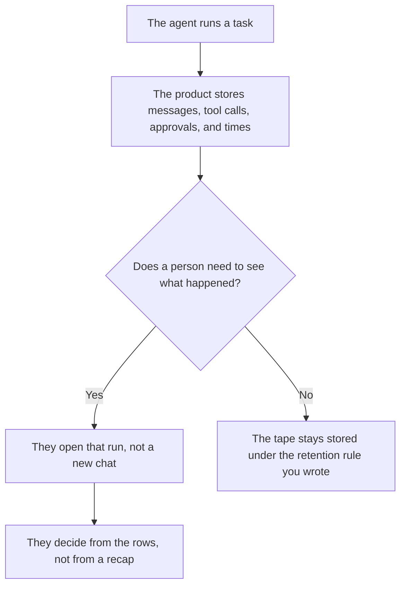

**AI session replay for agents is a stored record of one run that a person can open later: the messages, the tool calls, the approvals, and the times.** A live chat is the run while it happens. Replay is the tape after it stops. If you cannot open a finished run and see which tool was called, you do not have replay. You have a summary someone wrote.

The ask that should appear before a risky tool runs is [what an AI tool permission prompt is](/blog/what-is-ai-tool-permission-prompt-2026/). The person who reads a risky result is [what an AI human review queue is](/blog/what-is-ai-human-review-queue-2026/). The cases you re-run on purpose are [what an AI eval regression suite is](/blog/what-is-ai-eval-regression-suite-2026/).

Cursor prices below are from the X Subscription pricing page fetched October 24, 2026. That docs page was last updated October 11. Claude's prices are from claude.com/pricing the same day. ChatGPT's seat price is from the directory page checked October 16, because chatgpt.com/pricing returned HTTP 403 on October 24. Published October 24, 2026. The directory does not list a session-replay product fee, so this page does not invent one. We did not score agents.

## What the tape has to show

| On the tape | A reviewer can use it when | The tape is incomplete when |
|---|---|---|
| The goal the person typed | The words match the task that was assigned | A later summary replaced the original goal |
| Each tool call | The name, the inputs you are allowed to store, and the result status are there | The log says "used a tool" and stops |
| The approval | The person, the time, and the action they allowed are named | The run continued and no approval row exists |
| The clock | Start, each step, and stop are in order | Steps are listed with no times |

A recap the model writes at the end is not replay. The recap can drop the tool that sent an email. Replay is the row list. A permission prompt is the question asked before the tool runs. Replay is how you see, afterward, whether that question was asked.

Keep customer payloads out of the tape unless the retention rule already allows them. A useful tape can store the tool name, a redacted input, the status, and the approval. It does not need the full document the tool read.

## Where a person opens it

**In the editor's agent log.** [Cursor](/tools/cursor/) Plus is $8 a month, or $80 a year, on the October 24 X Subscription page. Premium at $30 a month is the tier that includes Grok Bot on that page. The agent still needs a tape of its own steps. The ladder is [Cursor pricing explained](/blog/cursor-pricing-explained-2026/).

**A long investigation in a Project.** [Claude](/tools/claude/) Pro is $17 a month billed annually, $200 up front, or $20 monthly, on the October 24 pricing page. Paste the rows. Ask which tool ran without an approval line. The review is [Claude review](/blog/claude-review-2026/).

**One incident, from a paste.** [ChatGPT](/tools/chatgpt/) Plus is $20 a month on the October 16 card. Ask for the steps in order. Discard a reply that adds a motive the tape does not contain. The review is [ChatGPT review](/blog/chatgpt-review-2026/).

**A Gateway you host.** [OpenClaw](/tools/openclaw/) software is $0 on the project site checked October 24. The model you connect is a separate bill. A replay feature is not a line on that page. If your install stores runs, the retention rule is yours. The invoice split is [OpenClaw pricing explained](/blog/openclaw-pricing-explained-2026/).

A prompt that holds the line:

"List the tool calls on this tape in time order. For each one, say whether an approval row is present. Do not explain why the agent 'meant' to do it. Do not add a step that is not in the paste."

## What not to delegate

Do not ask the model whether the run was safe. Do not treat a missing tape as proof that nothing happened. Do not paste a production secret into the prompt so the example "looks complete." The store the agent writes between runs, which is a different object, is [what an AI agent memory store is](/blog/what-is-ai-agent-memory-store-2026/).

## FAQ

### How is replay different from a permission prompt?

The prompt is the question before a tool runs. Replay is the record after the run. A prompt that was never logged cannot be replayed. A tape that shows the tool ran, and shows no prompt, is the finding.

### How is replay different from an eval suite?

The suite is a set of cases you chose to run again. Replay is one real run, including the cases you did not plan. A passing suite does not replace the tape of the incident in front of you.

### Who may delete a tape?

The owner named in the retention rule. A model does not delete a run because the summary looks fine. If the rule says 30 days, the date on the tape decides, not the prose.

### What if the product only stores the last message?

That is a transcript tail, not replay. Export what you can, and say the earlier steps are missing. Do not let a model fill them in.

## Last verified

October 24, 2026 for Claude, the X Subscription page, and OpenClaw's project site. October 16, 2026 for ChatGPT. No session-replay fee is recorded in the directory. Published October 24, 2026.

**Sources:** [Cursor pricing](https://cursor.com/help/account-and-billing/pricing), [X Subscription pricing](https://docs.x.ai/x-subscription/pricing), [Claude pricing](https://claude.com/pricing), [ChatGPT pricing](https://chatgpt.com/pricing/), [OpenClaw](https://openclaw.ai).

*Published by Andrew for [AI Tools Optimizer](https://aitoolsoptimizer.com).*

[Cursor](/tools/cursor/) is in the [coding directory](/tools/category/coding/). Directory pages may use affiliate links. A purchase through them may earn us a commission at no extra cost to you.
