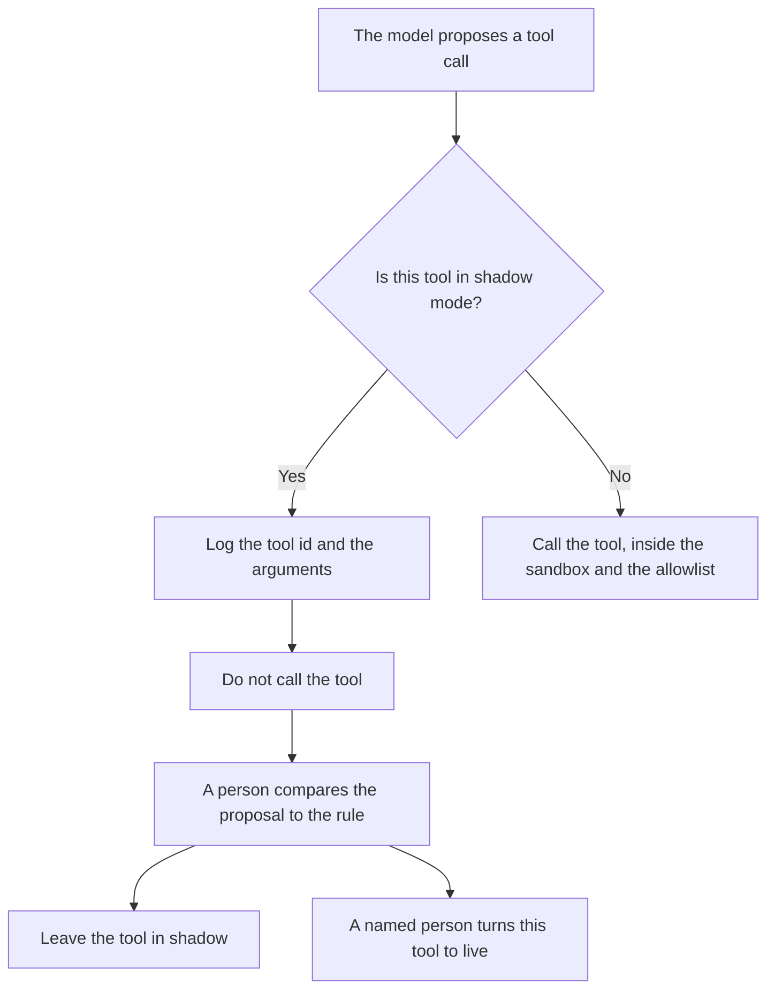

**AI shadow mode is a switch on an action: the model may propose a tool call, and the system logs that proposal without performing the side effect.** No email is sent, no refund is issued, and no record is written to the system of record. A person compares the proposal to what should have happened, then decides whether the live switch may be turned on.

Running a second model on a copy of the request, and hiding that model's text, is [what a shadow deployment for AI is](/blog/what-is-a-shadow-deployment-for-ai-2026/). The duplicate request itself is [what AI shadow traffic is](/blog/what-is-ai-shadow-traffic-2026/). This page is the action that does not fire. The place a tool is allowed to run when you do mean to fire it is [what an AI tool sandbox is](/blog/what-is-ai-tool-sandbox-2026/).

Prices are US list prices excluding tax from directory pages checked October 16, 2026. A live fetch of several vendor pricing pages returned HTTP 401 on October 24, 2026, so this page stays on the directory record. Published October 24, 2026. The directory does not list a shadow-mode fee. We did not score how often a proposal matched a human action.

## What shadow mode records

| Field | You store | A log that will not help you |
|---|---|---|
| Tool id | The action that would have run | "The agent did something" |
| Arguments | The exact payload, with secrets already removed | A paraphrase |
| Side effect | A line that says it was not performed | A success code from a system you did not call |
| Actor | The user or job that triggered the proposal | A shared service account with no request id |
| Decision | Keep shadow, or allow live, with a name | A default that flips to live on Friday |

Shadow mode is not a sandbox that still sends the email to a test inbox. If the inbox received it, the side effect happened. Write that case down as a test send, and keep shadow mode for the path that does not leave your log.

The list of tools that may be proposed at all is [what an AI tool allowlist is](/blog/what-is-ai-tool-allowlist-2026/). A tool in shadow mode can stay on the allowlist. The allowlist says it may be named. Shadow mode says naming it does not execute it.

## Where you read the proposals

**The diff.** [Cursor](/tools/cursor/) Plus is $8 a month, or $80 a year, when shadow mode is a flag in the agent. You review the change that would turn the flag off. The ladder is [Cursor pricing explained](/blog/cursor-pricing-explained-2026/). The flag pattern, for a feature users will eventually see, is [what AI feature flags are](/blog/what-is-ai-feature-flags-2026/).

**The sample.** [Claude](/tools/claude/) Pro is $20 a month, or $17 billed annually, when you paste proposals you are allowed to read and ask which ones fall outside a rule you pasted. The model may mark a gap. You decide the promotion. The review is [Claude review](/blog/claude-review-2026/).

**A Zap you have not armed.** [Zapier](/tools/zapier/) Professional is $19.99 a month billed annually. A Zap that is off is a crude shadow mode only if you are reading the task history and nothing is sent. Turning it on is the promotion. The invoice is [Zapier pricing explained](/blog/zapier-pricing-explained-2026/).

**A chat that role-plays the action.** [ChatGPT](/tools/chatgpt/) Plus is $20 a month can draft the log line. A chat is not shadow mode. Shadow mode is the system that would have called the tool and did not.

A prompt that holds the line:

"Format a shadow-mode log row from the tool id and arguments I pasted. State that the side effect was not performed. Do not add a success result. If the tool id is missing, write Tool missing and stop."

## What not to delegate

Do not let the agent leave shadow mode because the last ten proposals "looked right." Promotion is a named person. Do not store raw secrets in the shadow log. The retention rule for that log is [what an AI data retention policy is](/blog/what-is-ai-data-retention-policy-2026/).

## FAQ

### How is shadow mode different from a shadow deployment?

A shadow deployment compares two models on the same input and hides the candidate's text. Shadow mode compares a proposed action to your rule and does not perform the action. You can shadow a model and still let it send email. You can shadow a tool and still serve the old model. Write which one you mean.

### Does the user see a shadow proposal?

Only if you designed a preview and said so. The default is a log for the people allowed to read it. Showing a customer a refund you did not issue is a different product decision.

### When is a tool ready to leave shadow mode?

When a person has read a sample you defined, the mismatches are either fixed or accepted in writing, and the sandbox and allowlist for the live call already exist. A quiet week is not a sample.

### Can shadow mode call the tool against fake data?

That is a test in the sandbox, and it can be the right rehearsal. Call it a test. Shadow mode, on this page, means the production proposal was logged and the production side effect did not happen.

## Last verified

October 16, 2026 for Cursor, Claude, Zapier, and ChatGPT. No shadow-mode product fee is recorded in the directory. Published October 24, 2026.

**Sources:** [Cursor pricing](https://cursor.com/help/account-and-billing/pricing), [Claude pricing](https://claude.com/pricing), [Zapier pricing](https://zapier.com/blog/zapier-pricing/), [ChatGPT pricing](https://chatgpt.com/pricing/).

*Published by Andrew for [AI Tools Optimizer](https://aitoolsoptimizer.com).*

[Cursor](/tools/cursor/) is in the [coding directory](/tools/category/coding/). Directory pages may use affiliate links. A purchase through them may earn us a commission at no extra cost to you.
