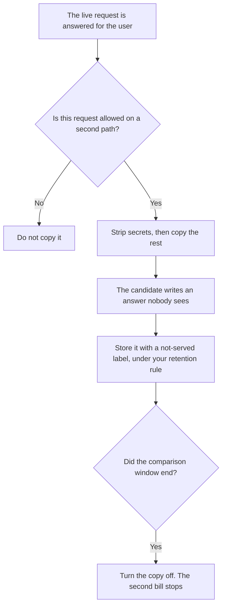

**AI shadow traffic is the duplicate of a live request that a candidate model receives while the user still gets the answer from the model you already shipped.** The rollout pattern that uses that duplicate is [what a shadow deployment for AI is](/blog/what-is-a-shadow-deployment-for-ai-2026/). This page is the duplicate itself: which fields you copy, which fields you strip, how long you keep the copy, and what the second call costs. It is not a guide to probing, bypassing, or attacking a model.

The unit on the second bill is [what AI tokens are](/blog/what-are-ai-tokens-explained-2026/). The tag that says which team pays for the duplicate is [what AI cost attribution is](/blog/what-is-ai-cost-attribution-2026/). The later decision to show the candidate to users, after a rollback, is [what AI rollforward is](/blog/what-is-ai-rollforward-2026/). A planned test of rules you already wrote, on inputs you are allowed to use, is [what AI red teaming is](/blog/what-is-ai-red-teaming-2026/).

Prices are US list prices excluding tax from directory pages checked October 16, 2026. n8n's price stays in euros. Published October 24, 2026. We did not measure how close a shadow answer sits to the live one.

## What the copy contains

| Field | Copy it when | Strip it when |
|---|---|---|
| The user text you are allowed to process | The comparison needs that text | The policy says this class of message stays on the live path only |
| Account ids | The comparison is per account and the id is permitted in logs | The id is a secret you do not put in a second vendor |
| Payment data, passwords, session tokens | Never, for a comparison | Always. A shadow path is not a second place to store them |
| The live answer | You are scoring agreement, and retention allows it | You only need the candidate's output |
| A label | Always: this output was not served | The label is missing. Then the row looks like a real answer |

Shadow traffic costs money because you pay for two calls. A candidate that is free inside a demo is not free at production volume. Put the duplicate on its own cost tag before you turn it on. A ceiling on that tag is [what AI budget caps are](/blog/what-is-ai-budget-caps-2026/).

## Where the copy is switched

**The candidate prompt.** [Claude](/tools/claude/) Pro is $20 a month, or $17 billed annually, when the candidate wording lives in a Project next to the live prompt. The seat price is not the shadow bill. API usage for the duplicate is a separate meter this page does not invent a rate for. The review is [Claude review](/blog/claude-review-2026/).

**A comparison note.** [ChatGPT](/tools/chatgpt/) Plus at $20 a month can format a diff you paste. It should not receive the raw production copy if your policy forbids consumer accounts. Business is $20 a user a month billed annually, with a two-user minimum, or $25 monthly, when the company requires that workspace. The review is [ChatGPT review](/blog/chatgpt-review-2026/).

**A switch you can draw.** [Zapier](/tools/zapier/) Professional is $19.99 a month billed annually. A shadow tap in a customer-facing zap is a second task path. Count the tasks. [n8n](/tools/n8n/) Starter cloud is €20 a month billed annually, with 2,500 executions. One live run plus one shadow run can be two executions. This page does not convert euros.

The path that later shows the candidate to a slice of users is a flag, not more shadow traffic. That switch is [what AI feature flags are](/blog/what-is-ai-feature-flags-2026/).

## What to write down

Name the fields that are copied, the fields that are stripped, the retention of the not-served rows, the owner who can turn the tap off, and the date the tap ends. A shadow stream with no end date is a permanent second bill. The latency of the user path should not wait on the copy. If the user waits, it is not shadow traffic. It is a slower live path.

## FAQ

### Is shadow traffic the same as a shadow deployment?

The deployment is the pattern: a candidate runs and the user does not see it. Shadow traffic is the duplicate request that pattern sends. You can describe the pattern without deciding which fields the duplicate carries. This page is that decision.

### Do we copy every request?

Copy the slice you are allowed to process and that you intend to compare. A full duplicate of production, including messages your policy excludes, is a second store of data you may not want. Sampling is a written rate, not an accident.

### Can the candidate call tools?

Not on this page's definition. A candidate that refunds, emails, or writes to the CRM is acting, and the user is affected. Shadow traffic is a read of the answer. Side effects belong on the live path, behind whatever approval you already require.

### How long do we keep the duplicate?

As long as your retention rule for unsent model output says, and no longer. Label the row not-served so a later export does not treat it as what the customer received. When the comparison ends, stop the copy and stop the bill.

## Last verified

October 16, 2026 for Claude, ChatGPT, Zapier, and n8n. Published October 24, 2026.

**Sources:** [Claude pricing](https://claude.com/pricing), [ChatGPT pricing](https://chatgpt.com/pricing/), [Zapier pricing](https://zapier.com/blog/zapier-pricing/), [n8n pricing](https://n8n.io/pricing/).

*Published by Andrew for [AI Tools Optimizer](https://aitoolsoptimizer.com).*

[Zapier](/tools/zapier/) is in the [automation and agents directory](/tools/category/automation-agents/). Directory pages may use affiliate links. A purchase through them may earn us a commission at no extra cost to you.
