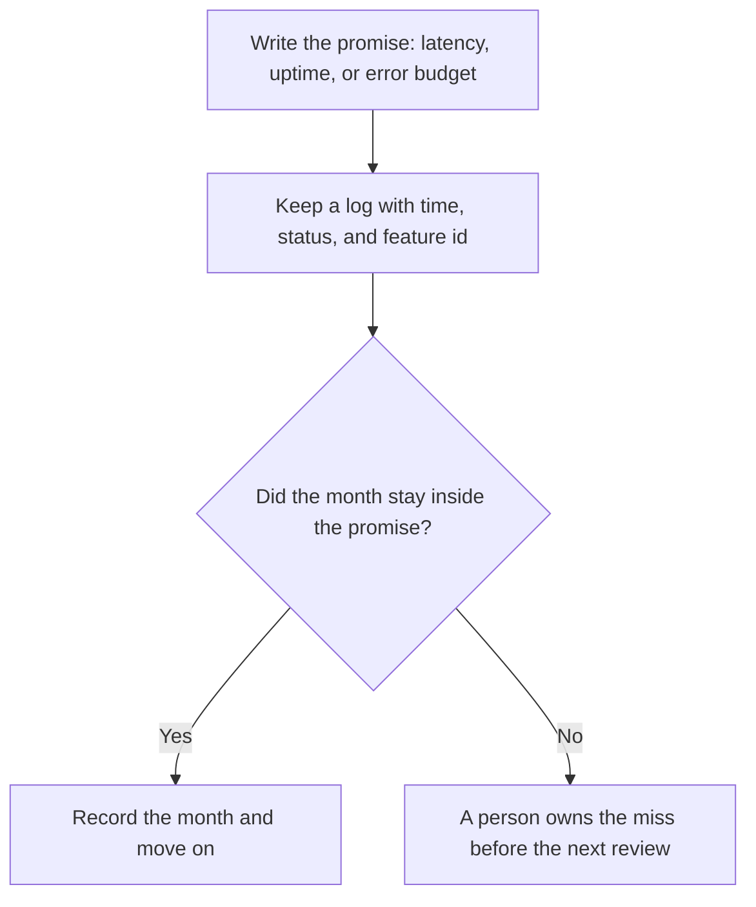

**AI SLA monitoring is the habit of writing a service promise for an AI feature, then checking that promise against logs you already keep.** The promise is usually uptime, a latency ceiling, or an error budget. A chat that "feels slow" is not a promise. A line that says "the support bot answers in under eight seconds on 99% of requests this month" is a promise you can miss.

The trace you open when a request fails is [what AI observability is](/blog/what-is-ai-observability-2026/). The team label on the bill is [what AI cost attribution is](/blog/what-is-ai-cost-attribution-2026/). A spike against that bill is [what AI cost anomaly detection is](/blog/what-is-ai-cost-anomaly-detection-2026/). Monitoring the promise is a third column: did the feature stay inside the envelope you published.

This directory does not list a standalone SLA product, so this page does not invent a price for one. Prices below are US list prices from directory pages checked October 16, 2026. Published October 24, 2026. We did not score uptime tools.

## What belongs in the promise

| Promise | A number you can store | A sentence that will not survive a review |
|---|---|---|
| Availability | Percent of scheduled minutes the endpoint accepted traffic | "The bot is always on" |
| Latency | A percentile, such as 95th, and the clock you use | "It feels fast" |
| Errors | Failed calls divided by attempts, with the error codes you count | "It rarely breaks" |
| Fallback | What the user sees when the model times out | A blank page and a hope |

A vendor status page is their promise to you. Your SLA, if you publish one to customers, is your promise about the feature you operate. Those are different documents. Copying a model provider's status wording onto your pricing page does not make it your measurement.

## Where the check can live

**A notebook for the export.** [Hex](/tools/hex/) Professional is $36 an editor a month and includes the Hex agent. Team is $75 an editor a month. Hex can chart a CSV of request times you trust. It will not invent the missing timestamp. The card is [Hex pricing explained](/blog/hex-pricing-explained-2026/).

**A path that files the alert.** [Zapier](/tools/zapier/) Professional is $19.99 a month billed annually for 750 tasks. It can drop a failed-request row into the channel the on-call person already reads. Filters do not count as tasks. The map of the three automation tools is [Zapier vs Make vs n8n](/blog/zapier-vs-make-vs-n8n/).

**A seat is not a monitor.** [ChatGPT](/tools/chatgpt/) Plus is $20 a month. Business is $20 a user a month billed annually, or $25 monthly, for two or more users. [Claude](/tools/claude/) Pro is $20 a month, or $17 billed annually. Either seat can draft the promise in plain language. Neither seat measures your endpoint. The ladder is [ChatGPT Go vs Plus vs Pro](/blog/chatgpt-go-vs-plus-vs-pro-2026/).

The place a fact is allowed to live after you agree it is [what a system of record for AI is](/blog/what-is-a-system-of-record-for-ai-2026/). If the log and the status page disagree, the log you control is the one you review. A shadow run of a new model, which is a different check, is [what a shadow deployment for AI is](/blog/what-is-a-shadow-deployment-for-ai-2026/).

## A minimum review

Keep four columns: date, feature id, the promise, and whether the month passed. Review it when you close the month, next to the cost ledger. A cheaper model that blows the latency promise is not a savings until both numbers are on the same row. That quality check is [what AI eval testing is](/blog/what-is-ai-eval-testing-2026/).

Publish a customer-facing SLA only when a person can explain the measurement. An internal error budget is enough for most teams. This page is not a contract template, and it is not legal advice.

## FAQ

### Is a model provider's uptime my SLA?

It is their status. Your SLA, if you have one, measures the feature your customer uses, including your own timeout, your retrieval step, and your fallback. Quote the piece you operate.

### Do I need a paid observability suite first?

You need a log with timestamps and status codes. A spreadsheet of that log is a start. A suite helps when the volume is too large to read. Do not buy a suite to compensate for a promise you have not written.

### Should latency include the retrieval step?

Yes, if the user waits for the whole answer. A model that is fast and a search that is slow is still a slow answer. Split the timers in the log so you can see which piece moved.

### What if we never published a number?

Then you are not monitoring an SLA yet. You are watching a product. Write one number, assign an owner, and start the next month. A dashboard without a threshold is a chart.

## Last verified

October 16, 2026 for Hex, Zapier, ChatGPT, and Claude prices named above. The directory does not list a standalone price for an SLA monitor. Published October 24, 2026.

**Sources:** [Hex](https://hex.tech), [Zapier pricing](https://zapier.com/pricing), [ChatGPT pricing](https://chatgpt.com/pricing).

*Published by Andrew for [AI Tools Optimizer](https://aitoolsoptimizer.com).*

[Hex](/tools/hex/) is in the [data and analytics directory](/tools/category/data-analytics/). Directory pages may use affiliate links. A purchase through them may earn us a commission at no extra cost to you.
