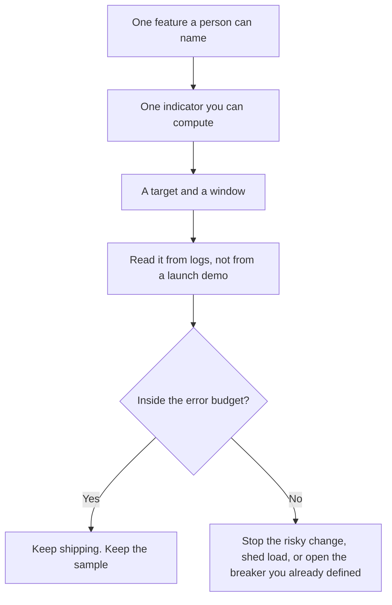

**An AI SLO is a target you write for one model feature, over a window you name.** Example shape: the share of requests that finish under a latency you chose, or the share of sampled answers that pass a check you defined. An SLA is the promise in a contract with a customer. The SLO is the internal line you will notice when you cross it.

The two clocks are [latency versus throughput](/blog/what-is-ai-latency-vs-throughput-2026/). The record that lets you compute the target is [what AI observability is](/blog/what-is-ai-observability-2026/). Stopping calls to a dependency that is already failing is [what an AI circuit breaker is](/blog/what-is-ai-circuit-breaker-2026/). Dropping optional work so the target can hold is [what AI load shedding is](/blog/what-is-ai-load-shedding-2026/).

Prices are US list prices excluding tax from directory pages checked October 16, 2026. Published October 24, 2026. The directory does not list an SLO product fee, so this page does not invent one. We did not measure uptime for any vendor. This page does not recommend a universal percentage.

## What you write on one line

| Piece | Write it | A target that cannot be missed or met |
|---|---|---|
| The feature | One user-facing path, such as "refund answer in the help widget" | "AI" for the whole company |
| The indicator | Latency, error rate, or a named check on a sample | A vibe, a star rating, or a blended score |
| The target | A number you can compute from logs | "As fast as possible" |
| The window | A week, or a billing month | A screenshot from a quiet Tuesday |
| The error budget | How much miss you will absorb before you change the feature | A target with no consequence |
| The owner | A person who can slow a launch | A channel where the chart is posted |

A latency SLO and a quality SLO are two lines. Averaging them into one "AI health" number hides which one failed. A fast wrong answer can meet a latency target and miss a groundedness sample. That sample is [what AI groundedness is](/blog/what-is-ai-groundedness-2026/).

## What the target is allowed to mean

**Latency.** Time to first token, or time to done. Say which. A support widget and a nightly batch should not share a number. Batch work that is allowed to wait is [what AI batch inference is](/blog/what-is-ai-batch-inference-2026/).

**Errors.** Timeouts and server failures. A safety refusal the product intended is a completed call. Count it in a separate line if you care about refusal rate. Mixing refusals into the error SLO will page someone for a policy.

**A check.** A sample of answers scored against a rubric you wrote: grounded, on-policy, or "contains only limits from the doc." The check itself is [what AI eval testing is](/blog/what-is-ai-eval-testing-2026/). The SLO is how often that check passes in production, in the window.

Seat prices are context for who calls the feature. They are not the SLO.

| Caller | Price the directory recorded | What you still define |
|---|---|---|
| [ChatGPT](/tools/chatgpt/) Plus | $20 a month | The latency and the check, if your app calls an API. This page does not invent an API rate |
| [Claude](/tools/claude/) Pro | $20 a month, or $17 billed annually | The same |
| [Gemini](/tools/gemini/) | Google AI Pro is $19.99 a month | The same |
| [DeepSeek](/tools/deepseek/) API | Input from $0.15 per 1 million tokens off-peak on a cache miss. Output $0.60 off-peak | A latency SLO is yours to compute. The vendor price is not an uptime promise |
| A help desk with an AI agent | [Zendesk AI](/tools/zendesk-ai/) records Support Team at $19 an agent a month paid yearly, and AI agents from Suite Team at $55 | The customer-facing target is still yours. The plan name is not an SLO |

## When the budget is gone

Spend the error budget on purpose: a launch, a model change, a prompt edit. When it is gone, the next change waits, or you shed the optional path, or you open the breaker. A target you miss every week without a consequence is a wish.

Write the SLO next to the log fields that compute it. If the field does not exist, you do not have the SLO yet. You have a sentence in a doc. The fields are [what AI telemetry is](/blog/what-is-ai-telemetry-2026/).

## FAQ

### Is an SLO the same as an SLA?

An SLA is what you owe a customer, including any credit you promised. An SLO is the line your team watches. You can set a tighter SLO than the SLA so you notice first. You should not paste an SLO into a contract by accident.

### What number should we pick?

The number you can explain from last month's logs, or from a drill. A 99.9 copied from a web page, including this one, will page you for a feature that was never that steady, or it will hide a feature that is worse than you think.

### Do we need an SLO for a personal chatbot?

You need one when many people depend on the feature, or when a wrong answer has a cost you track. A single user who rereads the reply is the check. Software that answers customers is the SLO.

### Can the vendor's status page be our SLO?

The status page is their incident record. Your SLO is the experience of your feature: your prompt, your tools, your corpus. Their uptime can be fine while your check fails.

## Last verified

October 16, 2026 for the prices named above. Published October 24, 2026. The definition does not depend on a price change.

**Sources:** [ChatGPT pricing](https://chatgpt.com/pricing/), [Claude pricing](https://claude.com/pricing), [Google AI subscriptions](https://gemini.google/subscriptions/), [DeepSeek API docs](https://api-docs.deepseek.com/).

*Published by Andrew for [AI Tools Optimizer](https://aitoolsoptimizer.com).*

[Zendesk AI](/tools/zendesk-ai/) is in the [customer support directory](/tools/category/customer-support/). Directory pages may use affiliate links. A purchase through them may earn us a commission at no extra cost to you.
