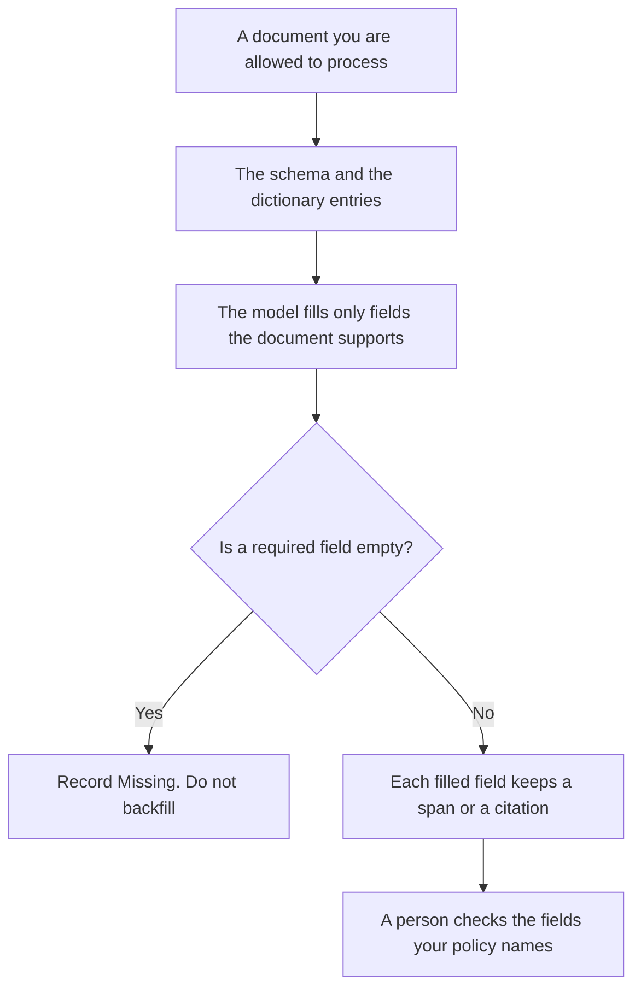

**AI structured extraction pulls named fields from a document into a schema you wrote, and it leaves a field empty when the document does not contain that fact.** A summary is a paragraph. Extraction is a table: this date, this amount, this owner, each one tied to a span in the source. The shape a tool must return after it runs is [what an AI tool result schema is](/blog/what-is-ai-tool-result-schema-2026/). The rule that an answer must cite a source is [what AI citation-required mode is](/blog/what-is-ai-citation-required-mode-2026/). The human definition of a field is [how to create a data dictionary entry with AI](/blog/how-to-create-a-data-dictionary-entry-with-ai-2026/).

Claude's prices are from claude.com/pricing on October 24, 2026. Gemini Notebook's plan prices are from gemini.google/subscriptions the same day. ChatGPT and Perplexity prices are from directory pages checked October 16, 2026. Those two vendor pages returned HTTP 403 on October 24. Published October 24, 2026. We did not score extraction accuracy.

## What a field is allowed to hold

| Field | Filled only when | Left empty when |
|---|---|---|
| A date, amount, or name | The document states it, and you can point at the span | The model "knows" a typical value |
| An id | The document prints that id | A similar id from another file would be convenient |
| A status | The document uses a status you listed | The model maps "soon" to "approved" |
| A missing-reason | You asked for one | You would rather have a guess than a blank |

The schema is the column list. The dictionary is what a column means. Extraction without the dictionary will put a renewal date in a start-date column because both are dates. If the span is missing, the cell is not done.

A tool result schema is the contract for what a function returns to the agent. Structured extraction is the job of reading a PDF, a contract, or a ticket and producing those fields. You can extract into a schema that later becomes a tool result. They are still two reviews.

## Where the fields are drafted

**A long document.** [Claude](/tools/claude/) Pro is $17 a month billed annually, $200 up front, or $20 monthly, on the October 24 page. Paste the schema and the document. Ask for empty cells, not estimates. The review is [Claude review](/blog/claude-review-2026/).

**Sources you uploaded.** [Gemini Notebook](/tools/gemini-notebook/) is free with a Google account. Google AI Plus is $4.99 a month and Pro is $19.99, on the October 24 subscriptions page. The notebook answers from the sources you add. The caps are [Gemini Notebook pricing explained](/blog/gemini-notebook-pricing-explained-2026/). It is a poor fit for a document you cannot upload.

**One record.** [ChatGPT](/tools/chatgpt/) Plus is $20 a month on the October 16 card. Free can format one row. Discard a row that fills "standard terms" you did not paste.

**A public page, cited.** [Perplexity](/tools/perplexity/) Pro is $17 a month billed annually on the October 16 card. Use it when the source is a public page and you need the citation. It is not the extractor for a private contract. The invoice is [Perplexity pricing explained](/blog/perplexity-pricing-explained-2026/).

A prompt that holds the line:

"Fill this schema from the document I pasted. If a field is not in the document, write null and Missing. Do not infer. Quote the span for every filled field."

## What not to delegate

Do not ask the model to "complete" a contract. Do not paste a document that contains customer identifiers into a personal seat your company has not approved. Do not merge two extractions by letting the model pick the "better" amount. The source span wins. A blank cell is a successful extraction when the document is silent.

## FAQ

### How is extraction different from a summary?

A summary may omit a date and still read well. Extraction fails closed: the date is present or the cell says Missing. If you need a paragraph for a person, write it from the table after the cells are checked.

### How is it different from a tool result schema?

The tool result schema is the shape a tool call must return. Extraction is how you fill a shape from a document. You can use the same field names. The review is different: one checks the function, the other checks the source span.

### Should empty fields be guessed when the reader needs a number?

No. Write Missing and the reason. A guessed renewal date will be copied into a system of record. The dictionary can say the field is required for a human to fill. It should not say the model may invent it.

### Who may load the row into the database?

The owner of that table. A model does not get a write credential because it produced JSON. The citation-required article is the rule for sentences. This article is the rule for cells.

## Last verified

October 24, 2026 for Claude and Google AI plan prices. October 16, 2026 for ChatGPT and Perplexity. No extraction-product fee is recorded in the directory. Published October 24, 2026.

**Sources:** [Claude pricing](https://claude.com/pricing), [Google AI subscriptions](https://gemini.google/subscriptions/), [ChatGPT pricing](https://chatgpt.com/pricing/), [Perplexity pricing](https://www.perplexity.ai/pro).

*Published by Andrew for [AI Tools Optimizer](https://aitoolsoptimizer.com).*

[Claude](/tools/claude/) is in the [chatbots and assistants directory](/tools/category/chatbots-assistants/). Directory pages may use affiliate links. A purchase through them may earn us a commission at no extra cost to you.
