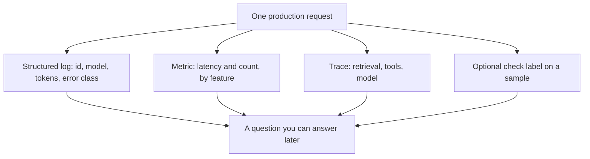

**AI telemetry is the set of signals one model request emits: a structured log, a metric, a trace, and a label from a check you defined.** Observability is the set of questions you can answer because those signals exist. A dashboard with no request id is a picture. Telemetry is the record that picture should have been built from.

Reading the record is [what AI observability is](/blog/what-is-ai-observability-2026/). The log shape is [what structured logging for AI is](/blog/what-is-structured-logging-for-ai-2026/). The label on a sampled answer is [what AI eval testing is](/blog/what-is-ai-eval-testing-2026/). The target you compute from the signals is [what an AI SLO is](/blog/what-is-ai-slo-2026/).

Prices are US list prices excluding tax from directory pages checked October 16, 2026. Published October 24, 2026. The directory does not list a telemetry-vendor fee, so this page does not invent one. We did not rank trace products.

## The four signals worth naming

| Signal | One field that makes it useful | A field that looks like telemetry and is not |
|---|---|---|
| Log | Request id, model, feature name, error class | A paragraph in a chat transcript with no id |
| Metric | Count or latency with the feature name as a dimension | A single average called "AI latency" |
| Trace | Spans for retrieval, tool calls, and the model | The final answer alone |
| Check label | Pass or fail for a named rubric, on that request | A star a user tapped, with no rubric |

Emit the request id in every signal so a metric spike can be opened as a trace. Without the id, the on-call person has a number and nothing to read. The hour after a customer-visible failure is [what AI incident response is](/blog/what-is-ai-incident-response-2026/).

## What to emit, and what to leave out

Emit the feature name, the model id, input and output token counts when you have them, latency, the tool names that ran, and whether the answer was shown to a person or blocked. Emit the check result when you sampled.

Leave out secrets, raw payment data, and the body of a document the log store is not allowed to hold. A prompt can be sensitive. Decide retention before you turn the firehose on. "Log everything forever" is how a debug aid becomes a second copy of customer data.

If you call [DeepSeek](/tools/deepseek/) and the directory's off-peak cache-miss price applies, input is from $0.15 per 1 million tokens and output is $0.60 per 1 million tokens. Telemetry is how you explain that invoice per feature. The price is not the telemetry product.

Seat products are a weaker meter. [ChatGPT](/tools/chatgpt/) Plus is $20 a month. [Claude](/tools/claude/) Pro is $20 a month, or $17 billed annually. A person using the website does not hand you a trace. Telemetry starts when your application makes the call. This page does not invent API rates for those seats.

A customer-facing agent has its own analytics, and you should still know which fields you can export. [Chatbase](/tools/chatbase/) Hobby is $32 a month billed yearly on the directory card. [Zendesk AI](/tools/zendesk-ai/) records Support Team at $19 an agent a month paid yearly. Export and retention are questions for the plan you buy. A chart inside the product is theirs. A request id in your incident doc is yours.

## A small set that answers real questions

You do not need a second platform on the first day. You need the questions written down:

- Which feature spent the tokens?
- Which requests timed out?
- Which tool ran?
- Which sampled answers failed the groundedness check?

If a field does not answer one of those, wait to emit it. The groundedness label is [what AI groundedness is](/blog/what-is-ai-groundedness-2026/). The token field is only meaningful if you also know the split you intended, which is [token budgeting](/blog/what-is-token-budgeting-2026/).

## FAQ

### Is telemetry the same as observability?

Telemetry is what you emit. Observability is what you can explain from it. You can emit logs nobody can query. You cannot answer a production question from a log you never wrote.

### Do we log the full prompt?

Only if policy, retention, and access say yes. Many teams log a hash, the template id, and the token counts, and keep the full prompt for a short sample. Write the choice down. A default of "full prompt, indefinite" is a decision you did not mean to make.

### What about a vendor that already has a dashboard?

Use it if it answers the four questions above for your feature. Add your own request id if the vendor's id never appears in your ticket. A dashboard you cannot join to a customer report will not close the incident.

### Is a user thumbs-down telemetry?

It is a signal. It is not a check label until you define what the thumb means and sample the misses. Treat it as a queue for review, which is the human step in [human-in-the-loop AI](/blog/what-is-human-in-the-loop-ai-2026/).

## Last verified

October 16, 2026 for DeepSeek, ChatGPT, Claude, Chatbase, and Zendesk AI. Published October 24, 2026. The definition does not depend on a price change.

**Sources:** [DeepSeek API docs](https://api-docs.deepseek.com/), [ChatGPT pricing](https://chatgpt.com/pricing/), [Claude pricing](https://claude.com/pricing).

*Published by Andrew for [AI Tools Optimizer](https://aitoolsoptimizer.com).*

[Chatbase](/tools/chatbase/) is in the [customer support directory](/tools/category/customer-support/). Directory pages may use affiliate links. A purchase through them may earn us a commission at no extra cost to you.
