**AI token metering is the counter that records how much of a model's unit a request consumed, then shows that count on a usage page or an invoice.** The unit is often a token. Some products meter points, credits, or messages instead. The meter is the record. The plan is the allowance wrapped around it.

The unit itself is [what AI tokens are](/blog/what-are-ai-tokens-explained-2026/). How you split one request before you send it is [what token budgeting is](/blog/what-is-token-budgeting-2026/). The allowance across a month is [what AI quota management is](/blog/what-is-ai-quota-management-2026/). The finance code the meter rolls into is [what an AI cost center is](/blog/what-is-ai-cost-center-2026/).

Prices are US list prices excluding tax from directory pages checked October 16, 2026. Published October 24, 2026. This page does not invent a per-token price for ChatGPT or Claude. We did not measure a tokenizer.

## What a meter has to show

| Piece | A meter shows it | A seat plan often hides it |
|---|---|---|
| The unit | Tokens, points, credits, or messages | "Usage" with no unit |
| The direction | Input and output, when the vendor splits them | One blended cap |
| The account | Which key or which seat | A company login |
| The time | When the count resets | A vague "fair use" |
| The price | Dollars per unit, or dollars per seat with a cap | A number you cannot recompute |
| The export | A CSV or an API you can reconcile | A chart with no download |

```mermaid
flowchart TD
  call["A request runs"] --> count["The meter adds input and output units"]
  count --> account["The count lands on a key or a seat"]
  account --> show{"Can you read the count?"}
  show -->|Yes| reconcile["You match it to the invoice"]
  show -->|No| cap["You only learn the limit when the product refuses"]
```

A repeated prefix the vendor caches can be a cheaper row on the same meter. That discount is still metering. The stored prefix is [what a KV cache is](/blog/what-is-kv-cache-2026/) when you are talking about the model's attention state, and [what prompt caching is](/blog/what-is-prompt-caching-2026/) when you are talking about the vendor's bill.

## Meters you can point at

**A published token price.** [DeepSeek](/tools/deepseek/) meters the API in tokens. For `deepseek-flash`, the directory records peak rates per 1 million tokens of $0.30 input on a cache miss, $0.006 on a cache hit, and $1.20 output. Off-peak is half. The chat app is free and does not show this meter. Use the API usage page when the product code needs a number. Peak hours on that card are 01:00–04:00 and 06:00–10:00 UTC on weekdays, excluding Chinese public holidays.

**Points, which are a meter with another name.** [Poe](/tools/poe/) spends compute points per bot. Free points reset every 24 hours and do not roll over. Subscriptions start at $4.99 a month. Add-on points are $30 per 1 million for subscribers and expire after one year. The point cost is on the bot before you send. Higher subscription prices were not on the pages we could read. The invoice is [Poe pricing explained](/blog/poe-pricing-explained-2026/).

**A token allowance as the plan.** [Bolt.new](/tools/bolt-new/) Free includes 1 million tokens a month, with a 300,000 daily limit. Pro starts at $25 a month for 10 million tokens. Paid tokens roll over for one additional month, on the October 16 card. That allowance is the meter and the product.

**A seat that hides the count.** [Claude](/tools/claude/) Pro is $20 a month, or $17 billed annually. Max starts at $100. The directory says paid plans include more usage, and context windows up to 1 million tokens depending on the model. There is no consumer per-token price on that card. [ChatGPT](/tools/chatgpt/) Plus is $20 a month. Go is $8. The limit is messages, uploads, and tools. You are still metered. You cannot reconcile tokens you were never shown. The split inside one call, when you do have a count, is the budgeting article.

## What to reconcile

Match three numbers: what the product page said the plan included, what the usage page counted, and what the invoice charged. If those three disagree, the meter is the thing you debug. A seat price can be correct while the usage export is missing. Ask for the export before you argue about the model.

Do not convert points to tokens with a ratio this site did not publish. Poe points, Bolt tokens, and DeepSeek tokens are different units. Report each in its own unit, then in dollars.

## FAQ

### Is metering the same as tokenization?

Tokenization splits text into the units the model counts. Metering records how many of those units a request used and who pays. You can tokenize a prompt in a notebook and still have no meter.

### Why does my chat plan show no token count?

The vendor chose a seat and a cap. The cap is a meter with the numbers removed. You learn the limit when a feature stops. An API key is how you get the count, when the vendor sells one separately.

### Do cached tokens still count?

On DeepSeek's card, a cache hit is a cheaper input row, not a zero. Read the vendor's cache rule. A discount is still a line on the meter.

### Can I meter a tool that only sells seats?

You can meter the seats: who has one, which cost center pays, and when you will remove it. You cannot invent a token count the vendor does not show. Record the seat and the cap you observed.

## Last verified

October 16, 2026 for DeepSeek, Poe, Bolt.new, Claude, and ChatGPT. Higher Poe tiers were not confirmed. Published October 24, 2026.

**Sources:** [DeepSeek API docs](https://api-docs.deepseek.com/), [Poe Purchases FAQs](https://help.poe.com/hc/en-us/articles/19945140063636-Poe-Purchases-FAQs), [Bolt.new pricing](https://bolt.new/pricing), [Claude pricing](https://claude.com/pricing), [ChatGPT pricing](https://chatgpt.com/pricing/).

*Published by Andrew for [AI Tools Optimizer](https://aitoolsoptimizer.com).*

[Poe](/tools/poe/) is in the [chatbots and assistants directory](/tools/category/chatbots-assistants/). Directory pages may use affiliate links. A purchase through them may earn us a commission at no extra cost to you.
