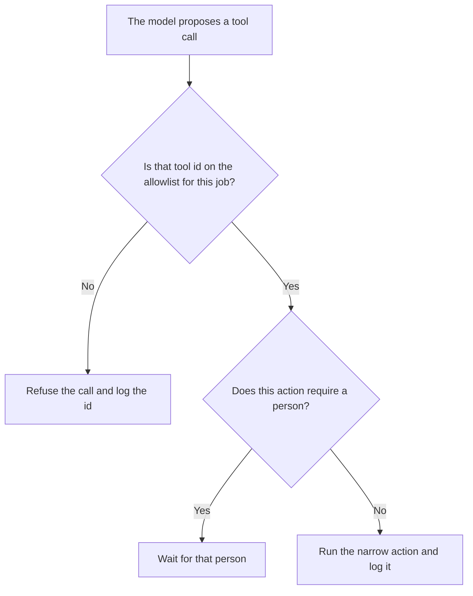

**An AI tool allowlist is the named set of tools an agent may call for a given job. A tool that is not on the list is refused, even if the model asks for it.** The list is a permission. A prompt that says "be careful" is not a list.

The place those tools may run, which is a different control, is [what an AI tool sandbox is](/blog/what-is-ai-tool-sandbox-2026/). The clock on one call is [what an AI tool timeout is](/blog/what-is-ai-tool-timeout-2026/). The controls that keep untrusted text from becoming an instruction are [what a prompt injection defense is](/blog/what-is-a-prompt-injection-defense-2026/). The product checks around a bad action are [what AI guardrails are](/blog/what-is-ai-guardrails-2026/).

Prices are US list prices excluding tax from directory pages checked October 16, 2026. n8n's price stays in euros. Published October 24, 2026. This page does not describe how to probe, bypass, or attack a model. We did not score any vendor's permission system.

## What the list has to say

| Line | A written allowlist | A list that will drift |
|---|---|---|
| Tool name | An id you can match in a log | "Search and stuff" |
| Action | Read, draft, or send | The whole product |
| Data | Which mailbox, which table, which folder | Every connected account |
| Approval | Which actions wait for a person | The model decides when it is sure |
| Owner | Who can add a tool | The last person who connected an app |

Read and send are different tools even when they share a logo. A help-center search can be on the list while outbound email stays off. Adding "the Slack integration" without naming the channel is how a draft becomes a post.

## Where the list is kept

**The policy.** [Claude](/tools/claude/) Pro is $20 a month, or $17 billed annually, when the allowlist is a page a second person reviews. The model may format rows you paste. It may not add a tool. The review is [Claude review](/blog/claude-review-2026/).

**The code.** [Cursor](/tools/cursor/) Plus is $8 a month, or $80 a year, when the list is a file in the repo. You read the diff. A generated import that connects a tool you did not name is a defect. The ladder is [Cursor pricing explained](/blog/cursor-pricing-explained-2026/).

**The zap.** [Zapier](/tools/zapier/) Professional is $19.99 a month billed annually. Each action in the Zap is an entry. A path that adds a step after you approved the Zap has left the list. The invoice is [Zapier pricing explained](/blog/zapier-pricing-explained-2026/).

**The self-hosted flow.** [n8n](/tools/n8n/) Starter cloud is €20 a month billed annually. The euro price is not converted. A node you did not put on the canvas is not allowed because the model suggested it. The invoice is [n8n pricing explained](/blog/n8n-pricing-explained-2026/).

A prompt that holds the line:

"Format an allowlist from the tool ids, actions, data scopes, and approval rules I pasted. Do not add a tool. If approval is missing for a send, write Approval missing and stop."

## What not to delegate

Do not let an agent "connect whatever it needs." Do not treat a sandbox as a substitute for the list. A sandbox limits where a call lands. The allowlist limits which call exists. The moment a model is allowed to use a tool at all is [what tool use in LLMs is](/blog/what-is-tool-use-in-llms-2026/).

## FAQ

### Is an allowlist the same as a blocklist?

A blocklist names what is forbidden and allows the rest. An allowlist names what is permitted and refuses the rest. For tools that can send, pay, or delete, the allowlist is the list you can review. A blocklist will miss the tool you forgot to ban.

### Can the same agent have two lists?

Yes. A research job and a refund job should not share a list. Name the job on the list. A global list that includes every integration the company owns is not an allowlist. It is a catalog.

### What do I log when a call is refused?

The tool id the model asked for, the job, and the time. You do not need the full prompt in the ticket. You need enough to see which proposed tool is showing up often, so a person can decide whether the list is wrong or the prompt is.

### Who adds a tool?

The owner on that list, in a change someone else can see. A connection made in a settings screen at 6 p.m. is still a change. Write it down the same day.

## Last verified

October 16, 2026 for Claude, Cursor, Zapier, and n8n. No allowlist product fee is recorded in the directory. Published October 24, 2026. This page does not include attack steps.

**Sources:** [Claude pricing](https://claude.com/pricing), [Cursor pricing](https://cursor.com/help/account-and-billing/pricing), [Zapier pricing](https://zapier.com/blog/zapier-pricing/), [n8n pricing](https://n8n.io/pricing/).

*Published by Andrew for [AI Tools Optimizer](https://aitoolsoptimizer.com).*

[Cursor](/tools/cursor/) is in the [coding directory](/tools/category/coding/). Directory pages may use affiliate links. A purchase through them may earn us a commission at no extra cost to you.
