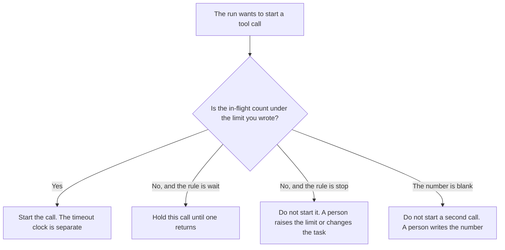

**An AI tool concurrency limit is the maximum number of calls of one class that may be in flight at the same time.** A limit of 1 on a send means the run does not start a second send until the first returns. The clock on a single call is [what an AI tool timeout policy is](/blog/what-is-ai-tool-timeout-policy-2026/). How many times a failed call may be tried again is [what an AI tool retry budget is](/blog/what-is-ai-tool-retry-budget-2026/). Whether the call is allowed at all is [what an AI tool permission gate is](/blog/what-is-ai-tool-permission-gate-2026/).

A call that changes something outside the chat is [what an AI tool side-effect label is](/blog/what-is-ai-tool-side-effect-label-2026/). A side-effect class usually gets a limit of 1 until a person writes a higher number and says why. A read class can have a higher limit. The limit is not a quality score, and it is not a rate limit the vendor printed unless you copied that number from their page.

Claude's prices are the October 24, 2026 read of claude.com/pricing recorded in [Claude pricing explained](/blog/claude-pricing-explained-2026/). Cursor's Plus price is the October 24 help-center figure recorded in [Cursor Business pricing explained](/blog/cursor-business-pricing-explained-2026/). Notion and Zapier prices are from directory pages checked October 16, 2026. A live fetch of Zapier's pricing page returned HTTP 401 on October 24, 2026, so the Zapier figure stays on the directory record. Published October 24, 2026. We did not measure queue time. The directory does not list a concurrency-limit fee.

## What the limit has to say

| Line | Who writes it | A blank means |
|---|---|---|
| Tool class | You | A send and a lookup share one cap |
| How many may be in flight | You, as a number | The run starts every call the model asks for |
| Read or side effect | You | A charge runs beside another charge |
| What happens at the cap | You: wait, or stop | The run invents a queue |
| Who may raise the number | A person | The model raises it after a slow call |

A timeout still applies to each call that did start. A retry still spends the retry budget. Concurrency does not replace either one. Four reads in flight can each time out. One send at a time can still be retried once, if the retry budget says so, and only if the side-effect label and the idempotency key agree. The key that refuses a second charge is [what AI idempotency is](/blog/what-is-ai-idempotency-2026/).

Waiting is not permission. If the permission gate says no, the call does not enter the queue. A full concurrency slot is not a reason to relabel a send as a read.

## Where the number is kept

**The definition of the classes.** [Claude](/tools/claude/) Pro is $17 a month billed annually, $200 up front, or $20 monthly. The Project holds the classes: read, send, charge, delete, and the number on each. The review is [Claude review](/blog/claude-review-2026/).

**The diff, if the limit lives next to the tool.** [Cursor](/tools/cursor/) Plus is $8 a month, or $80 a year, on the October 24 help page. You review a diff that moves a send from 1 to 4. The ladder is [Cursor pricing explained](/blog/cursor-pricing-explained-2026/).

**The register.** [Notion AI](/tools/notion-ai/) Business is $20 a seat a month. One row per class, the number, and the owner. Plus at $10 is not the full AI tier. The invoice is [Notion AI pricing explained](/blog/notion-ai-pricing-explained-2026/).

**A notice when the cap is hit.** [Zapier](/tools/zapier/) Professional is $19.99 a month billed annually, with 750 tasks a month, on the October 16 card. The Zap tells a person. It does not raise the number. The invoice is [Zapier pricing explained](/blog/zapier-pricing-explained-2026/).

A prompt that holds the line:

"Draft the concurrency row from the tool class, the number, and the read-or-side-effect label I pasted. If the number is missing, write Limit not set. Do not start a second call. Do not raise the number."

## What not to delegate

Do not ask the model for a "reasonable" parallel count. Do not raise the limit because a call was slow. Slowness is the timeout policy. Do not run two charges because the first one has not returned an error yet. The owner of the tool sets the number. A generated table is not the limit.

## FAQ

### How is this different from a timeout?

A timeout is how long one call may run. A concurrency limit is how many calls of that class may run together. A call can be under the timeout and still be refused because the slot is full. A single call can time out with a concurrency limit of 1. Write both.

### How is this different from a retry budget?

The retry budget is how many times one failed call may be tried again. Concurrency is how many calls may be open before any of them has failed. A retry of a send still has to fit in the concurrency limit. Spending a retry does not add a slot.

### How is this different from a permission gate?

The gate says this class of call may happen at all. The limit says how many of the allowed calls may overlap. A gate that says no ends the question. A gate that says yes still obeys the number. Do not treat a free slot as a new permission.

### Who may raise the number?

The person named on the row. Moving a side-effect class from 1 to anything higher is a new version of the row, with a date and a reason that person wrote. The model does not raise it after a failure.

## Last verified

October 24, 2026 for Claude and for Cursor's help page, via the posts cited above. October 16, 2026 for Notion and Zapier. Published October 24, 2026. Zapier's pricing page returned HTTP 401 on October 24.

**Sources:** [Claude pricing](https://claude.com/pricing), [Cursor pricing](https://cursor.com/help/account-and-billing/pricing), [Notion pricing](https://www.notion.com/pricing), [Zapier pricing guide](https://zapier.com/blog/zapier-pricing/).

*Published by Andrew for [AI Tools Optimizer](https://aitoolsoptimizer.com).*

[Claude](/tools/claude/) is in the [chatbots and assistants directory](/tools/category/chatbots-assistants/). Directory pages may use affiliate links. A purchase through them may earn us a commission at no extra cost to you.
