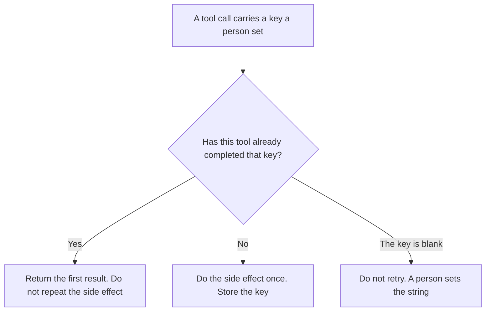

**An AI tool idempotency key is the string a person attaches to one tool call so a retry of that same call performs the side effect once.** The email, the charge, the ticket, or the row is created once. The model may be asked twice. The property that the side effect happens once is [what AI idempotency is](/blog/what-is-ai-idempotency-2026/). This page is the string. A hope that the model "remembers" it already sent the email is not a key.

A key that decides whether two requests may share a cached prefix is [what an AI prompt cache key is](/blog/what-is-ai-prompt-cache-key-2026/). Those strings can sit on the same request. They do different jobs. The log line that should show the key is [what structured logging for AI is](/blog/what-is-structured-logging-for-ai-2026/).

Claude's prices are the October 24, 2026 read of claude.com/pricing recorded in [Claude pricing explained](/blog/claude-pricing-explained-2026/). Cursor's Plus price is the October 24 help-center figure recorded in [Cursor Business pricing explained](/blog/cursor-business-pricing-explained-2026/). Zapier is the October 16 directory card. A live fetch of Zapier's pricing page returned HTTP 401 on October 24, 2026, so that figure stays on the directory record. Published October 24, 2026. We did not score retries. The directory does not list an idempotency-key fee.

## What the key has to include

| Field | Who writes it | A blank means |
|---|---|---|
| The string | You, unique for this intended side effect | A retry can create a second ticket |
| Which tool must honor it | You | The model stores the string and the tool ignores it |
| How long the tool keeps it | You, or Retention not set | A late retry looks like a new call |
| What a repeat returns | You: the first result, or Already done | The second call does the work again |
| Where it is logged | You | A person cannot tell a retry from a new request |

The same string on two different intended actions is a bug. A new email is a new key. A retry of the email that failed to send is the old key. Changing the recipient is a new key, even if the body matches. The model does not get to reuse yesterday's key because the sentences look alike.

A cache key allows a second request to reuse a prefix. An idempotency key refuses a second side effect. Put both on the call if you need both. Do not copy one into the other's field.

## Where the string is written

**The sentence that names the key.** [Claude](/tools/claude/) Pro is $17 a month billed annually, $200 up front, or $20 monthly. A Project can hold the rule: new action, new key. The review is [Claude review](/blog/claude-review-2026/).

**The automation that must honor it.** [Zapier](/tools/zapier/) Professional is $19.99 a month billed annually, 750 tasks, on the October 16 card. A task that creates a row still needs the tool on the other side to store the key. Zapier remembering the Zap ran is not the same string. The invoice is [Zapier pricing explained](/blog/zapier-pricing-explained-2026/).

**A workflow you can read.** [n8n](/tools/n8n/) is the place the key can sit next to the node, when you self-host the flow. This page does not restate an n8n dollar. A node without the string is a node that can double-send.

**The diff, if the call lives in a repo.** [Cursor](/tools/cursor/) Plus is $8 a month, or $80 a year, on the October 24 help page. You review a diff that drops the key or reuses it across recipients. The individual ladder is [Cursor pricing explained](/blog/cursor-pricing-explained-2026/).

A prompt that holds the line:

"List the idempotency key on the tool call I pasted. If it is missing, write Key not set. Do not invent a key. Do not reuse a key from a different recipient or a different action."

## What not to delegate

Do not let the model mint a new key on every retry. A new key is how you get two charges. Do not let it drop the key to "simplify" the call. Do not treat a cache hit as proof the side effect already happened.

## FAQ

### How is this different from idempotency?

Idempotency is the outcome: the side effect happens once. The key is the string the tool uses to recognize the retry. You can believe in the outcome and still have no string. Without the string, the tool cannot tell a retry from a new request.

### How is this different from a prompt cache key?

A cache key says two requests may share a stored prefix. An idempotency key says this tool call must not do its side effect a second time. One saves a repeated read. The other blocks a duplicate ticket, email, or charge. They are not interchangeable.

### Does the model need to see the key?

The tool that performs the side effect needs to store and check it. The model needs to pass the string through, not replace it. A summary that says "I used a key" is not a key.

### Who may change a key?

The person who owns the action. A retry keeps the key. A new action gets a new one, written by that person. A generated string on a retry is a second action.

## Last verified

October 24, 2026 for Claude and for Cursor's help page, via the posts cited above. October 16, 2026 for Zapier. Published October 24, 2026. Zapier's pricing page returned HTTP 401 on October 24. No idempotency-key fee is recorded in the directory.

**Sources:** [Claude pricing](https://claude.com/pricing), [Cursor pricing](https://cursor.com/help/account-and-billing/pricing), [Zapier pricing](https://zapier.com/pricing).

*Published by Andrew for [AI Tools Optimizer](https://aitoolsoptimizer.com).*

[Claude](/tools/claude/) is in the [chatbots and assistants directory](/tools/category/chatbots-assistants/). Directory pages may use affiliate links. A purchase through them may earn us a commission at no extra cost to you.
