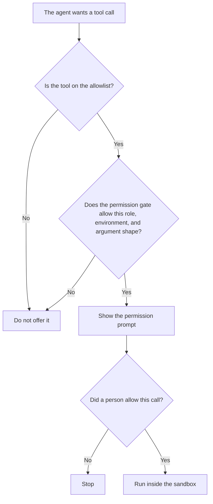

**An AI tool permission gate is a rule that decides whether a tool call may be offered at all, before a person is asked to allow it.** The rule names the tool, the environment, and sometimes the shape of the arguments. If the gate says no, there is no prompt. The person's yes, when a prompt is shown, is [what an AI tool permission prompt is](/blog/what-is-ai-tool-permission-prompt-2026/). The broader rules about what the product may do with data are [what an AI policy enforcement layer is](/blog/what-is-ai-policy-enforcement-layer-2026/).

The set of tools that exist for the agent to propose is [what an AI tool allowlist is](/blog/what-is-ai-tool-allowlist-2026/). Where a call runs after a yes is [what an AI tool sandbox is](/blog/what-is-ai-tool-sandbox-2026/).

Cursor and Claude prices below are from pages fetched October 24, 2026. GitHub Copilot and ChatGPT prices are from directory pages checked October 16, 2026. chatgpt.com/pricing returned HTTP 403 on October 24. Published October 24, 2026. We did not time approvals.

## What the gate decides

| The rule | A pass means | A pass does not mean |
|---|---|---|
| This role may call this tool | The prompt is allowed to appear | The person already said yes |
| This tool is staging-only | A production argument never reaches the prompt | Staging data is fine to paste anywhere |
| Arguments must match a pattern you wrote | A call outside the pattern is blocked | A matching call is safe |
| The tool is on the allowlist and passes the gate | It may be offered | It may run without a person |

An allowlist answers "is this tool in the set?" A gate answers "is this call allowed to be asked, here, by this role?" A prompt answers "did a person say yes to these arguments?" Skipping the gate and showing every allowlisted tool to every user is how a production delete gets a friendly dialog. The dialog is not the control. The gate is.

## Where the rule lives

**The team editor.** [Cursor](/tools/cursor/) Teams seats are $30, $100, or $200 a seat a month on the October 24 help page. Enterprise is the sales plan on that page, with SCIM and audit logs. A gate you cannot audit is a sentence in a doc. The company-seat article is [Cursor business pricing explained](/blog/cursor-business-pricing-explained-2026/).

**A connector.** [Claude](/tools/claude/) Pro is $17 a month billed annually, $200 up front, or $20 monthly. Team standard seats are $20 a seat a month billed annually, or $25 monthly. A connector that can read mail still needs a gate for who may be offered that connector. The review is [Claude review](/blog/claude-review-2026/).

**The company coding seat.** [GitHub Copilot](/tools/github-copilot/) Business is $19 a user a month on the October 16 card, which is the card that lists access controls. A personal Pro seat at $10 does not answer who may be offered a tool. The invoice is [GitHub Copilot Business pricing explained](/blog/github-copilot-business-pricing-explained-2026/).

**The rule text.** [ChatGPT](/tools/chatgpt/) Plus is $20 a month on the October 16 card. Use it to format the rule. It does not enforce the gate.

A prompt that holds the line:

"Write the gate rule from the tool name, the role, and the environment I pasted. If any of those is missing, write Missing. Do not add an always-allow line."

## What not to delegate

Do not let the model decide the role mapping. Do not treat "the tool is popular" as a pass. Do not show the prompt when the gate failed and hope the person notices. A prompt after a failed gate teaches people to click through a control that already said no.

## FAQ

### How is this different from an allowlist?

The allowlist is which tools exist for the agent. The gate is which of those tools may be offered to this role, in this environment, with this argument shape. A tool can be allowlisted and still fail the gate. A tool that fails the allowlist never reaches the gate.

### How is this different from a permission prompt?

The prompt is a person's yes for one call. The gate decides whether that question is allowed to be asked. A gate pass is not a yes. A yes does not repair a call the gate should have blocked.

### How is this different from a policy enforcement layer?

The policy layer is the broader set of rules on data, retention, and what the product may do. The gate is the specific check on a tool call before the prompt. A policy can require a gate. The policy document is not the gate unless something actually blocks the call.

### Who may change the rule?

The owner named for that environment. A change is a diff a second person can read. A chat transcript is not the rule, even if the wording started there.

## Last verified

October 24, 2026 for Cursor and Claude. October 16, 2026 for GitHub Copilot and ChatGPT. No separate permission-gate fee is on those pages. Published October 24, 2026.

**Sources:** [Cursor pricing](https://cursor.com/help/account-and-billing/pricing), [Claude pricing](https://claude.com/pricing), [GitHub Copilot](https://github.com/features/copilot), [ChatGPT pricing](https://chatgpt.com/pricing/).

*Published by Andrew for [AI Tools Optimizer](https://aitoolsoptimizer.com).*

[Cursor](/tools/cursor/) is in the [coding directory](/tools/category/coding/). Directory pages may use affiliate links. A purchase through them may earn us a commission at no extra cost to you.
