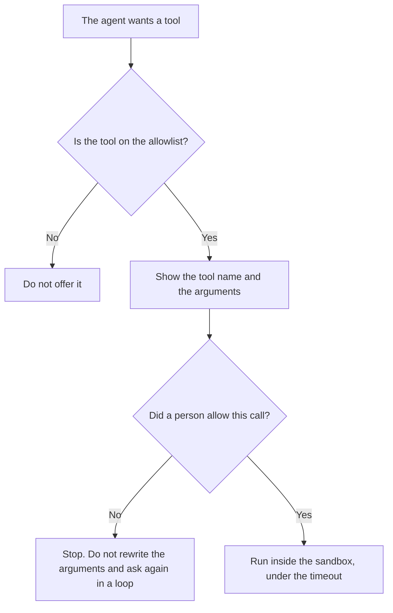

**An AI tool permission prompt is a question a person must answer before one tool call runs.** The agent may propose the call. It may not treat silence, a previous yes, or a similar call as a yes for this one, unless a rule you wrote says that exact call is pre-approved. The list of tools that may be offered at all is [what an AI tool allowlist is](/blog/what-is-ai-tool-allowlist-2026/). The place the call is allowed to run is [what an AI tool sandbox is](/blog/what-is-ai-tool-sandbox-2026/). How long you will wait for it is [what an AI tool timeout is](/blog/what-is-ai-tool-timeout-2026/).

Cursor and GitHub Copilot prices below are from directory pages checked October 16, 2026. Claude's are from claude.com/pricing on October 24, 2026. ChatGPT's are from the October 16 directory card, because chatgpt.com/pricing returned HTTP 403 that day. Published October 24, 2026. We did not time how fast people click Allow.

## What the prompt must show

| The person needs to see | A yes means | A yes does not mean |
|---|---|---|
| The tool name and the arguments | This call, with these arguments, may run | Every future call to that tool |
| What the call can change | You accept that change | A second call that edits a different file |
| Who will be billed or logged | You know the seat | The vendor approved your security review |
| A deny path | The agent stops that call | The agent should "try a close variant" |

A prompt that says "Allow tools?" with no arguments is a blanket. A blanket is how a delete runs because an edit was allowed last Tuesday. If your product has a "always allow this tool" switch, the switch is a rule you can point at, with a scope: this repo, this command, this day. The absence of a click is a no.

## Where the question is asked

**The editor.** [Cursor](/tools/cursor/) Plus is $8 a month, or $80 a year, on the October 16 directory card. Agent runs are the place a permission prompt matters, because the call can edit files. You still read the diff. The ladder is [Cursor pricing explained](/blog/cursor-pricing-explained-2026/).

**The project.** [Claude](/tools/claude/) Pro is $17 a month billed annually, $200 up front, or $20 monthly, on the October 24 pricing page. Pro includes Claude Code on that page's feature list as part of the paid plan the directory also describes. A connector that can read mail or files needs the same yes as a shell command. The review is [Claude review](/blog/claude-review-2026/).

**The IDE assistant.** [GitHub Copilot](/tools/github-copilot/) Pro is $10 a user a month on the October 16 card. Business is $19 a user a month and is the card that lists access controls and IP indemnity. A personal Pro seat does not answer your company's question about who may approve a tool call. The invoice is [GitHub Copilot pricing explained](/blog/github-copilot-pricing-explained-2026/).

**A one-line policy.** [ChatGPT](/tools/chatgpt/) Plus is $20 a month on the October 16 card. Use it to format the sentence the prompt will show. It does not sit in your repo and intercept the call.

A prompt that holds the line:

"Write the permission text for this one tool call. Include the tool name and the arguments I pasted. State that a missing answer is a no. Do not add an always-allow line."

## What not to delegate

Do not let the model click Allow. Do not hide arguments behind "and related files." Do not pre-approve a tool because it was on the allowlist. The allowlist decides what can be asked. The permission prompt decides whether this call runs. The sandbox decides where. All three can fail independently.

## FAQ

### How is this different from an allowlist?

The allowlist is the set of tools the agent may propose. The permission prompt is the person's yes for one call. A tool can be allowlisted and still wait. A tool that is not allowlisted should not reach the prompt.

### How is it different from a sandbox?

The sandbox is the boundary around the call after a yes: which files, which network, which account. A yes outside a sandbox is a yes on the machine you actually use. Set the boundary before you ask the person to trust the button.

### Can one yes cover a whole task?

Only if the rule you wrote says so, and the rule names the commands. "Finish the ticket" is not a command list. If the arguments change, ask again.

### Who is allowed to click yes?

The person your policy names for that repo or that system. A model session is not that person. If the seat is a shared login, you do not have an approver. You have a log you cannot assign.

## Last verified

October 24, 2026 for Claude. October 16, 2026 for Cursor, GitHub Copilot, and ChatGPT. No separate permission-prompt fee is recorded in the directory. Published October 24, 2026.

**Sources:** [Cursor pricing](https://cursor.com/help/account-and-billing/pricing), [Claude pricing](https://claude.com/pricing), [GitHub Copilot](https://github.com/features/copilot), [ChatGPT pricing](https://chatgpt.com/pricing/).

*Published by Andrew for [AI Tools Optimizer](https://aitoolsoptimizer.com).*

[Cursor](/tools/cursor/) is in the [coding directory](/tools/category/coding/). Directory pages may use affiliate links. A purchase through them may earn us a commission at no extra cost to you.
