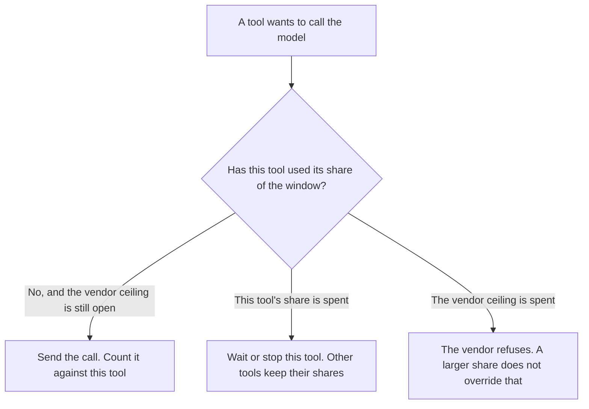

**An AI tool rate-limit budget is the share of a vendor's rate-limit window that you assign to one tool, one workflow, or one agent, so a noisy caller cannot spend the whole minute.** The vendor still has a ceiling. Your budget is the slice under that ceiling. When the slice is gone, that tool waits or stops, even if the vendor would still accept another call from a different tool.

The vendor's own count is [what AI rate limiting is](/blog/what-is-ai-rate-limiting-2026/). A stop based on the shape of the traffic is [what an AI abuse rate limit is](/blog/what-is-ai-abuse-rate-limit-2026/). How many tool calls one task may make, with no clock, is [what an AI tool call budget is](/blog/what-is-ai-tool-call-budget-2026/). Dollars for one run are [what an AI agent cost ceiling is](/blog/what-is-ai-agent-cost-ceiling-2026/).

Claude's prices are the October 24, 2026 read of claude.com/pricing recorded in [Claude pricing explained](/blog/claude-pricing-explained-2026/). Cursor's Plus price is the October 24 help-center figure recorded in [Cursor pricing explained](/blog/cursor-pricing-explained-2026/). Zapier is the October 16 directory card. A live fetch of Zapier's pricing page returned HTTP 401 on October 24, 2026, so that figure stays on the directory record. Published October 24, 2026. We did not measure any vendor's live ceiling. The directory does not list a rate-limit-budget fee.

## What the share has to name

| Field | Who writes it | A blank means |
|---|---|---|
| The window | You: a minute, an hour, or the vendor's window | You cannot tell a share from a lifetime cap |
| The count for this tool | You, under the vendor ceiling | The tool may spend the whole window |
| What happens at the count | You: wait, refuse, or hand to a person | A retry looks like permission |
| Which other tools keep a share | You | One workflow starves the rest |
| Where the spend is logged | You | A person cannot see who used the window |

A tool call budget stops a task after N calls, even if those calls were an hour apart. A rate-limit budget stops a tool after N calls inside the window, even if the task still has calls left on its other budget. You can set both. The run stops on the first one it hits.

The vendor ceiling is not yours to raise by rewriting the prompt. If the vendor says 60 requests a minute and you assigned 50 of them to one agent, the other tools share 10. Assigning 80 to that agent does not create 20 extra requests. It only lies about the share.

## Where the share is written

**The rule next to the key.** [Claude](/tools/claude/) Pro is $17 a month billed annually, $200 up front, or $20 monthly. A Project can hold the sentence: this agent may use this many requests in this window. The review is [Claude review](/blog/claude-review-2026/).

**The automation that fans out.** [Zapier](/tools/zapier/) Professional is $19.99 a month billed annually, 750 tasks, on the October 16 card. A Zap that calls a model on every new row can spend the window before a second Zap runs. The task count is not the rate-limit share. The invoice is [Zapier pricing explained](/blog/zapier-pricing-explained-2026/).

**The flow you can read.** [n8n](/tools/n8n/) can sit the share next to the node when you run the flow yourself. This page does not restate an n8n dollar. The October 16 record showed a cloud price in euros, and this page does not convert it.

**The diff, if the limit lives in code.** [Cursor](/tools/cursor/) Plus is $8 a month, or $80 a year, on the October 24 help page. You review a diff that deletes the share or sets it above the vendor ceiling. The individual ladder is [Cursor pricing explained](/blog/cursor-pricing-explained-2026/).

A prompt that holds the line:

"List the rate-limit share for the tool I named: window, count, and what happens when the count is reached. If any field is missing, write Share not set. Do not raise the count to the vendor ceiling. Do not invent a vendor limit."

## What not to delegate

Do not let the model pick the share because a workflow "seems important." Do not treat a dollar ceiling as a request share. Do not hide a vendor 429 behind a retry that spends another tool's share. The person who owns the key writes the numbers.

## FAQ

### How is this different from rate limiting?

Rate limiting is the cap, often the vendor's, on how many requests a key may send in a window. The rate-limit budget is how you divide the room under that cap across tools. You can have a vendor limit and still have no share, which means the first tool to burst owns the window.

### How is this different from a tool call budget?

A tool call budget counts calls in one task and ignores the clock. A rate-limit budget counts calls inside a window and ignores how many tasks those calls belong to. A task can be under its call budget and still be over its share of the minute.

### How is this different from an agent cost ceiling?

The cost ceiling is dollars for one run. The rate-limit budget is requests in a window. A cheap model can still exhaust the window. An expensive model can hit the dollar ceiling on the third call. Stop on whichever limit you wrote.

### Who may change the share?

The person who owns the key. A generated number that uses the whole vendor ceiling is not a budget. Share not set stays unset until that person writes the window and the count.

## Last verified

October 24, 2026 for Claude and for Cursor's help page, via the posts cited above. October 16, 2026 for Zapier. Published October 24, 2026. Zapier's pricing page returned HTTP 401 on October 24. No rate-limit-budget fee is recorded in the directory.

**Sources:** [Claude pricing](https://claude.com/pricing), [Cursor pricing](https://cursor.com/help/account-and-billing/pricing), [Zapier pricing](https://zapier.com/pricing).

*Published by Andrew for [AI Tools Optimizer](https://aitoolsoptimizer.com).*

[Claude](/tools/claude/) is in the [chatbots and assistants directory](/tools/category/chatbots-assistants/). Directory pages may use affiliate links. A purchase through them may earn us a commission at no extra cost to you.
