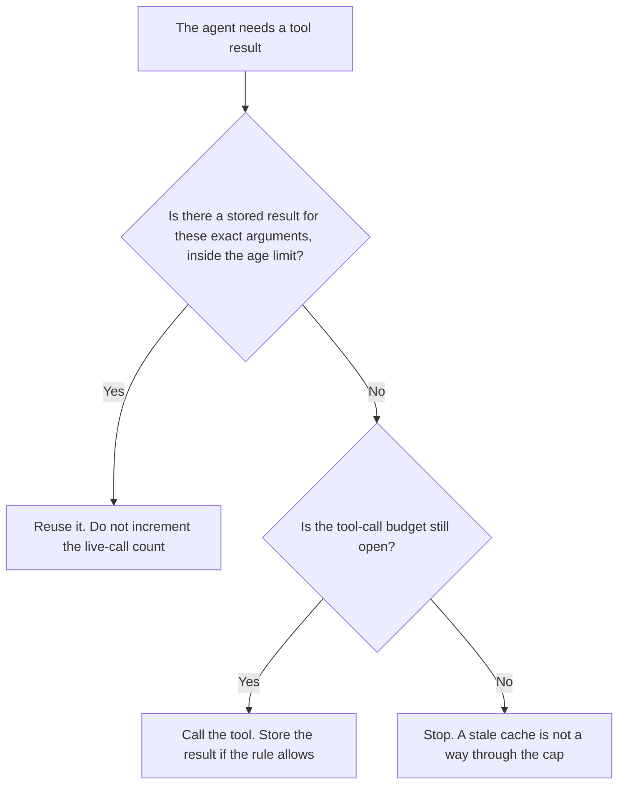

**An AI tool result cache stores the output of one tool call, with the inputs and the time, so a later step can reuse that output instead of calling the tool again.** The cache is valid only while the rule you wrote still says it is. A model prefix that the vendor bills at a discount is a different cache: [what a context cache is](/blog/what-is-a-context-cache-2026/). The cap on how many live calls a task may make is [what an AI tool call budget is](/blog/what-is-ai-tool-call-budget-2026/).

Claude's prices, including Claude Code on paid plans, are from claude.com/pricing on October 24, 2026. Cursor and GitHub Copilot prices are from directory pages checked October 16, 2026. Published October 24, 2026. We did not time any cache. The directory does not list a tool-result-cache SKU.

## What you store, and when you refuse it

| You store | You also store | You refuse the cached result when |
|---|---|---|
| The tool name and the arguments | The time the call returned | The arguments differ, including a filter the model "cleaned up" |
| The output, unchanged | The task id | The age is past the limit you wrote |
| A hash of the output if you have one | Who is allowed to read it | The owner marked this tool uncacheable |

A cache hit that used a similar ticket, a nearby customer, or yesterday's file with a new name is a miss you failed to notice. Exact arguments are the key. How old a retrieved document may be, which is a cousin rule for search, is [what an AI retrieval freshness SLA is](/blog/what-is-ai-retrieval-freshness-sla-2026/). A tool result can have a shorter age than a wiki page. Write both numbers.

## Where the call would have been made

**The editor agent.** [Cursor](/tools/cursor/) Plus is $8 a month, or $80 a year, on the October 16 card. A second look at the same file should reuse the read you already accepted, until the file changes. The ladder is [Cursor pricing explained](/blog/cursor-pricing-explained-2026/).

**The terminal agent.** [Claude Code](/tools/claude-code/) is included with paid Claude plans. Pro is $17 a month billed annually, $200 up front, or $20 monthly. The October 24 page says Claude Code shares usage with chat. A cached tool result can spare a call. It does not spare you from reading the diff. The review is [Claude Code review](/blog/claude-code-review-2026/).

**The sentence that states the age.** [Claude](/tools/claude/) Pro is the same seat when you only need the rule written down. The sentence is not the cache.

**The IDE assistant.** [GitHub Copilot](/tools/github-copilot/) Pro is $10 a user a month on the October 16 card. Business is $19. A credit on that plan is not a tool-result cache. The invoice is [GitHub Copilot pricing explained](/blog/github-copilot-pricing-explained-2026/).

A prompt that holds the line:

"Reuse a tool result only when the tool name, the arguments, and the age all match the rule I wrote. If any part differs, call the tool if the budget allows. If the budget does not allow it, stop."

## What not to delegate

Do not cache a payment, a delete, or a send. Do not let the model decide that two customers are "close enough" to share a result. Do not reset the age because the draft is almost done.

## FAQ

### How is this different from a context cache?

A context cache is the model provider reusing a prefix of the prompt. A tool result cache is your system reusing a tool's output. One can be cheap while the other is stale. Check the one your decision depends on.

### Does a cache hit count against the tool-call budget?

A live call counts. A reuse of a stored result does not, if your budget rule says reuse is free. Write that sentence on the task. A retry of a failed call is still a live call. The retry cap is separate.

### How long may a result live?

The owner writes the age per tool. A weather read and a contract clause do not share a default on this page. If the age cell is blank, do not cache that tool.

### Who may mark a tool uncacheable?

The owner of the task, before the run. An agent that found the live call annoying does not get to cache a send.

## Last verified

October 24, 2026 for Claude and for Claude Code on paid plans. October 16, 2026 for Cursor and GitHub Copilot. No tool-result-cache fee is recorded in the directory. Published October 24, 2026.

**Sources:** [Claude pricing](https://claude.com/pricing), [Claude Code](https://claude.com/product/claude-code), [Cursor pricing](https://cursor.com/help/account-and-billing/pricing), [GitHub Copilot](https://github.com/features/copilot).

*Published by Andrew for [AI Tools Optimizer](https://aitoolsoptimizer.com).*

[Claude Code](/tools/claude-code/) is in the [coding directory](/tools/category/coding/). Directory pages may use affiliate links. A purchase through them may earn us a commission at no extra cost to you.
