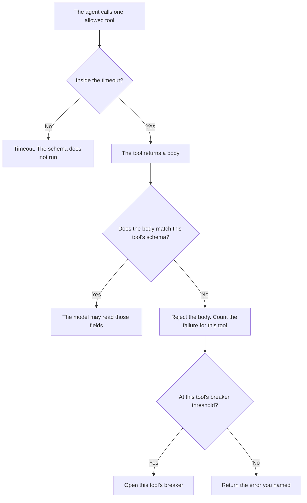

**An AI tool result schema is the contract for one tool's reply: the fields, the types, and what a missing field means, checked before the model treats the reply as fact.** If the payload does not match, the model does not get to "work with what it got." The call fails in the way you wrote.

A check on the model's own text is [what AI output validation is](/blog/what-is-ai-output-validation-2026/). The switch that stops a tool after repeated failures is [what an AI tool circuit breaker is](/blog/what-is-ai-tool-circuit-breaker-2026/). The clock on a single call, before any schema runs, is [what an AI tool timeout is](/blog/what-is-ai-tool-timeout-2026/). The list of tools the agent may name at all is [what an AI tool allowlist is](/blog/what-is-ai-tool-allowlist-2026/).

Prices are US list prices excluding tax from directory pages checked October 16, 2026. A live fetch of vendor pricing pages on October 24, 2026 returned HTTP 401, so this page stays on the directory record. Published October 24, 2026. The directory does not list a tool-result-schema fee. We did not measure parse rates.

## What the contract names

| Piece | Example you write | If it fails |
|---|---|---|
| Required field | `order_id` is a string | The result is rejected. The model does not invent an id |
| Type | `amount` is a number in cents | A numeric string is a failure until you name the coercion |
| Enum | `status` is one of the three values you listed | Any other string is a failure |
| Absence | A missing `refundable` field means unknown | The model must say unknown. It must not assume yes |
| Extra fields | Ignored, or rejected, and you pick one | You do not discover the policy at 2 a.m. |

Output validation looks at what the model said to the user. The result schema looks at what the tool said to the model. A beautiful sentence built on a payload that failed the schema is the bug. The timeout fires first, because there is no body to validate. The breaker watches how often this tool fails, including schema failures if you counted them. The allowlist is whether the tool may be called at all.

Write one schema per tool id. A shared "whatever JSON comes back" parser will accept a CRM error page as if it were an order.

## Where the schema is written

**The code next to the tool client.** [Cursor](/tools/cursor/) Plus is $8 a month, or $80 a year. You review the diff. A generated schema that marks every field optional is a defect. The ladder is [Cursor pricing explained](/blog/cursor-pricing-explained-2026/).

**The note a second person reads.** [Claude](/tools/claude/) Pro is $20 a month, or $17 billed annually, when the field list is a table you will paste into the ticket. The model may format rows you paste. It may not add a field. The review is [Claude review](/blog/claude-review-2026/).

**A workflow tool that hides the payload.** [Zapier](/tools/zapier/) Professional is $19.99 a month billed annually. Zapier's field mapping is Zapier's. If a step continues when a field is blank, you have accepted a schema that treats blank as success. The invoice is [Zapier pricing explained](/blog/zapier-pricing-explained-2026/).

**A one-table draft.** [ChatGPT](/tools/chatgpt/) Plus is $20 a month. Discard a schema that adds "notes" and "summary" because every API "should be human friendly."

A prompt that holds the line:

"Format a result schema from the fields, types, and missing-field behavior I pasted. Do not add a field. If I did not say what a missing field means, write Missing behavior missing and stop."

## What not to delegate

Do not let the model repair a payload that failed the schema and then answer as if the repair were the tool's data. Do not log the full body if it can contain a payment instrument or a customer record. Log the tool id, the schema version, and the field that failed. That habit belongs with [structured logging for AI](/blog/what-is-structured-logging-for-ai-2026/).

## FAQ

### How is this different from output validation?

Output validation checks the model's reply to the user: the shape, the citations, the refusal. The tool result schema checks the tool's reply to the model. Both can exist on one request. They look at different bodies.

### Does a schema replace the circuit breaker?

No. The schema rejects one bad body. The breaker stops calling a tool that keeps failing. Count schema rejects toward the breaker only if you decided that a bad body is the kind of failure that should open the switch. A single malformed row might be a bug in your parser, not a dead vendor.

### What about extra fields the vendor adds?

Pick one behavior and write it down. Ignoring unknown fields survives a vendor adding a harmless key. Rejecting unknown fields catches a payload you no longer understand. The worst choice is whichever one the model prefers that day.

### Can the timeout and the schema disagree?

The timeout means you have no body. The schema does not run. Do not record a schema failure for a call that never returned. The logs should say timeout, or schema, and not both for the same attempt.

## Last verified

October 16, 2026 for Cursor, Claude, Zapier, and ChatGPT. No tool-result-schema product fee is recorded in the directory. Published October 24, 2026.

**Sources:** [Cursor pricing](https://cursor.com/help/account-and-billing/pricing), [Claude pricing](https://claude.com/pricing), [Zapier pricing](https://zapier.com/blog/zapier-pricing/), [ChatGPT pricing](https://chatgpt.com/pricing/).

*Published by Andrew for [AI Tools Optimizer](https://aitoolsoptimizer.com).*

[Cursor](/tools/cursor/) is in the [coding directory](/tools/category/coding/). Directory pages may use affiliate links. A purchase through them may earn us a commission at no extra cost to you.
