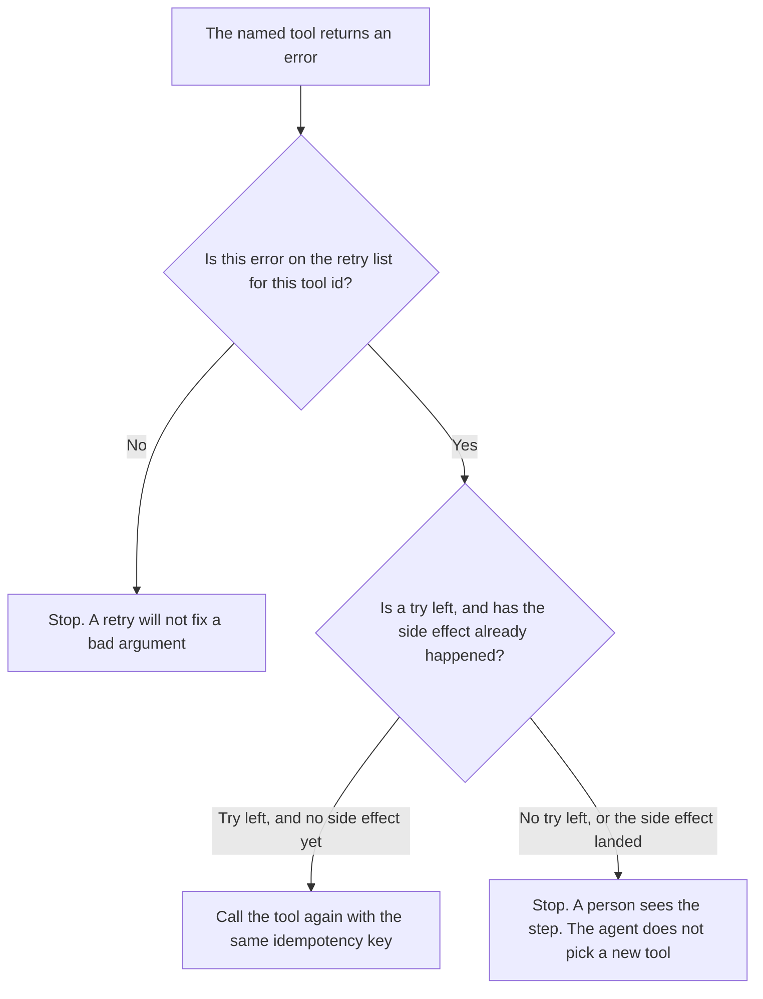

**An AI tool retry budget is the maximum number of times one named agent may call the same tool again after that tool fails, and the maximum extra effect those calls may cause, before the agent stops.** The counter on a failed model request is [what an AI retry budget is](/blog/what-is-ai-retry-budget-2026/). How long one tool call may run before you cut it off is [what an AI tool timeout policy is](/blog/what-is-ai-tool-timeout-policy-2026/). Whether the agent may call the tool at all is [what an AI tool permission gate is](/blog/what-is-ai-tool-permission-gate-2026/).

A tool that charges, sends, or deletes has to do that once. That key is [what AI idempotency is](/blog/what-is-ai-idempotency-2026/). A retry budget without that key can spend the count on duplicate side effects.

Claude's prices are the October 24, 2026 read of claude.com/pricing recorded in [Claude pricing explained](/blog/claude-pricing-explained-2026/). Zapier and Cursor prices are from directory pages checked October 16, 2026. n8n's Starter price on that card is €20 a month billed annually, for 2,500 executions. This page does not convert euros to dollars. A live fetch of Zapier's pricing page returned HTTP 401 on October 24, in the budget-cap article, so the Zapier figure stays on the directory record. Published October 24, 2026. We did not measure tool failures.

## What the budget has to name

| Line | A written budget | An accident |
|---|---|---|
| Tool id | One tool, such as the calendar create you named | Every tool the agent can see |
| Tries | A number, such as 2, after the first failure | Call until the tool returns success |
| Which errors | Timeouts and the status codes you listed | A 400 that means the arguments were wrong |
| Side effect | Whether this tool already changed something a person can see | A second email because the first call timed out after the send |
| Stop | Fail the step, or ask a person | A silent success with two records |

A model-call retry can succeed and then the tool call can fail. Those are two counters. Spending the model budget does not refill the tool budget. A timeout policy can fire on the first call, before any retry. The retry budget starts after that failure, and only if the error is on the list.

Permission is earlier. A tool that is not on the allowlist does not get a retry. The gate refused it. Do not raise the retry count to "get around" a refusal.

## Where the counter lives

**The definition.** [Claude](/tools/claude/) Pro is $17 a month billed annually, $200 up front, or $20 monthly. The Project names the tool id, the try count, and the stop action. The review is [Claude review](/blog/claude-review-2026/).

**A Zap that tells a person when the counter hits zero.** [Zapier](/tools/zapier/) Professional is $19.99 a month billed annually, with 750 tasks a month, on the October 16 card. The Zap does not decide the count. The invoice is [Zapier pricing explained](/blog/zapier-pricing-explained-2026/).

**The workflow that actually calls the tool, if you run it there.** [n8n](/tools/n8n/) Starter is €20 a month billed annually, for 2,500 executions, on the October 16 card. The euro figure stays in euros. An execution retry in n8n is still your budget. The product does not set the number for you.

**The diff, if the counter is code.** [Cursor](/tools/cursor/) Plus is $8 a month, or $80 a year. You review the diff that changes the try count. The ladder is [Cursor pricing explained](/blog/cursor-pricing-explained-2026/).

A prompt that holds the line:

"Draft the tool retry budget from the tool id, the try count, the error list, and the stop action I pasted. If the tool id is missing, write Tool not set. Do not raise the count. Do not add a tool."

## What not to delegate

Do not ask how many retries are "safe." Do not retry a tool that already sent, posted, or charged unless the idempotency key is the one you tested. Do not share one count across every tool because the config file was shorter. The owner sets the row. The agent does not.

## FAQ

### How is this different from a model retry budget?

The model retry budget counts failed calls to the model. The tool retry budget counts failed calls to one tool the agent invoked. A model can answer on the first try and the tool can still fail twice. A model can burn its retries before any tool is called. Write both numbers. A single integer cannot mean both.

### How is this different from a timeout policy?

The timeout cuts off a call that has run too long. The retry budget says whether you may place another call after that, or after another listed error. A timeout without a retry budget becomes an infinite loop if the agent "tries again" by default. A retry budget without a timeout can leave the first call hanging until the vendor does.

### How is this different from a permission gate?

The gate decides whether this agent may call this tool. The retry budget decides how many failures are allowed after a call that was permitted. A refused tool has a count of zero, because it was never allowed. Do not log a refusal as a retry. The logs mean different things.

### Who may raise the count?

The owner of the tool row. A failed demo is not a reason to edit the count in the same hour. If the error was not on the list, add the error in a new version and say why. Do not delete the old count.

## Last verified

October 24, 2026 for Claude, via the pricing article. October 16, 2026 for Zapier, n8n, and Cursor. Published October 24, 2026. Zapier's pricing page returned HTTP 401 on October 24, as recorded in the budget-cap article. n8n's price is in euros on the directory card.

**Sources:** [Claude pricing](https://claude.com/pricing), [Zapier pricing guide](https://zapier.com/blog/zapier-pricing/), [n8n pricing](https://n8n.io/pricing/), [Cursor pricing](https://cursor.com/help/account-and-billing/pricing).

*Published by Andrew for [AI Tools Optimizer](https://aitoolsoptimizer.com).*

[n8n](/tools/n8n/) is in the [automation and agents directory](/tools/category/automation-agents/). Directory pages may use affiliate links. A purchase through them may earn us a commission at no extra cost to you.
