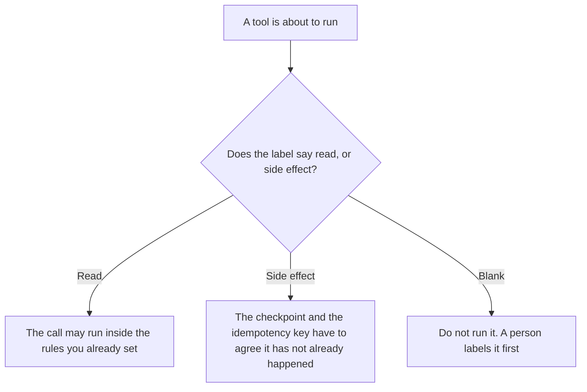

**An AI tool side-effect label is a mark a person puts on a tool: this call only reads, or this call changes something outside the chat.** A change is a write, a send, a charge, or a delete. The saved point that records a change already happened is [what an AI agent checkpoint is](/blog/what-is-ai-agent-checkpoint-2026/). The key that refuses a second charge on retry is [what AI idempotency is](/blog/what-is-ai-idempotency-2026/). The label is the classification. It does not store the run, and it does not block the duplicate by itself.

A place that cannot ship is [what an AI tool sandbox is](/blog/what-is-ai-tool-sandbox-2026/). A sandbox can hold a tool you labeled as a side effect so the test never sends the real mail. The label still says the production call would send it.

Claude's prices are the October 24, 2026 read of claude.com/pricing recorded in [Claude pricing explained](/blog/claude-pricing-explained-2026/). Cursor, Notion, and Zapier prices are from directory pages checked October 16, 2026. A live fetch of Zapier's pricing page returned HTTP 401 on October 24, 2026, so the Zapier figure stays on the directory record. Published October 24, 2026. We did not score tool safety. The directory does not list a labeling fee.

## What the label has to say

| Line | Who writes it | A blank means |
|---|---|---|
| Tool name | You | Two calls share a nickname and one of them sends |
| Read or side effect | You | A resume treats a charge as a lookup |
| What changes | You, in words | "Update" might be a draft or a live record |
| Environment | You | A test label gets copied onto production |
| Who may change the label | A person | The model relabels a send as a read after a failure |

A read that returns a secret is still a read. The label does not replace a permission gate. It tells the next step whether repeating the call would change the world. If the tool both reads and writes, label it as a side effect. A mixed call is not a read because the first line of the response was a lookup.

The label does not contain a quality rating of the vendor. It does not say the tool is safe. It says what this call does to something outside the chat.

## Where the label is kept

**The definition of the labels you allow.** [Claude](/tools/claude/) Pro is $17 a month billed annually, $200 up front, or $20 monthly, on that October 24 read. The Project holds the words you use: read, send, charge, delete. The review is [Claude review](/blog/claude-review-2026/).

**The diff, if the label lives next to the tool in a repo.** [Cursor](/tools/cursor/) Plus is $8 a month, or $80 a year, on the October 16 card. You review the diff that changes a label from read to send. The ladder is [Cursor pricing explained](/blog/cursor-pricing-explained-2026/).

**The register.** [Notion AI](/tools/notion-ai/) Business is $20 a seat a month. One row per tool, the label, the environment, and the owner. Plus at $10 is not the full AI tier. The invoice is [Notion AI pricing explained](/blog/notion-ai-pricing-explained-2026/).

**A notice when a side-effect tool is called.** [Zapier](/tools/zapier/) Professional is $19.99 a month billed annually, with 750 tasks a month, on the October 16 card. The Zap tells a person. It does not relabel the tool. The invoice is [Zapier pricing explained](/blog/zapier-pricing-explained-2026/).

A prompt that holds the line:

"Draft the side-effect label from the tool name, the environment, and the change I pasted. If I did not say what changes, write Side effect not described. Do not mark the tool as read. Do not run the tool."

## What not to delegate

Do not ask the model which tools are "basically read-only." Do not drop the label because the call failed and "nothing happened." A failed send can still have sent. Do not treat a sandbox success as a production label. The owner of the tool sets the label. A generated table is not the label.

## FAQ

### How is this different from a checkpoint?

The checkpoint is a save for one run: this step already sent the mail. The label is on the tool, for every run. A checkpoint without a label can still say what happened. A label without a checkpoint does not remember this run. Write both when the tool changes something.

### How is this different from an idempotency key?

The key is how the system refuses a second charge for the same request. The label is why you required a key: the call is a side effect. A read does not need that key. A side effect without a key can still be labeled honestly, and it can still double-charge. The label does not implement the key.

### How is this different from a sandbox?

The sandbox is a place that cannot ship. The label says what the call would do in the place that can. You can test a side-effect tool in a sandbox. You still label the production tool as a side effect. A sandbox is not a reason to mark the tool as read.

### Who may change a label?

The person named on the row. A model suggestion is not a change. Moving a tool from read to send is a new version of the row, with a date. Last month's runs stay attached to the label they had.

## Last verified

October 24, 2026 for Claude, via the pricing article. October 16, 2026 for Cursor, Notion, and Zapier. Published October 24, 2026. Zapier's pricing page returned HTTP 401 on October 24.

**Sources:** [Claude pricing](https://claude.com/pricing), [Cursor pricing](https://cursor.com/help/account-and-billing/pricing), [Notion pricing](https://www.notion.com/pricing), [Zapier pricing guide](https://zapier.com/blog/zapier-pricing/).

*Published by Andrew for [AI Tools Optimizer](https://aitoolsoptimizer.com).*

[Claude](/tools/claude/) is in the [chatbots and assistants directory](/tools/category/chatbots-assistants/). Directory pages may use affiliate links. A purchase through them may earn us a commission at no extra cost to you.
