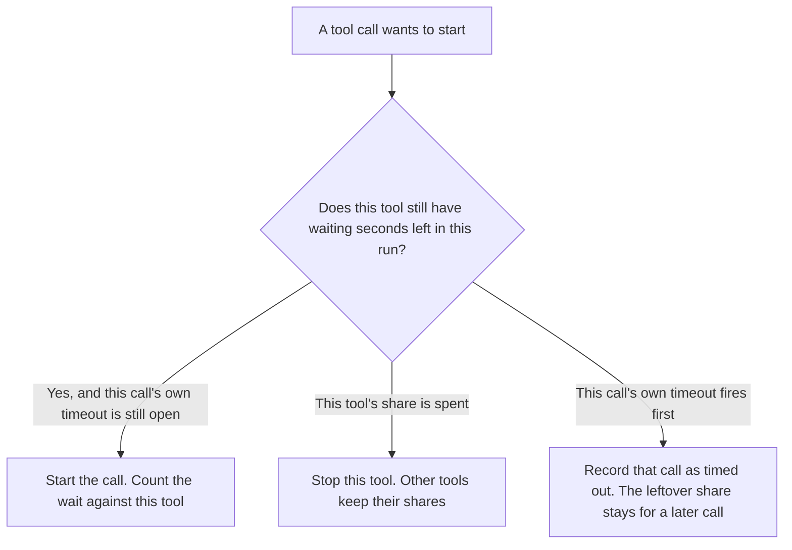

**An AI tool timeout budget is the share of waiting time you assign to one tool inside a run, so a slow caller cannot spend the whole deadline.** The vendor, or your own clock, still has a limit on a single call. Your budget is the slice of wait that tool may consume across its calls. When the slice is gone, that tool stops, even if one more call would still fit inside its own timeout.

The clock on one call is [what an AI tool timeout is](/blog/what-is-ai-tool-timeout-2026/). Which class of call gets which clock is [what an AI tool timeout policy is](/blog/what-is-ai-tool-timeout-policy-2026/). The way you split one user-facing deadline across hops is [what an AI latency budget is](/blog/what-is-ai-latency-budget-2026/). Requests inside a rate-limit window are [what an AI tool rate-limit budget is](/blog/what-is-ai-tool-rate-limit-budget-2026/). How many times you may try again is [what an AI retry budget is](/blog/what-is-ai-retry-budget-2026/).

Claude's prices are the October 24, 2026 read of claude.com/pricing recorded in [Claude pricing explained](/blog/claude-pricing-explained-2026/). Cursor's Plus price is the October 24 help-center figure recorded in [Cursor pricing explained](/blog/cursor-pricing-explained-2026/). Zapier is the October 16 directory card. A live fetch of Zapier's pricing page returned HTTP 401 on October 24, 2026, so that figure stays on the directory record. Published October 24, 2026. We did not time any vendor's tools. The directory does not list a timeout-budget fee.

## What the share has to name

| Field | Who writes it | A blank means |
|---|---|---|
| The run the share belongs to | You | A tool can wait across runs you meant to separate |
| The seconds for this tool | You, under the run's deadline | The tool may use the whole wait |
| What happens when the seconds are gone | You: stop this tool, or hand to a person | A retry looks like more time |
| Which other tools keep a share | You | One slow tool starves the rest |
| Where the wait is logged | You | A person cannot see who used the deadline |

A tool timeout stops one call when its clock expires. A timeout budget stops a tool after it has used its share of the run, even if the next call would have been short. A latency budget splits the user-facing deadline across hops such as retrieval and the model. You can set all three. The run stops on the first limit it hits.

The deadline is not yours to raise by rewriting the prompt. If the run may wait 20 seconds and you assigned 15 of them to one tool, the other tools share 5. Assigning 30 to that tool does not create 10 extra seconds. It only lies about the share.

## Where the share is written

**The rule next to the key.** [Claude](/tools/claude/) Pro is $17 a month billed annually, $200 up front, or $20 monthly. A Project can hold the sentence: this tool may wait this many seconds in this run. The review is [Claude review](/blog/claude-review-2026/).

**The automation that fans out.** [Zapier](/tools/zapier/) Professional is $19.99 a month billed annually, 750 tasks, on the October 16 card. A Zap that waits on a slow step can spend the deadline before a second Zap runs. The task count is not the waiting share. The invoice is [Zapier pricing explained](/blog/zapier-pricing-explained-2026/).

**The flow you can read.** [n8n](/tools/n8n/) can sit the share next to the node when you run the flow yourself. This page does not restate an n8n dollar. The October 16 record showed a cloud price in euros, and this page does not convert it.

**The diff, if the limit lives in code.** [Cursor](/tools/cursor/) Plus is $8 a month, or $80 a year, on the October 24 help page. You review a diff that deletes the share or sets it above the run's deadline. The individual ladder is [Cursor pricing explained](/blog/cursor-pricing-explained-2026/).

A prompt that holds the line:

"List the timeout share for the tool I named: the run, the seconds, and what happens when the seconds are gone. If any field is missing, write Share not set. Do not raise the seconds to the whole deadline. Do not invent a vendor limit."

## What not to delegate

Do not let the model pick the share because a tool "seems important." Do not treat a retry count as extra seconds. Do not hide a timeout behind a retry that spends another tool's share. The person who owns the run writes the numbers.

## FAQ

### How is this different from a tool timeout?

A tool timeout is the clock on one call. The timeout budget is how much waiting that tool may use across the calls in one run. A call can finish inside its own timeout and still exhaust the tool's share. A later call can be refused because the share is already gone.

### How is this different from a latency budget?

A latency budget splits one user-facing deadline across hops: retrieval, the model, tools, the page. A timeout budget is the slice inside the tool hop, assigned to one tool. The hops can each be on time while one tool has already used the tool hop's share.

### How is this different from a rate-limit budget?

A rate-limit budget counts requests inside a window. A timeout budget counts seconds of waiting inside a run. A tool can stay under its request share and still spend the deadline. A fast tool can exhaust the request window without using much of the wait.

### Who may change the share?

The person who owns the run. A generated number that uses the whole deadline is not a budget. Share not set stays unset until that person writes the run and the seconds.

## Last verified

October 24, 2026 for Claude and for Cursor's help page, via the posts cited above. October 16, 2026 for Zapier. Published October 24, 2026. Zapier's pricing page returned HTTP 401 on October 24. No timeout-budget fee is recorded in the directory.

**Sources:** [Claude pricing](https://claude.com/pricing), [Cursor pricing](https://cursor.com/help/account-and-billing/pricing), [Zapier pricing](https://zapier.com/pricing).

*Published by Andrew for [AI Tools Optimizer](https://aitoolsoptimizer.com).*

[Claude](/tools/claude/) is in the [chatbots and assistants directory](/tools/category/chatbots-assistants/). Directory pages may use affiliate links. A purchase through them may earn us a commission at no extra cost to you.
