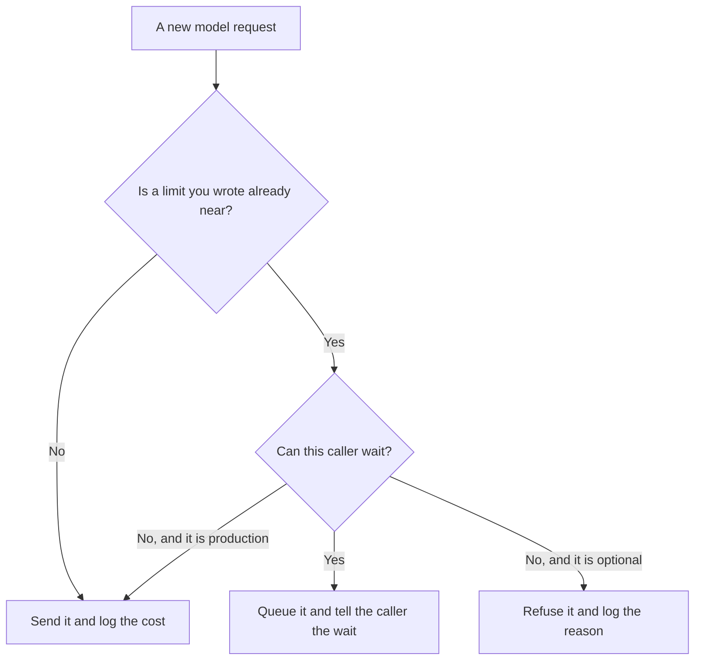

**AI traffic shaping is a rule set that decides which requests run now, which wait, and which stop when a model, an API key, or a team is near a limit you already set.** The model does not get faster. The queue in front of it gets a policy. Routing picks the model. Shaping picks the order and the refusal.

Which model receives the job is [what AI routing is](/blog/what-is-ai-routing-2026/). The shared door is [what a model gateway is](/blog/what-is-a-model-gateway-2026/). A hard dollar stop, as opposed to a wait, is [what AI budget caps are](/blog/what-is-ai-budget-caps-2026/). One request's wait versus the whole queue is [what AI latency versus throughput is](/blog/what-is-ai-latency-vs-throughput-2026/).

Prices below are US list prices excluding tax from directory pages checked October 16, 2026. Published October 24, 2026. The directory does not list a traffic-shaping product fee, so this page does not invent one. We did not measure queue times.

## What the rule is allowed to do

| Pressure | A shaping rule can | Leave the request alone |
|---|---|---|
| One team is using most of a shared key | Slow that team's non-urgent jobs | A customer-facing reply that has a published response-time promise |
| A batch of summaries can wait until tonight | Hold them for the cheap window | A person waiting in a chat box |
| The monthly budget is close | Refuse new playground calls and keep production | Hide the refusal so the app looks hung |
| Two plans share one vendor | Give the paid plan a larger share of the minute | Invent a second price to justify the share |

A silent queue is an outage. The caller should see a wait, a retry time, or a clear stop. The promise you check afterward is [what AI SLA monitoring is](/blog/what-is-ai-sla-monitoring-2026/).

## What this site can price, and what it cannot

**A seat that is not the shaper.** [ChatGPT](/tools/chatgpt/) Plus is $20 a month. Business is $20 a user a month billed annually for two or more users, or $25 billed monthly. A Business admin can turn a seat off. That is an account control. It is not a per-minute queue in front of your own API key. The ladder is [ChatGPT Go vs Plus vs Pro](/blog/chatgpt-go-vs-plus-vs-pro-2026/).

**A second drafting seat.** [Claude](/tools/claude/) Pro is $20 a month, or $17 billed annually. Use it to write the policy in plain language. The gateway, not the chat, enforces the wait. The review is [Claude review](/blog/claude-review-2026/).

**A workflow that can wait.** [Make](/tools/make/) Core is $9 a month billed annually for 10,000 credits. A scenario that summarizes yesterday's tickets can run off-peak. Make's credit plan is not a model-rate limiter. The invoice is [Make pricing explained](/blog/make-pricing-explained-2026/).

**The editor, if the rule lives in code.** [Cursor](/tools/cursor/) team seats for new customers are $30, $100, or $200 a month, matching the usage tier. The rule still needs a review before it ships. The invoice is [Cursor pricing explained](/blog/cursor-pricing-explained-2026/).

## Rules that keep a queue explainable

Name the caller, the limit, and the action in one sentence a finance partner can read. Separate interactive traffic from batch traffic. Log refusals next to the dollars you did not spend, so a stop is visible on the ledger. That ledger is [what AI cost attribution is](/blog/what-is-ai-cost-attribution-2026/). When the cost jumps anyway, the page for the spike is [what AI cost anomaly detection is](/blog/what-is-ai-cost-anomaly-detection-2026/).

Do not shape by hiding errors. A user who retries ten times because the app spun forever will cost more than a single honest refusal.

## FAQ

### Is traffic shaping the same as routing?

Routing chooses a model. Shaping chooses whether this request may use the chosen model now. You can route a job to a cheaper model and still queue it.

### Does a vendor rate limit count?

A vendor limit is a ceiling you do not control. Shaping is the policy you add before you hit that ceiling, so production keeps a share and a batch job waits.

### Can the model decide its own priority?

No. A person writes the priority from the product promise and the budget. A prompt that says "this is urgent" is not a policy.

### Should interactive chat and nightly batches share one key?

They can share a vendor. They should not share an unshaped key. Give the batch a window and a cap. Give the chat the response-time promise you published.

## Last verified

October 16, 2026 for ChatGPT, Claude, Make, and Cursor prices named above. No traffic-shaping vendor fee is recorded in the directory. Published October 24, 2026.

**Sources:** [ChatGPT pricing](https://chatgpt.com/pricing/), [Claude pricing](https://claude.com/pricing), [Make pricing](https://www.make.com/en/pricing).

*Published by Andrew for [AI Tools Optimizer](https://aitoolsoptimizer.com).*

[ChatGPT](/tools/chatgpt/) is in the [chatbots and assistants directory](/tools/category/chatbots-assistants/). Directory pages may use affiliate links. A purchase through them may earn us a commission at no extra cost to you.
