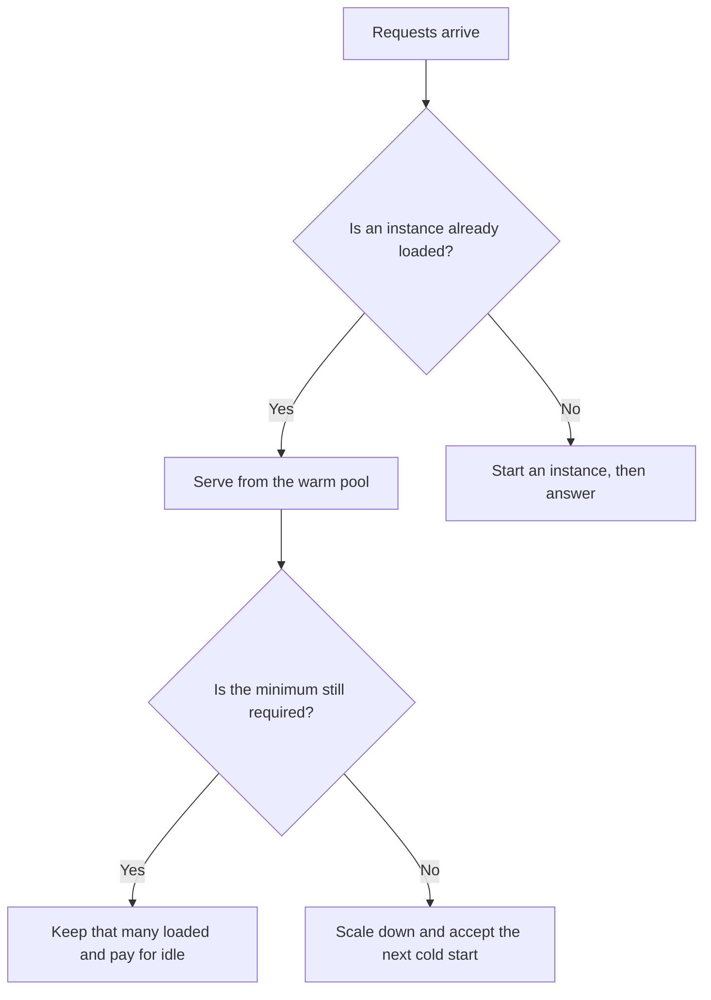

**An AI warm pool is a set of model-serving instances kept loaded and ready, so a new request does not wait for the model to start from nothing.** You pay for idle capacity in exchange for a shorter first response. A cold start is the wait when no instance is ready. A warm pool is the decision to keep a minimum number ready.

The path from request to answer is [what model serving is](/blog/what-is-model-serving-2026/). The attention state a server may reuse for a repeated prefix is [what a KV cache is](/blog/what-is-kv-cache-2026/). One person's wait versus the work the system finishes is [latency versus throughput](/blog/what-is-ai-latency-vs-throughput-2026/). Combining similar requests so one load serves several is [what AI request coalescing is](/blog/what-is-ai-request-coalescing-2026/).

Prices are US list prices excluding tax from directory pages checked October 16, 2026. Published October 24, 2026. This page does not claim that any chat vendor publishes a warm-pool size. We did not measure cold starts.

## What you name if you operate the pool

| Piece | A warm pool has it | A chat subscription hides it |
|---|---|---|
| Minimum instances | A number kept loaded | The vendor's private capacity |
| The model version | The weights those instances hold | "The latest" |
| Idle cost | The bill for instances with no traffic | A seat price |
| Scale rule | When you add or remove instances | A limit you hit without a diagram |
| Health check | How you know an instance can take a request | A status page |
| Owner | Who may set the minimum to zero | Nobody on your team |

A KV cache speeds a prefix you have already seen on a running instance. It does not start the instance. A warm pool starts, or keeps, the instance. People mix the two because both show up as "the second request felt faster." They are different bills. Cache discounts a token row. A warm pool bills idle machines.

## What you buy when you do not operate one

**A chat seat.** [ChatGPT](/tools/chatgpt/) Plus is $20 a month. [Claude](/tools/claude/) Pro is $20 a month, or $17 billed annually. [Gemini](/tools/gemini/) on Google AI Pro is $19.99 a month. The vendor may keep capacity warm. Your contract is the seat and the usage cap. You do not set a minimum instance count, and this directory does not list one. Treat a fast reply as their serving. Treat a timeout as your product's problem to show the user. The deadline you publish is [what an AI SLO is](/blog/what-is-ai-slo-2026/).

**An API you call.** [DeepSeek](/tools/deepseek/) meters tokens, including a cheaper cache-hit input rate, recorded October 16, 2026: $0.003 per 1 million tokens off-peak and $0.006 at peak. That row is a cache. It is not a warm-pool control. If you need a minimum number of instances, you need a serving setup that exposes one. This page does not invent that switch on DeepSeek's card.

**Work that can wait.** A nightly job does not need a warm pool. Let it cold-start, or run it as [batch inference](/blog/what-is-ai-batch-inference-2026/). Paying idle capacity for a queue you allowed to be slow is how a warm pool becomes a standing waste.

## When a warm pool is the wrong spend

Keep a pool warm when a person is waiting and a cold start would break a deadline you wrote down. Drain it when traffic is gone. A pool sized for a launch demo will bill all month if nobody sets it back.

The internal split of that deadline, hop by hop, is [what an AI latency budget is](/blog/what-is-ai-latency-budget-2026/). Cold start belongs in that budget as its own line, with a number you measured on your stack. Do not paste a vendor's marketing latency into the line.

## FAQ

### Is a warm pool the same as autoscaling?

Autoscaling adds and removes capacity as traffic moves. A warm pool is the floor you refuse to scale below, so the next request finds something already loaded. You can autoscale with a floor of zero. That floor is a cold start.

### Do we need our own GPUs?

Only if you operate the instances. A chat or API vendor can keep their own pool. You operate a warm pool when the minimum is a setting you can change and a bill you can see.

### Will a warm pool make every request fast?

It removes one wait: the start. The model can still be slow once it is loaded. Queueing, a long prompt, and a long reply are other lines. Measure them separately.

### Should every internal tool have one?

A tool a person opens a few times a day can cold-start. A checkout assistant or a support reply with a written deadline is the case for a floor above zero. Write the deadline first. Then decide the floor.

## Last verified

October 16, 2026 for ChatGPT, Claude, Gemini, and DeepSeek prices named above. No warm-pool size is published on those directory cards. Published October 24, 2026.

**Sources:** [ChatGPT pricing](https://chatgpt.com/pricing/), [Claude pricing](https://claude.com/pricing), [Google AI subscriptions](https://gemini.google/subscriptions/), [DeepSeek API docs](https://api-docs.deepseek.com/).

*Published by Andrew for [AI Tools Optimizer](https://aitoolsoptimizer.com).*

[Claude](/tools/claude/) is in the [chatbots and assistants directory](/tools/category/chatbots-assistants/). Directory pages may use affiliate links. A purchase through them may earn us a commission at no extra cost to you.
