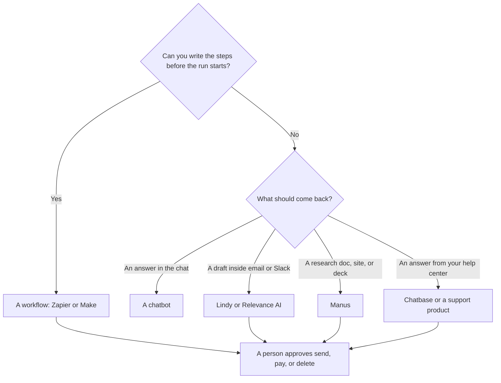

**An AI agent is software that takes a goal, chooses steps, and uses tools until it hands work back.** A chatbot answers the message in front of it. A workflow runs steps you drew in advance. An agent is the middle case: the goal is stable, the path can change, and something in your stack (an inbox, a calendar, a browser, a document) is allowed to move.

That definition is the useful one in 2026. Vendor pages use "agent" for a scheduled email draft, a support bot, and a research tool that builds a slide deck. The word does not tell you the bill or the risk. The job does.

Prices below are US list prices excluding tax, from vendor pages recorded October 16, 2026, except where a later directory article names an October 24, 2026 read. We did not score how often these agents finish a task correctly.

## Three shapes people call an agent

| Shape | What it does | A directory example | Price to know |
|---|---|---|---|
| Chat, one turn | Answers from the prompt and the files you paste | [ChatGPT](/tools/chatgpt/) or [Claude](/tools/claude/) | ChatGPT Plus $20/month. Claude Pro $20/month, or $17 billed annually |
| Workflow | Runs a path you drew: trigger, steps, stop | [Zapier](/tools/zapier/) or [Make](/tools/make/) | Zapier Free is 100 tasks/month. Professional is $19.99/month billed annually. Make Free is 1,000 credits/month. Core is from $9/month billed annually |
| Agent | Pursues a role or a goal and can pick among tools | [Lindy](/tools/lindy/), [Manus](/tools/manus/), or [Relevance AI](/tools/relevance-ai/) | Lindy's trial is $50 in credits for 7 days. Team starts at $49.99/month for 5,000 credits. Manus Free includes 300 refresh credits a day. Pro starts at $20/month for 4,000 credits. Relevance Pro is $19/month billed annually. The free plan is retired |
| Agent on a corpus you own | Answers customers from your docs, with handoff | [Chatbase](/tools/chatbase/) | Hobby is $32/month billed yearly, or $40 monthly, read October 24, 2026 |
| Agent inside a wiki you already pay for | Acts on pages and tasks in that workspace | [Notion AI](/tools/notion-ai/) | Business is $20/seat/month for full Notion AI. Custom Agent credits are a separate meter |

The build order for the no-code products is [how to create an AI agent without coding](/blog/how-to-create-an-ai-agent-without-coding/). The workflow comparison is [Zapier vs Make vs n8n](/blog/zapier-vs-make-vs-n8n/). Customer-facing bots are a different aisle: [best AI chatbots for business](/blog/best-ai-chatbots-for-business-2026/).

## When the word is worth caring about

Care when the work repeats, the inputs change, and a person is currently copying between apps. Inbox triage, a weekly pipeline note, and "turn this brief into a first-draft deck" are agent-shaped. A one-off question is a chat. A form that always files the same way is a workflow. Buying an agent platform for a workflow you could draw on a whiteboard adds a credit meter without adding a decision.

Care about permissions before you care about the model. An agent that can send mail, move money, or delete records needs a human approval step on those actions. Read-only for the first week is the setup in the no-code guide. Lindy's product review is [Lindy review](/blog/lindy-review-2026/). Manus as a research agent is [Manus review](/blog/manus-ai-review-2026/).

## What the tools in the table actually sell

**Lindy** is a role you describe and connect to apps. The $50 trial lasts 7 days and does not require a card. Team credits are pooled. Top-ups on the page we used were $10 per 1,000 credits. Enterprise is where HIPAA, SSO, and audit logs show up. Do not assume the $49.99 plan has those controls.

**Manus** takes a goal and returns a deliverable: research, a site, slides. Free refreshes 300 credits a day. Pro's first paid pack is $20 a month for 4,000 credits. Credit use on a large task is hard to predict from the marketing page. Start with a small goal and read the credit receipt.

**Relevance AI** is a workforce of agents for go-to-market and operations, metered in Actions and Vendor Credits. Pro is $19 a month billed annually ($29 monthly) with 2,500 Actions a month and $20 a month in Vendor Credits. Team jumps to $234 a month on annual billing. There is no free plan for new signups.

**Zapier and Make** belong in this glossary because their pages now say "agents" next to Zaps and scenarios. If you can draw the path, you are still buying a workflow. Filters and paths on Zapier do not count as tasks, which is a billing detail, not a reason to call the Zap an agent.

**Chatbase** is the case where the agent faces a customer and the knowledge is your content. That is retrieval plus a bot. The concept is [what RAG is](/blog/what-is-rag-explained-2026/). The product review is [Chatbase review](/blog/chatbase-review-2026/).

## What an agent does not do

- It does not become correct because it took more steps. A wrong fact in step one is still wrong in the draft.
- It does not create permission to email people, charge a card, or change a bank detail.
- It does not replace the approval you would have required from a new hire on the same task.

If the failure mode is "it did not know our policy," the fix is often the document, not a larger model. If the failure mode is "it took an action we did not want," the fix is the permission, not a better prompt.

## FAQ

### Is ChatGPT an AI agent?

The chat is a chatbot. Features that carry out a multi-step task with tools are the agent-shaped part of the product. Plus at $20 a month is the common individual plan. You still approve anything that sends or pays. The plan ladder is [ChatGPT Go vs Plus vs Pro](/blog/chatgpt-go-vs-plus-vs-pro-2026/).

### What is the difference between an AI agent and automation?

Automation follows a path you specified. An agent is allowed to choose among steps to reach a goal. Many products sell both. If your diagram has no branches you could not predict, buy the automation.

### Do I need to code an agent?

No, for the jobs in the table. A coded agent inside a repository is a different project. The coding comparison is [Cursor vs Claude Code vs Codex](/blog/cursor-vs-claude-code-vs-codex-2026/).

### Are agents safe to connect to email?

Connect them read-only first. Let them draft. Have a person send. Enterprise controls such as SSO and audit logs are plan features, not a property of the word "agent."

## Last verified

October 16, 2026 for Lindy, Manus, Zapier, Make, Relevance AI, and Notion prices. October 24, 2026 for the Chatbase Hobby price in the product review. Published October 24, 2026.

**Sources:** [Lindy pricing](https://www.lindy.ai/pricing), [Manus](https://manus.im), [Zapier pricing](https://zapier.com/pricing), [Make pricing](https://www.make.com/en/pricing), [Relevance AI pricing](https://relevanceai.com/pricing).

These products are in the [automation and agents directory](/tools/category/automation-agents/). Directory pages may use affiliate links. A purchase through them may earn us a commission at no extra cost to you.
