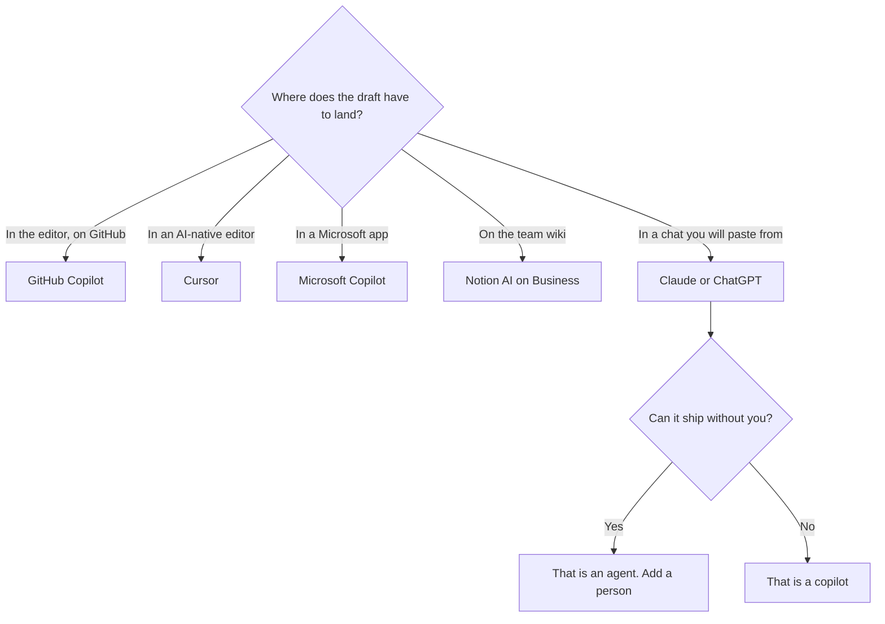

**An AI copilot drafts inside a tool you already use, and a person still decides what ships.** The suggestion appears in the editor, the document, or the inbox. You accept it, edit it, or ignore it. A system that merges the pull request, sends the email, or closes the ticket without that decision is an agent. The product name on the invoice often says copilot either way. The behavior is the definition.

An agent that takes actions is [what an AI agent is](/blog/what-is-an-ai-agent-2026/). The mechanism that lets a model call a tool is [what tool use is](/blog/what-is-tool-use-in-llms-2026/). The person who must still say yes is [what human-in-the-loop AI is](/blog/what-is-human-in-the-loop-ai-2026/).

Prices are US list prices excluding tax from directory pages checked October 16, 2026. Published October 24, 2026. We did not score suggestion quality.

## The name, then the commitment

| Product in this directory | Where the draft shows up | First price that matters | Who commits |
|---|---|---|---|
| [GitHub Copilot](/tools/github-copilot/) | The editor and GitHub | Free is 2,000 completions a month. Pro is $10. Business is $19 | You accept the completion. Business adds IP indemnity and admin controls |
| [Cursor](/tools/cursor/) | Cursor's editor | Plus is $8 a month on The X Subscription. Premium is $30 | You, unless you let an agent apply a change you did not read |
| [Microsoft Copilot](/tools/microsoft-copilot/) | A Microsoft account, and Microsoft 365 | Free with a signed-in account. Microsoft 365 Personal is $9.99 a month | You, in the Microsoft app you opened |
| [Notion AI](/tools/notion-ai/) | The wiki page | Business at $20 a seat is the full AI tier. Plus at $10 is not that tier | The people who can edit the page |
| [Claude](/tools/claude/) or [ChatGPT](/tools/chatgpt/) | A chat, plus projects | Pro or Plus is $20. Claude Pro is also $17 billed annually | You paste the result back. The chat is not the system of record |

Copilot Pro+ is $39 and Copilot Max is $100, on the same October 16 card, when the Pro credit pool is the limit. Enterprise is $39. Those are capacity and admin rows. They do not change who should merge the code. The receipt is [GitHub Copilot pricing explained](/blog/github-copilot-pricing-explained-2026/). The editor comparison is [Cursor vs GitHub Copilot](/blog/cursor-vs-github-copilot-2026/).

## A copilot becomes an agent at the commit

Cursor can suggest a line. Cursor can also run an agent across a task. Plus at $8 is enough for a person who reads more than they generate, on the recorded X Subscription ladder. The moment the agent edits files you do not open, you have left the copilot definition, even if the marketing page still says assistant. The bill is [Cursor pricing explained](/blog/cursor-pricing-explained-2026/). The cloud IDE that publishes an app from a prompt is a different job again. That comparison is [Cursor vs Replit Agent](/blog/cursor-vs-replit-agent-2026/).

Microsoft's directory page records a free copilot with a signed-in Microsoft account, and Microsoft 365 Personal at $9.99 a month. This page does not invent a separate Microsoft 365 Copilot enterprise price. If your admin center shows a different seat, the admin center wins.

Notion is a copilot when it rewrites the page you have open, and an agent when a Custom Agent runs on a trigger while you are away. Custom Agent credits are a second line, $10 per 1,000 credits, only on Business and Enterprise. The split is [Notion AI pricing explained](/blog/notion-ai-pricing-explained-2026/).

Claude and ChatGPT are copilots for writing when you bring the answer back yourself. They are agents when a connector takes an action. Projects keep the instructions. The container is [Claude Projects vs ChatGPT Projects](/blog/claude-projects-vs-chatgpt-projects-2026/). The writing choice between them is [ChatGPT vs Claude for writing](/blog/chatgpt-vs-claude-for-writing-2026/).

## What to refuse even if the draft looks finished

A copilot does not own the fact. If it inserts a price, a legal line, or a metric you did not supply, delete it. That failure mode is [what an AI hallucination is](/blog/what-is-ai-hallucination-2026/). The pass before you publish is [how to fact-check AI writing](/blog/how-to-fact-check-ai-writing-2026/).

A copilot also does not own the review. Accepting a completion you did not read is how a wrong condition ships. The coding map, if the work is a repository rather than a paragraph, is [best AI coding assistants](/blog/best-ai-coding-assistants-2026/).

## FAQ

### Is GitHub Copilot the only copilot?

No. It is the product that made the word ordinary in an editor. Microsoft Copilot, Cursor, and Notion AI fit the same shape when a person still commits. Reserve the word agent for the step that acts while you are gone.

### Is ChatGPT a copilot?

It is a copilot for the work you paste back into the real tool. It is a chat product first. Calling every chatbot a copilot makes the word useless. Use it when the draft appears where the work already lives.

### Do I need a copilot and an agent?

Start with the copilot that matches the file you touch every day. Add an agent when a repeated action has a person or a check in front of the commit. Two subscriptions that draft the same paragraph are a duplicate seat.

### Does a more expensive tier make it safer?

Business and Enterprise rows add admin controls, and Copilot Business adds IP indemnity on the recorded card. They do not read the diff for you. Safety is the review, plus [what AI guardrails are](/blog/what-is-ai-guardrails-2026/) if the model can call a tool.

## Last verified

October 16, 2026 for GitHub Copilot, Cursor, Microsoft Copilot, Notion, Claude, and ChatGPT prices named above. Published October 24, 2026.

**Sources:** [GitHub Copilot](https://github.com/features/copilot), [Cursor pricing](https://cursor.com/help/account-and-billing/pricing), [Notion pricing](https://www.notion.com/pricing).

*Published by Andrew for [AI Tools Optimizer](https://aitoolsoptimizer.com).*

[GitHub Copilot](/tools/github-copilot/) is in the [coding directory](/tools/category/coding/). Directory pages may use affiliate links. A purchase through them may earn us a commission at no extra cost to you.
