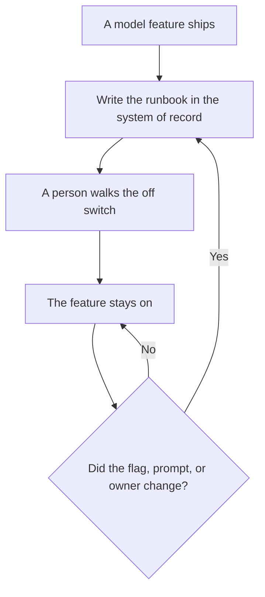

**An AI runbook is the page an on-call opens for one model-backed feature: who owns it, how to tell it is unhealthy, which flag or key turns it off, what to tell customers, and which prompt version is live.** A chat transcript is not a runbook. A runbook has an owner and a date, and it is updated when the feature changes.

The path that uses that page during a bad day is [what AI incident response is](/blog/what-is-ai-incident-response-2026/). The place a fact is allowed to live is [what a system of record for AI is](/blog/what-is-a-system-of-record-for-ai-2026/). The checks the page should point at are [what AI observability is](/blog/what-is-ai-observability-2026/) and [what AI SLA monitoring is](/blog/what-is-ai-sla-monitoring-2026/).

Prices are US list prices excluding tax from directory pages checked October 16, 2026. Published October 24, 2026. We did not score documentation tools.

## What the page contains

| Section | Written by | A model may |
|---|---|---|
| Owner and backup | You, with names that match the schedule | Not invent a rotation |
| What healthy looks like | The latency, error, or cost line you already monitor | Link the chart. It may not set the threshold |
| Turn it off | The feature flag or key name, and who has access | Repeat the name from this page |
| Customer note | Two sentences you approved in advance for "down" and "degraded" | Fill the time only from the incident |
| Prompt and tool list | The version number and the tools that feature may call | Not add a tool because it would be useful |
| Last tested | The date a person walked the steps | Not mark the test as done |

The off switch is [what AI feature flags are](/blog/what-is-ai-feature-flags-2026/). The person who walks it is [what human-in-the-loop AI is](/blog/what-is-human-in-the-loop-ai-2026/).

## Where teams keep it

**The wiki the on-call already opens.** [Notion AI](/tools/notion-ai/) Business is $20 a seat a month, which is the full AI tier on the directory card. Name one database for runbooks so they are not scattered across private pages. The invoice is [Notion AI pricing explained](/blog/notion-ai-pricing-explained-2026/).

**A draft from a ticket.** [Claude](/tools/claude/) Pro is $20 a month, or $17 billed annually. Paste the flag name and the owner. Ask for the headings in the table above, and delete anything that was not in the paste. The review is [Claude review](/blog/claude-review-2026/).

**A shared team seat.** [ChatGPT](/tools/chatgpt/) Business is $20 a user a month billed annually, minimum two, or $25 monthly. A personal Plus seat at $20 can draft. It should not be the only copy of the off switch.

**The edit before you publish the customer lines.** [Grammarly](/tools/grammarly/) Pro is $12 a member a month billed annually. Short sentences survive a status page better than a generated paragraph.

Writing those customer lines as a habit is [how to write a status update with AI](/blog/how-to-write-a-status-update-with-ai-2026/). The people who keep production docs are on [best AI tools for SRE teams](/blog/best-ai-tools-for-sre-teams-2026/) and [best AI tools for security ops docs](/blog/best-ai-tools-for-security-ops-docs-2026/).

## A runbook that will fail you

It fails if the flag name is stale, if the only copy is in a chat, or if the customer note includes a cause you have not confirmed. It also fails if it includes steps for attacking the system. Keep those out. If the feature reads untrusted text, point at the control you already run, described at a policy level in [what a prompt injection defense is](/blog/what-is-a-prompt-injection-defense-2026/).

Spend limits belong on the same page when money is part of "unhealthy." That ceiling is [what an AI budget cap is](/blog/what-is-ai-budget-caps-2026/).

## FAQ

### How long should a runbook be?

One page for one feature. If the off switch takes more than a few numbered steps, the feature is harder to operate than the document can fix. Shorten the path, then the page.

### Can one runbook cover every model?

No. Each feature has its own flag, owner, and customer impact. A single "AI runbook" becomes a list of links. The links are fine. The steps have to be specific.

### How often should someone test it?

When the flag, the prompt version, or the owner changes, and on a schedule you can keep. A date in the future with no name is not a test. The eval habit for the model itself, separate from the on-call page, is [what AI eval testing is](/blog/what-is-ai-eval-testing-2026/).

### Should the runbook live in the repo?

The off-switch steps can live next to the flag in the repo if that is where engineers look. The customer sentences can live in the wiki. Write down which copy wins when they disagree.

## Last verified

October 16, 2026 for Notion, Claude, ChatGPT, and Grammarly prices named above. Published October 24, 2026.

**Sources:** [Notion pricing](https://www.notion.com/pricing), [Claude pricing](https://claude.com/pricing), [ChatGPT pricing](https://chatgpt.com/pricing/).

*Published by Andrew for [AI Tools Optimizer](https://aitoolsoptimizer.com).*

[Notion AI](/tools/notion-ai/) is in the [productivity and notes directory](/tools/category/productivity-notes/). Directory pages may use affiliate links. A purchase through them may earn us a commission at no extra cost to you.
