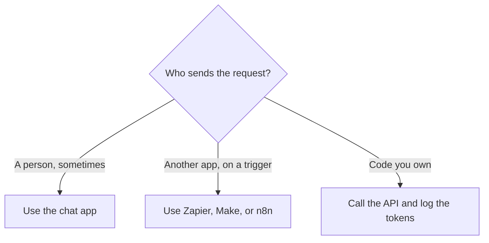

**An API is a way for software to send a request to an AI tool and receive a result, without someone typing in a chat window.** You use one when a product you are building, or a workflow that runs unattended, needs the model on a schedule or inside another app. A chat subscription is the same model behind a text box. The API is the same model behind code.

The thing the API counts is usually [a token](/blog/what-are-ai-tokens-explained-2026/). Each request is [inference](/blog/what-is-ai-inference-vs-training-2026/). The instruction you send, including a system field, is still [a prompt](/blog/what-is-prompt-engineering-2026/).

Prices are US list prices excluding tax from directory pages checked October 16, 2026. Published October 24, 2026. We did not benchmark latency.

## Chat seat, connector, or API

| You need | Use | A published price |
|---|---|---|
| A person asking questions | The chat app | [ChatGPT](/tools/chatgpt/) Plus is $20/month. Go is $8. Free exists |
| An app you already use to nudge another app | A connector such as [Zapier](/tools/zapier/) | Professional is $19.99/month billed annually, 750 tasks. Free is 100 tasks |
| Your own product calling a model | The vendor's API | [DeepSeek](/tools/deepseek/) input from $0.15 per 1 million tokens off-peak on a cache miss. Output $0.60 off-peak |
| Speech inside a product | A voice API | [ElevenLabs](/tools/elevenlabs/) Starter is $6/month for 30,000 credits, with a commercial license |
| Images from your backend | An image API | [FLUX](/tools/flux/) from $0.008 per image at 768×768 for FLUX 3 Klein. 1 credit = $0.01 |

The connector comparison is [Zapier vs Make vs n8n](/blog/zapier-vs-make-vs-n8n/). Make's Core plan starts at $9 a month billed annually at the 10,000-credit tier. n8n's cloud Starter was shown in euros, at €20 a month billed annually. This guide does not convert that euro price into dollars.

## What an API request contains

A typical text call has four parts:

| Part | Role |
|---|---|
| The endpoint and the model name | Which product and which model |
| A credential | The key. Keep it on a server, not in a front-end repo |
| The input | System rules, the user text, and sometimes a file |
| The meter | Tokens, credits, characters, or images, depending on the vendor |

When the model must use a calculator, a database, or another service, the API feature is [function calling](/blog/what-is-function-calling-in-ai-2026/). The model proposes a call. Your code runs it and sends the result back. That is a different design from pasting the whole database into the prompt. How much you can paste is the [context window](/blog/what-is-a-context-window-2026/).

ChatGPT's image API, recorded for GPT-Image-2.5 Sunburst, is $8 per 1 million image input tokens and $30 per 1 million image output tokens on standard processing. Batch is half price on that directory page. DALL·E as a separate API name was removed on May 12, 2026, according to the [ChatGPT Images directory page](/tools/dall-e/). New image calls use the GPT Image models.

ElevenLabs prices the voice API in credits on the same plans as the app. Free includes 10,000 credits a month and, on the directory page, no commercial license. Starter at $6 is the first plan that lists a commercial license. Read the license before you ship a voice feature. The plan ladder is [ElevenLabs pricing explained](/blog/elevenlabs-pricing-explained-2026/).

## When to stay in the chat box

Stay in chat when a person is the one who needs the answer and the volume is a workday. Plus at $20 can be cheaper than an API key that a script calls overnight. Move to an API when the same prompt must run inside your product, when you need a log of every call, or when finance needs a per-token forecast.

Move to Zapier when the AI step is one box in a workflow between apps you already pay for, and a non-developer owns it. Move to code when you need retries, a test, or a key that never reaches the browser. An agent product wraps the API in a job description. The definition is [what an AI agent is](/blog/what-is-an-ai-agent-2026/).

DeepSeek's chat app is free, and the API is prepaid. Peak input on a cache miss is $0.30 per 1 million tokens, and peak output is $1.20, against the off-peak figures above. Schedule batch jobs on purpose. The directory page records peak hours as 01:00–04:00 and 06:00–10:00 UTC on weekdays.

## FAQ

### Is ChatGPT an API?

ChatGPT is the app. OpenAI also sells an API. A Plus subscription does not, by itself, give your website a key. Budget the product you are actually calling.

### Do I need to be a developer to use an AI API?

You need someone who can hold a key and read a bill. A connector such as Zapier can call many AI steps without you hosting code. The moment the workflow is your product, the API is the cleaner contract.

### Why did my API bill jump?

Volume, a larger prompt, or a pricier model. Log tokens per request before you raise the plan. A system prompt that repeats on every call is a permanent surcharge. See [what a system prompt is](/blog/what-is-a-system-prompt-2026/).

### Are API prices the same worldwide?

The figures in this article are US list prices from the pages we could read, excluding tax. A vendor can show a different currency at checkout. n8n's page was in euros. Confirm the currency before you forecast a year.

## Last verified

October 16, 2026. Published October 24, 2026.

**Sources:** [DeepSeek API pricing](https://api-docs.deepseek.com/quick_start/pricing/), [OpenAI ChatGPT pricing](https://openai.com/chatgpt/pricing/), [ElevenLabs pricing](https://elevenlabs.io/pricing), [Zapier pricing](https://zapier.com/pricing).

*Published by Andrew for [AI Tools Optimizer](https://aitoolsoptimizer.com).*

[ChatGPT](/tools/chatgpt/) is in the [chatbots directory](/tools/category/chatbots-assistants/). [Zapier](/tools/zapier/) is in the [automation directory](/tools/category/automation-agents/). Directory pages may use affiliate links. A purchase through them may earn us a commission at no extra cost to you.
