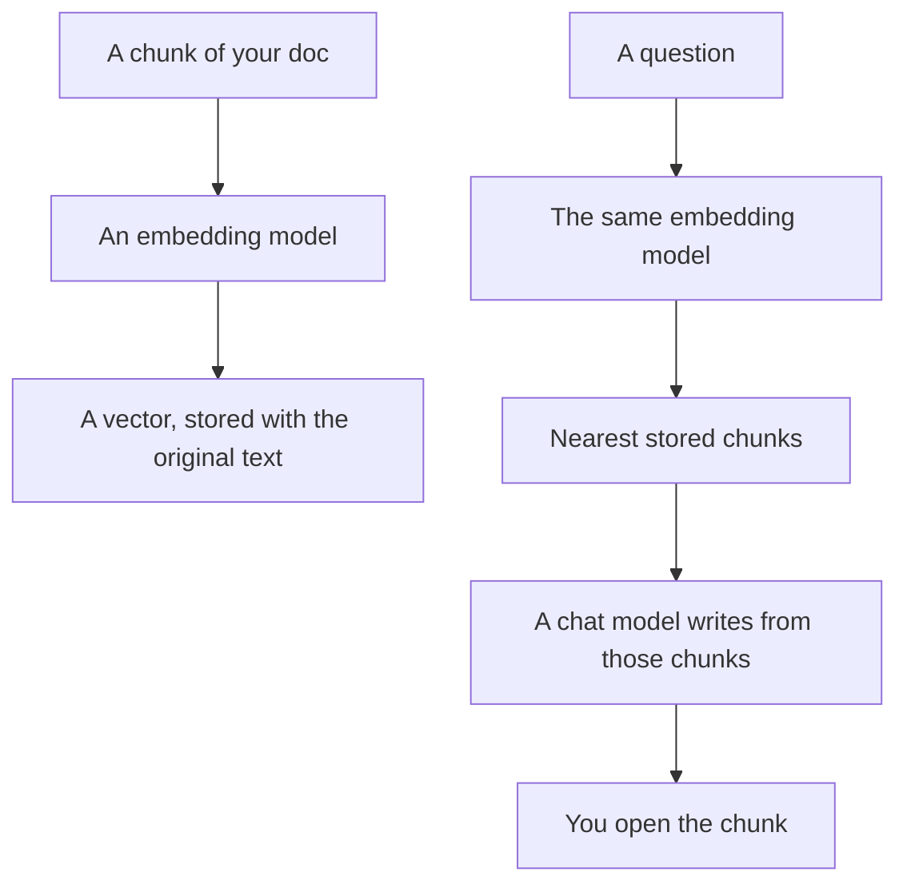

**An embedding model is a model whose job is to turn text into a list of numbers, so other software can search by similarity.** It does not write the answer. A chat model writes. A vector database stores the lists. The embedding model is the piece in the middle, and most products in this directory hide it.

The list of numbers itself is [what embeddings are](/blog/what-is-embeddings-in-ai-2026/). The store is [what a vector database is](/blog/what-is-a-vector-database-2026/). The loop that retrieves and then writes is [what RAG is](/blog/what-is-rag-explained-2026/).

This page does not name a dimension count or a price per vector. The directory does not record a standalone embedding-API rate. Prices below are for products that embed for you. They are US list prices excluding tax from directory pages checked October 16, 2026. Published October 24, 2026.

## Three pieces people collapse into one

| Piece | What it returns | What you pay for, in this directory |
|---|---|---|
| An embedding model | A vector for a chunk or a question | Not listed as its own seat |
| A vector store | The vectors, plus the original text | Often hidden inside the product |
| A chat or answer model | A paragraph | The seat or the message credits you actually buy |
| Keyword search | Exact matches | Still useful for IDs, SKUs, and error strings |
| A reranker | A new order of candidates | A step this directory does not price separately |

Use the same embedding model for the documents and the questions. Mixing two models' vectors in one index is a silent failure: the neighbors stop meaning "similar." If you change models, re-embed the corpus. Keep the original text attached. A neighbor without the sentence is not something you can verify.

The chat model can still misread a chunk it was handed. Retrieval is not grounding until you can open the passage. That requirement is [what AI grounding is](/blog/what-is-ai-grounding-2026/).

## Products that hide the embedding model

You do not have to call an embedding model to get this behavior.

[Chatbase](/tools/chatbase/) trains an agent on sources you upload. Hobby is $32 a month billed yearly, or $40 monthly, for 700 message credits. You are buying answers against that corpus. You are not picking a vector size. The build is [how to build a knowledge-base chatbot](/blog/how-to-build-a-knowledge-base-chatbot-2026/). If the corpus is a docs folder rather than a help center, the cousin workflow is [how to build an FAQ chatbot from docs](/blog/how-to-build-an-faq-chatbot-from-docs-2026/).

[Perplexity](/tools/perplexity/) searches and cites. Pro is $17 a month billed annually. The search stack is theirs. Your job is to open the citation. The product page is [Perplexity review](/blog/perplexity-review-2026/).

[Gemini Notebook](/tools/gemini-notebook/) answers from files you upload. It is free with a Google account. Google AI Plus is $4.99 a month. You never see the embedding call. You see a citation into your file, and you should click it. The long-document map is [Claude vs Gemini for long documents](/blog/claude-vs-gemini-for-long-documents-2026/).

[Notion AI](/tools/notion-ai/) Business is $20 a seat a month and can search the workspace and connected apps. Plus at $10 is not the full AI tier. If the pages are stale, the nearest page is a stale answer. The card is [Notion AI pricing explained](/blog/notion-ai-pricing-explained-2026/).

[Elicit](/tools/elicit/) searches papers. Free includes unlimited paper search and chat with papers. Plus is $11 a user a month billed annually. The "model" you experience is paper search, not a vector you store.

## When you would call an embedding model yourself

Call one when you are building the search, not buying it. You chunk the docs, you store the vectors, you embed the question, you pass the nearest chunks to a chat model. That is a product you now operate. The directory does not list a recommended embedding vendor or a rate for that call. Use the API card you will actually sign, and re-check it. Do not copy a price from a chat model's seat.

Keyword search stays in the design. An order ID, a function name, and a statute number want an exact match. An embedding model is a poor index for those strings. Use both.

A smaller chat model does not replace an embedding model. Quantizing a generator changes how weights are stored. It does not build an index. The definition is [what quantization is](/blog/what-is-quantization-in-ai-2026/).

## FAQ

### Is an embedding model a kind of LLM?

It is a model trained to place texts near each other. It is not the model you ask for a paragraph. Some families ship both. The job you call is what matters. Asking an embedding endpoint to "summarize this" is the wrong endpoint.

### Do I need one for ChatGPT?

No. [ChatGPT](/tools/chatgpt/) Plus at $20 answers from the conversation and the tools on that plan. You need an embedding model when you are building retrieval over a corpus the chat product does not already index for you.

### What chunk size should I use?

This page will not give you one. Chunks that split a procedure in half retrieve half a procedure. Test the questions you actually ask, including the ones with exact strings. The eval habit is [what AI eval testing is](/blog/what-is-ai-eval-testing-2026/).

### Can two embedding models share an index?

Not usefully. Rebuild the index when you change the model. Keep a note of which model wrote the vectors. A silent swap is how search "gets worse" with no prompt change to blame.

## Last verified

October 16, 2026 for Chatbase, Perplexity, Gemini, Notion, Elicit, and ChatGPT prices named above. Published October 24, 2026. The directory still does not list a standalone embedding-API price.

**Sources:** [Chatbase pricing](https://www.chatbase.co/pricing), [Notion pricing](https://www.notion.com/pricing), [Perplexity](https://www.perplexity.ai/).

*Published by Andrew for [AI Tools Optimizer](https://aitoolsoptimizer.com).*

[Chatbase](/tools/chatbase/) is in the [customer support directory](/tools/category/customer-support/). Directory pages may use affiliate links. A purchase through them may earn us a commission at no extra cost to you.
