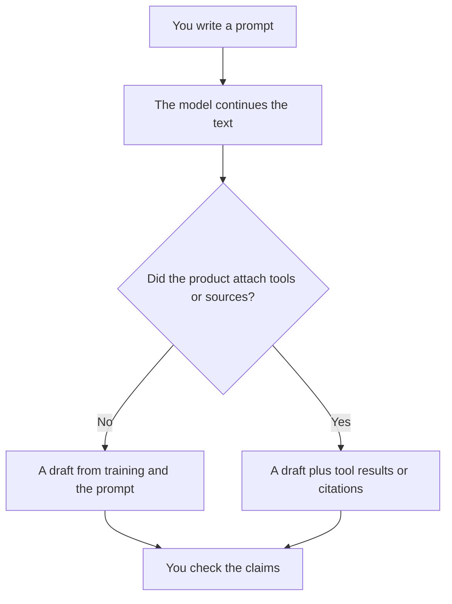

**A large language model, an LLM, is a model trained to continue text.** You give it a prompt. It produces the next tokens. Chat is that mechanism with a product around it: memory, file upload, tools, and a usage cap. The model does not look up your files unless the product retrieves them or you paste them.

That is why an LLM can draft a clear paragraph and still invent a citation. Fluency is the training goal. Truth is a separate check. When the check is "open the source," you want retrieval, which is [what RAG is](/blog/what-is-rag-explained-2026/).

Prices are US list prices excluding tax from directory pages checked October 16, 2026. This page does not rank models.

## What the product adds around the model

| Layer | What you experience | A directory example |
|---|---|---|
| The model | Text in, text out | The assistant behind [ChatGPT](/tools/chatgpt/), [Claude](/tools/claude/), or [Gemini](/tools/gemini/) |
| The chat plan | A seat, a usage cap, apps and files | ChatGPT Plus $20/month. Claude Pro $20, or $17 billed annually. Google AI Plus $4.99 |
| Tools | The model can call search, code, or an action | See [what function calling is](/blog/what-is-function-calling-in-ai-2026/) |
| Retrieval | The answer is supposed to come from passages | [Perplexity](/tools/perplexity/) Pro is $17/month billed annually |
| An API | You pay for [tokens](/blog/what-are-ai-tokens-explained-2026/) | [DeepSeek](/tools/deepseek/) publishes a per-million-token rate. The chat app is free |

The three general assistants are compared as products in [ChatGPT vs Gemini vs Claude](/blog/chatgpt-vs-gemini-vs-claude-2026/). A wider shortlist is [ChatGPT alternatives](/blog/chatgpt-alternatives-2026/).

## What an LLM is good at, in this directory

**A first draft from notes you supply.** Claude and ChatGPT are the usual seats. The writing split is [ChatGPT vs Claude for writing](/blog/chatgpt-vs-claude-for-writing-2026/). You remain the author of any claim a client will rely on.

**A transformation with a format.** Turn these bullets into a table. Shorten this to 120 words. Extract dates. The instruction pattern is [what prompt engineering is](/blog/what-is-prompt-engineering-2026/).

**Code, when a coding product selects the files.** That is still an LLM, with a repository in reach. The editor choice is [Cursor vs Claude Code vs Codex](/blog/cursor-vs-claude-code-vs-codex-2026/).

**Answers inside a corpus, when retrieval is real.** Perplexity for the public web. [Consensus](/tools/consensus/) and [Elicit](/tools/elicit/) for papers. [Gemini Notebook](/tools/gemini-notebook/) for files you upload. The model is still generating the sentences. The sentences are supposed to stay inside the passages.

[Mistral Vibe](/tools/mistral-vibe/) is another assistant with a published seat: Pro is $14.99/month excluding tax, with a free plan. The directory page records that price. It is an option when you want a separate vendor, not a score over the others.

## What the acronym does not guarantee

An LLM does not know what changed this morning unless the product searched or you pasted it. It does not have your unshared files. It does not become reliable because the reply is long. A larger context window lets you attach more text. It does not check that text. The limit is [what a context window is](/blog/what-is-a-context-window-2026/).

A model that accepts images or audio as well as text is still often called an LLM in product copy, or a multimodal model. The distinction is [what multimodal AI is](/blog/what-is-multimodal-ai-2026/).

Training a further copy on your examples is [fine-tuning](/blog/what-is-fine-tuning-ai-2026/). Most people using ChatGPT or Claude are not fine-tuning anything. They are prompting a hosted model.

## FAQ

### Is ChatGPT the same thing as an LLM?

ChatGPT is a product. An LLM is the kind of model behind the reply. The product adds plans, tools, and limits. Plus is $20/month on the directory page checked October 16, 2026.

### Is Gemini an LLM?

Gemini is Google's assistant, built on Google's models, with a free tier and paid Google AI plans. Plus is $4.99/month. Calling it an LLM describes the text model. The product also generates images and, on paid plans, video.

### Do I need to know the model name?

Only when the plan or the API prices models differently. For a chat seat, the plan name (Free, Plus, Pro) changes your allowance. The model picker matters when you are choosing a slower, more expensive mode on purpose.

### Can an LLM cite sources?

The model can print a citation-shaped string. A product that retrieves pages can attach real links. Open the link. The failure when the string is invented is [what an AI hallucination is](/blog/what-is-ai-hallucination-2026/).

## Last verified

October 16, 2026 for plan prices. Published October 24, 2026.

**Sources:** [OpenAI ChatGPT pricing](https://openai.com/chatgpt/pricing/), [Claude pricing](https://claude.com/pricing), [Google Gemini](https://gemini.google.com/).

*Published by Andrew for [AI Tools Optimizer](https://aitoolsoptimizer.com).*

[ChatGPT](/tools/chatgpt/), [Claude](/tools/claude/), and [Gemini](/tools/gemini/) are in the [chatbots directory](/tools/category/chatbots-assistants/). Directory pages may use affiliate links. A purchase through them may earn us a commission at no extra cost to you.
