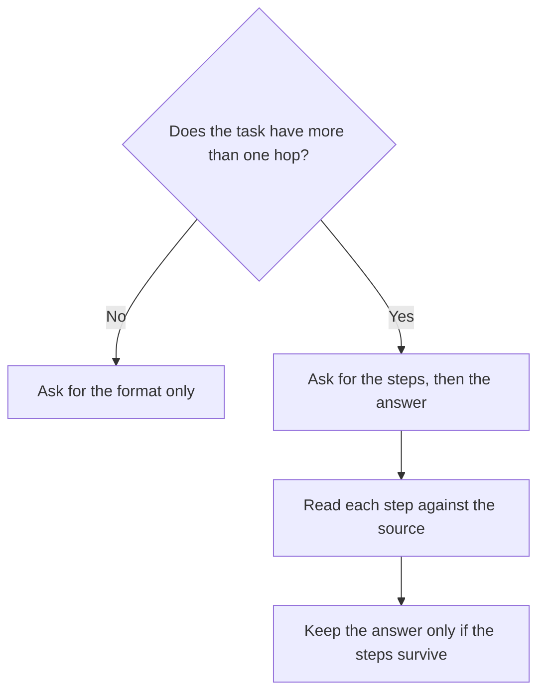

**Chain-of-thought prompting asks the model to write the intermediate steps before the final answer.** You do it when the task has more than one hop and a person will read the hops. A step that sounds orderly is still a sentence you can check. It is a method for your review, and it is a weak substitute for a source.

The phrase covers two habits. One is your instruction: "show the calculation, then the number." The other is a product's hidden reasoning, which you may or may not see. This article is about the instruction you write. The general craft is [what prompt engineering is](/blog/what-is-prompt-engineering-2026/).

Prices are US list prices excluding tax from directory pages checked October 16, 2026, and from the October 24, 2026 Perplexity pricing article where noted. Published October 24, 2026.

## When the steps earn their tokens

| Task | Ask for steps | Skip the steps |
|---|---|---|
| A price, a date, or a count from a file you pasted | Yes. Require the line it used | When you only need a rewrite of one sentence |
| A decision with two constraints | Yes. Name both constraints and ask it to test each | When you already decided and want a cleaner paragraph |
| A fact that must come from the web | The step is the link, opened by you | A private chain of thought with no citation |
| A poem, a headline, a tone pass | The steps rarely change the line | Write the constraint in one sentence |

Asking with no example at all is [what zero-shot prompting is](/blog/what-is-zero-shot-prompting-2026/). You can combine them: zero examples, plus a request to show the work. You can also show one solved problem and ask it to follow that shape. The second version spends more tokens. The meter is [what AI tokens are](/blog/what-are-ai-tokens-explained-2026/).

## What to write

A usable chain-of-thought instruction names the hops. "Think step by step" leaves the hops up to the model. Prefer:

"From these notes only: list the two options, the cost of each as written in the notes, and the constraint each one violates. Then recommend one. If a cost is absent, write 'not in the notes.'"

That prompt forces a structure you can audit. A hidden scratchpad you never see cannot be audited. If a product offers a reasoning mode, use it when you can open the trace or when the final answer cites a line. The standing rules around the prompt are [what a system prompt is](/blog/what-is-a-system-prompt-2026/).

| Product | What you are buying | Price to know |
|---|---|---|
| [Claude](/tools/claude/) | A draft with the steps in the reply, on the same plan as any other chat | Pro is $20/month, or $17 billed annually |
| [ChatGPT](/tools/chatgpt/) | The same habit inside ChatGPT | Plus is $20/month. Go is $8 |
| [Perplexity](/tools/perplexity/) | Steps that should end in a citation you open | Pro is $17/month billed annually |
| [Consensus](/tools/consensus/) | A paper question, where the "step" is the paper | Pro is $12/month on the directory page |

Perplexity's ladder is [Perplexity pricing explained](/blog/perplexity-pricing-explained-2026/). Research steps that start from citations are [how to use Perplexity for market research](/blog/how-to-use-perplexity-for-market-research-2026/). Consensus is for papers, and the paired workflow is [how to research with Elicit and Consensus](/blog/how-to-research-with-elicit-and-consensus-2026/).

## Where chain-of-thought fails in a familiar way

**The steps cite a number that was never in the source.** The chain looks rigorous and the input was incomplete. The fix is the boundary, plus your read of the source. That failure is [what an AI hallucination is](/blog/what-is-ai-hallucination-2026/).

**The steps are performed on a creative task.** A headline does not get better because the model narrated three moods. State the audience and the offer.

**The steps are too long to read, so nobody reads them.** Cap the trace: three bullets, then the answer. A chain nobody checks is decoration. How much variation the model is allowed in the wording is [what temperature is](/blog/what-is-temperature-in-ai-models-2026/). Lower temperature is the closer match to a calculation. It still needs the source.

**The steps replace a tool.** Arithmetic on a large sheet belongs in the sheet. A model can explain a formula. The formula should run where the numbers live. The spreadsheet guide is [best AI for Excel and Google Sheets](/blog/best-ai-for-excel-and-google-sheets-2026/).

## FAQ

### Does chain-of-thought make a model more accurate?

It makes some multi-step answers easier to audit, and it gives the model room to do a hop it would otherwise skip. It does not create a missing source. Treat an unaudited chain as an unverified answer.

### Should I pay for a "reasoning" model to get chain-of-thought?

Pay for a higher plan when the usage cap, or a feature on that plan, blocks work you already do. A reasoning trace you cannot read is a vendor choice. Your instruction to show the steps works on ordinary chat plans, including free tiers, until the cap stops you.

### Is this the same as the model "thinking" in the product?

Products sometimes run extra inference before the visible answer. Your prompt can also ask for visible steps. Those are different controls. Use the visible steps when a person must sign the result.

### How is this different from an agent?

An agent takes actions across steps and tools. Chain-of-thought is text before an answer. The agent definition is [what an AI agent is](/blog/what-is-an-ai-agent-2026/).

## Last verified

October 16, 2026 for Claude, ChatGPT, and Consensus prices. Perplexity Pro at $17 a month billed annually is also recorded in the October 24, 2026 pricing article. Published October 24, 2026.

**Sources:** [Claude pricing](https://claude.com/pricing), [OpenAI ChatGPT pricing](https://openai.com/chatgpt/pricing/), [Perplexity pricing](https://www.perplexity.ai/pro).

*Published by Andrew for [AI Tools Optimizer](https://aitoolsoptimizer.com).*

[Claude](/tools/claude/) and [ChatGPT](/tools/chatgpt/) are in the [chatbots directory](/tools/category/chatbots-assistants/). [Perplexity](/tools/perplexity/) is in the [research directory](/tools/category/research-search/). Directory pages may use affiliate links. A purchase through them may earn us a commission at no extra cost to you.
