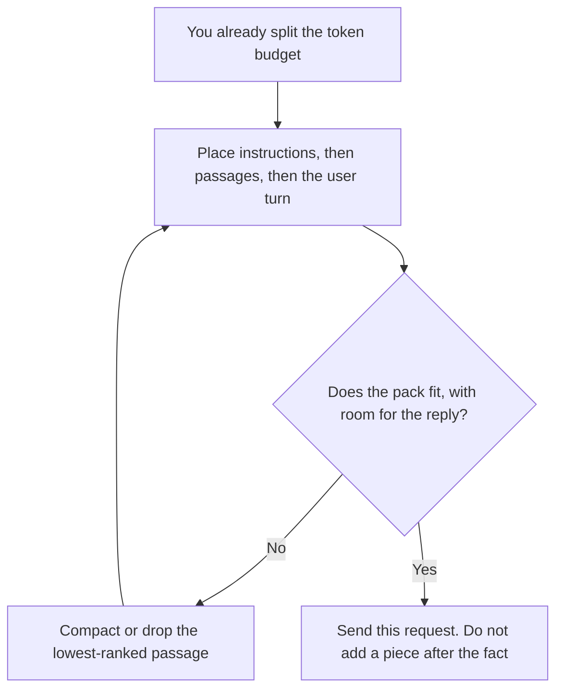

**Context packing is the ordered assembly of one request: which instructions, which passages, and which user turn you place in the window, and which pieces you leave out.** The window is the limit. The budget is how you split that limit. Packing is the list you actually send, in the order you send it. A packed request that includes a secret the user should not see, or a passage that contradicts the instruction, failed before the model wrote a word.

The limit itself is [what a context window is](/blog/what-is-a-context-window-2026/). The split across instructions, retrieval, history, and the reply is [what token budgeting is](/blog/what-is-token-budgeting-2026/). Shrinking a piece so it fits the split is [what prompt compaction is](/blog/what-is-prompt-compaction-2026/). A repeated prefix you hope to reuse is [what a context cache is](/blog/what-is-a-context-cache-2026/).

Prices are US list prices excluding tax from directory pages checked October 16, 2026. Published October 24, 2026. This page does not invent a token limit for any chat plan. We did not score which pack produces a better answer.

## The order that should be deliberate

| Slot | What you put there | Leave it out when |
|---|---|---|
| Instructions | The task, the refusals, the output shape | The instruction is a secret policy the user is not allowed to receive back |
| Tool list | The tools this request may call | This request should not call tools |
| Passages | The few chunks you already ranked | The chunk is stale, or it is another customer's |
| History | The turns this task still needs | The thread is long and the budget says to compact |
| User turn | The message you are answering | You are answering a different question than they asked |
| Room for the reply | Empty space you reserved | The pack filled the window and the answer will be cut off |

Several calls, each with its own pack and a check between them, are [what prompt chaining is](/blog/what-is-prompt-chaining-2026/). Packing is inside one call. Chaining is the sequence of calls. A second pass that reorders passages before you pack them is [what retrieval reranking is](/blog/what-is-retrieval-reranking-2026/).

## Where the pack is decided

**A long handbook in a Project.** [Claude](/tools/claude/) Pro is $20 a month, or $17 billed annually. The Project can hold the handbook. The request still needs a pack: the pages that matter for this question, not the entire handbook, unless the budget says the handbook fits. The review is [Claude review](/blog/claude-review-2026/).

**A reusable template.** [ChatGPT](/tools/chatgpt/) Plus at $20 a month, when the instructions are stable and the user pastes the source. Plus includes projects on the directory card. The review is [ChatGPT review](/blog/chatgpt-review-2026/).

**Notes that already live in Google.** [Gemini](/tools/gemini/) on the Google AI Pro plan at $19.99 a month lists Gemini in Docs. Pack the doc you mean. Do not assume the plan pulls every file in the account into the request. The review is [Gemini review](/blog/gemini-review-2026/).

**The source page.** [Notion AI](/tools/notion-ai/) Business is $20 a seat a month when the passage should be a wiki page with an owner, not a chat scroll. The page is the record. The pack cites it.

The hidden instruction slot is [what a system prompt is](/blog/what-is-a-system-prompt-2026/). Packing does not make that slot a place to hide a policy you have not written down. If the instruction matters, it has an owner outside the request.

## What a bad pack looks like

The pack includes two passages that disagree, and no line that says which one wins. The pack includes the full thread after the budget said to keep the last decision only. The pack includes another tenant's text because the retrieval filter was missing. That last failure is [what AI multi-tenancy is](/blog/what-is-ai-multi-tenancy-2026/). The fix is to drop the passage, not to ask the model to ignore it.

## FAQ

### Is packing the same as stuffing the window?

Stuffing is what happens when every available piece goes in until the limit. Packing is the choice of a short list, in an order, under a budget that still leaves room for the reply. A full window is not a better pack.

### Should instructions come first?

On this page, yes: the task and the refusals sit before the passages, so a long passage does not crowd them out of the budget. If your provider's API documents a different required order, follow that. The point is that the order is chosen, not accidental.

### Can compaction replace packing?

Compaction shrinks a piece that is already selected. Packing decides whether the piece is selected. Compact a passage you intend to keep. Drop a passage you should not have included.

### Does a cache change the pack?

A cache may make a repeated prefix cheaper to send again. It does not choose the prefix. If the cached block contains a stale policy, you are cheaply repeating a wrong instruction. Decide the pack, then consider the cache.

## Last verified

October 16, 2026 for Claude, ChatGPT, Gemini, and Notion AI. Published October 24, 2026.

**Sources:** [Claude pricing](https://claude.com/pricing), [ChatGPT pricing](https://chatgpt.com/pricing/), [Gemini subscriptions](https://gemini.google/subscriptions/), [Notion pricing](https://www.notion.com/pricing).

*Published by Andrew for [AI Tools Optimizer](https://aitoolsoptimizer.com).*

[Claude](/tools/claude/) is in the [chatbots and assistants directory](/tools/category/chatbots-assistants/). Directory pages may use affiliate links. A purchase through them may earn us a commission at no extra cost to you.
