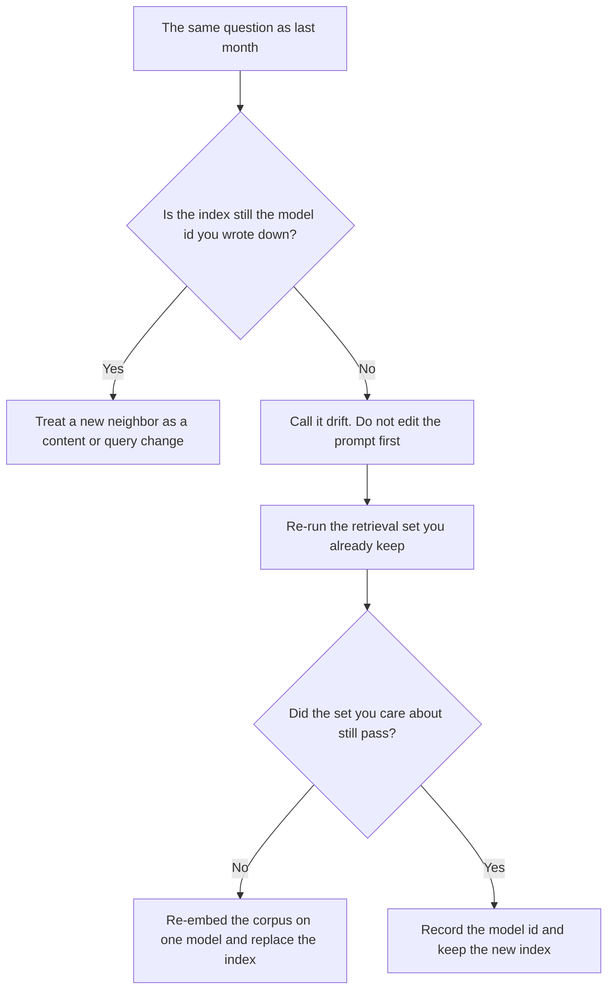

**Embedding drift is a change in which passages a search returns for the same question, after you change the embedding model, the way you cut the text, or the index, even though the source documents did not change.** The words on the page are stable. The numeric fingerprint is not. A neighbor that was first last month can fall off the list. If you do not date the model that built the index, you will "fix" the prompt for a retrieval change.

The fingerprint itself is [what embeddings are](/blog/what-is-embeddings-in-ai-2026/). The store is [what a vector database is](/blog/what-is-a-vector-database-2026/). Answering from the passages you fetched is [what RAG is](/blog/what-is-rag-explained-2026/). Whether you fetched the right pages is [what retrieval evaluation is](/blog/what-is-retrieval-evaluation-2026/).

Prices are US list prices excluding tax from directory pages checked October 16, 2026. Published October 24, 2026. The directory does not list an embedding-model fee, so this page does not invent one. We did not measure neighbor overlap for any vendor.

## What moved, and what did not

| What changed | What the user sees | What did not change |
|---|---|---|
| A new embedding model id on the same corpus | Different passages in the top results | The source files |
| A new chunk size or a new cleanup step | A hit that starts mid-sentence, or a hit that used to be one paragraph | The question |
| A partial re-index, so old and new vectors share one index | A mix of neighbors from two fingerprint schemes | Your prompt text |
| The documents themselves | A real content change. That is not drift | The model id |

A prompt tweak can hide drift for one question and worsen the next. The comparison to the last passing retrieval run belongs with [what prompt regression testing is](/blog/what-is-prompt-regression-testing-2026/). A scored recipe for the answers, once the passages are right, is [what RAGAS evaluation is](/blog/what-is-ragas-evaluation-2026/).

## What to write on the index

**The model id and the date.** "Embedded on this date with this model name." If the vendor renames the model, the index is a new index. Two names in one index is how drift hides inside a single search.

**The chunk rule.** Character count, heading boundaries, and whether you dropped headers, footers, or page numbers. A PDF that loses page numbers will cite the wrong page later. The long-file habit, when you are not building an index at all, is [Claude vs Gemini for long PDFs](/blog/gemini-vs-claude-for-long-pdfs-2026/).

**The overlap you will tolerate.** You pick a rule before the swap: for this question set, the top passage may change only when a person accepts the new list. This page does not publish a percentage. Your set is the percentage.

**The rollback.** Keep the previous index until the new one passes the set. Deleting the old vectors on the same afternoon as the swap leaves you with no previous neighbor list.

## Seats that are not an index

These products do not sell you an embedding version you can pin in the way a database does. They are still where people notice a summary that no longer matches the file.

| What you run | The limit this directory recorded | Why it is not the index |
|---|---|---|
| A file in a Project | [Claude](/tools/claude/) Pro is $20 a month, or $17 billed annually | You attached a file. You did not version a vector model |
| A notebook of sources | [Gemini Notebook](/tools/gemini-notebook/) is free with a Google account. Google AI Pro at $19.99 a month is the 5x limit on that card | Citations follow the sources you uploaded. They are not a dated embedding id |
| A literature table | [Elicit](/tools/elicit/) Pro is $39 a user a month billed annually | Extraction columns are a table, not your production index |
| A place to chart a retrieval export | [Hex](/tools/hex/) Team is $75 an editor a month when you need a schedule | The notebook can count neighbors you exported. It does not embed them |
| A chat you paste into | [ChatGPT](/tools/chatgpt/) Plus is $20 a month | A paste has no index version |

Hex's schedule is [Hex pricing explained](/blog/hex-pricing-explained-2026/). Elicit's literature plans are [Elicit pricing explained](/blog/elicit-pricing-explained-2026/).

## FAQ

### Is drift the same as a stale document?

No. A stale document changed, or should have. Drift is the fingerprint changing while the document stays put. You can have both on the same day. Date them separately.

### If I only paste one PDF, can I ignore this?

Yes, for that one file. You are not searching an index. The paste limit is [what a context window is](/blog/what-is-a-context-window-2026/). Drift starts when a second process embeds the corpus for you and you keep the vectors.

### Will a better prompt fix the wrong neighbor?

It can instruct the model to say "I do not have that passage." It cannot put the old neighbor back. Restore the index, or accept the new neighbor list after you re-run the retrieval set.

### Do I re-embed every document when the model changes?

If the new model is not the one that built the index, yes, for every chunk that index serves. A mixed index is the failure mode. The cost is the vendor's embed price, which this directory does not list as a single public rate, so this page does not invent one.

## Last verified

October 16, 2026 for the seat prices named above. Published October 24, 2026. The definition does not depend on a price change.

**Sources:** [Claude pricing](https://claude.com/pricing), [Google AI subscriptions](https://gemini.google/subscriptions/), [Elicit pricing](https://elicit.com/pricing).

*Published by Andrew for [AI Tools Optimizer](https://aitoolsoptimizer.com).*

[Claude](/tools/claude/) is in the [chatbots and assistants directory](/tools/category/chatbots-assistants/). Directory pages may use affiliate links. A purchase through them may earn us a commission at no extra cost to you.
