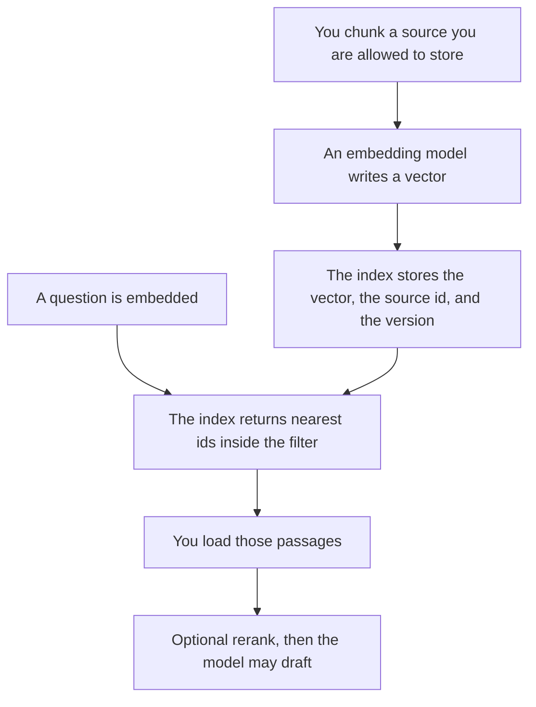

**An embedding index is the structure that stores vectors together with the identifiers you need to find the original passage.** The embedding is the list of numbers. The index is how you search those numbers, filter them, and rebuild them when the source changes. A folder of vectors with no ids is not an index. You can find a neighbor and still have nothing you are allowed to show.

The numbers themselves are [what embeddings are](/blog/what-is-embeddings-in-ai-2026/). The model that produces them is [what an embedding model is](/blog/what-is-an-embedding-model-2026/). Vectors that quietly stop matching the text you think they represent are [what embedding drift is](/blog/what-is-embedding-drift-2026/). A later step that reorders the neighbors is [what retrieval reranking is](/blog/what-is-retrieval-reranking-2026/).

Prices are US list prices excluding tax from directory pages checked October 16, 2026. Published October 24, 2026. This page does not name a dimension count or a price per vector. Those belong on the API card you would call.

## What the index has to hold

| Piece | Why you store it | If it is missing |
|---|---|---|
| The vector | So a query can be compared | You cannot search by meaning |
| The source id | So you can open the passage | You have a neighbor and no document |
| Tenant or collection | So customer A cannot retrieve customer B | One shared index without a filter is a leak |
| Version or time | So you can tell stale from current | You answer from a page you already replaced |
| Filter fields | Only fields you will actually query | A filter that never matches, and a silent empty result |

The store people buy for this is [what a vector database is](/blog/what-is-a-vector-database-2026/). The index is the contract inside it: ids, filters, and a rebuild. Freshness of the text you fetch, once the id is in hand, is [what retrieval freshness is](/blog/what-is-retrieval-freshness-2026/). An index can be fast and still point at last quarter's policy.

## Products that hide the index

You can use these without operating an index. You still have to know which corpus is in it.

**Web answers with links.** [Perplexity](/tools/perplexity/) Pro is $17 a month billed annually, on the October 16 card. Free includes limited weekly use of top models. Perplexity's index is theirs. Your job is to open the citation. A neighbor you cannot open is not a source. The habit is [Perplexity vs Elicit for citations](/blog/perplexity-vs-elicit-for-citations-2026/).

**Papers.** [Elicit](/tools/elicit/) Basic is free for unlimited paper search, on the October 16 card. Plus is $11 per user per month billed annually. The card also lists higher rates, so confirm checkout. Elicit searches a paper corpus. It is not your private wiki unless you put that wiki there and the product says so.

**A bot on your docs.** [Chatbase](/tools/chatbase/) Hobby is $32 a month billed yearly, with 700 message credits. The sources you upload are the corpus. If two customers share one bot, the index needs a tenant filter. That boundary is [what AI multi-tenancy is](/blog/what-is-ai-multi-tenancy-2026/).

**A wiki you already run.** [Notion AI](/tools/notion-ai/) Business is $20 a seat a month. Notion's search is over the pages people can already open. Permissions are the filter. An AI answer that surfaces a page the asker cannot open is an index bug, or a permissions bug. Treat it as one.

## What to rebuild

Rebuild when the embedding model changes, when you change the chunking, or when the source text changes and the version on the row is older than the source. Do not mix vectors from two models in one index and hope the distances still mean the same thing. Drift is that hope failing.

Do not embed text you are not allowed to store. The index copies it into a form that is hard for a person to read and easy for a query to retrieve. A policy that says "we do not keep customer files" and an index full of those files is a contradiction.

## FAQ

### Is the index the vector database?

The database is a product that can hold the index. The index is the rows: vectors plus the ids and filters you rely on. You can buy the database and still forget the tenant id. The purchase is not the design.

### Do we need an index if we use chat search?

For a personal seat, no. For a bot that answers from your documents, something is indexing those documents, whether you see it or not. Ask which sources are in, how a deleted page leaves, and how a second customer is excluded.

### Can we skip versions?

You can, until someone corrects a policy and the bot keeps quoting the old paragraph. The version is how you notice. Freshness is the decision to prefer the new one.

### Should the model write into the index?

Only through a job you scheduled, from sources you named. A chat reply that inserts itself as a source becomes future evidence. That loop is how a mistake becomes the corpus.

## Last verified

October 16, 2026 for Perplexity, Elicit, Chatbase, and Notion AI. No retrieval accuracy score is claimed. Published October 24, 2026.

**Sources:** [Perplexity](https://www.perplexity.ai), [Elicit](https://elicit.com), [Chatbase pricing](https://www.chatbase.co/pricing), [Notion pricing](https://www.notion.com/pricing).

*Published by Andrew for [AI Tools Optimizer](https://aitoolsoptimizer.com).*

[Perplexity](/tools/perplexity/) is in the [research and search directory](/tools/category/research-search/). Directory pages may use affiliate links. A purchase through them may earn us a commission at no extra cost to you.
