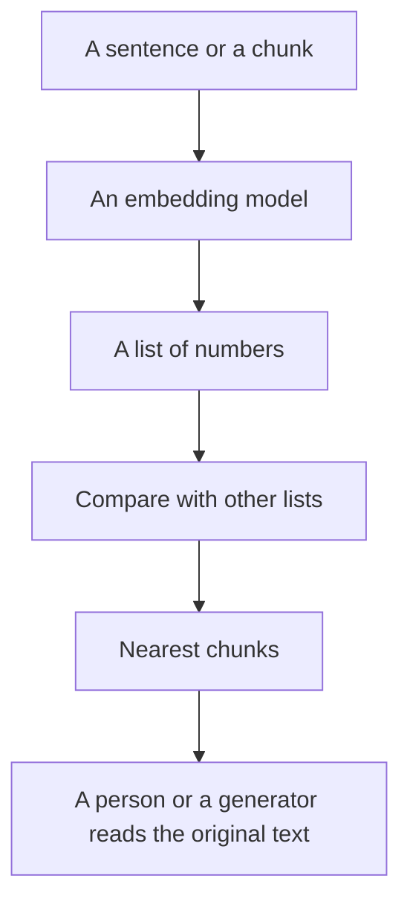

**An embedding is a list of numbers that stands in for a piece of text, so software can compare meanings instead of only matching keywords.** "Refund window" and "how long do I have to return this" can land near each other even when they share few words. That comparison is how many retrieval systems pick passages before a model writes.

The store for those numbers is [what a vector database is](/blog/what-is-a-vector-database-2026/). The full loop, retrieve then write, is [what RAG is](/blog/what-is-rag-explained-2026/). You can use both ideas without calculating a vector yourself.

This page does not publish an embedding model name, a dimension count, or a price per vector. Those belong on the API card you would actually call. Prices below are for products that already embed and search for you. They are US list prices excluding tax from directory pages checked October 16, 2026.

## What the numbers are for

| Task | How embeddings get used | What they do not do |
|---|---|---|
| Find a passage | Compare the question's embedding with stored passage embeddings | Prove the passage is correct |
| Cluster feedback | Group similar comments | Name the groups. You still read them |
| Detect near-duplicates | Flag chunks that sit very close | Decide which copy is current |
| Recommend a related doc | Surface neighbors | Replace a citation check |

The original text has to stay attached to the numbers. A nearest-neighbor hit without the sentence is not something you can verify. Keyword search still matters for exact strings: an order ID, a statute number, a product SKU. Embeddings are a poor tool for "find this exact code." Use both when the corpus has both kinds of questions.

## Products that embed so you do not have to

| You have | Use | Price to know |
|---|---|---|
| A question about the public web | [Perplexity](/tools/perplexity/) | Pro is $17/month billed annually. Free is a limited allowance. See [Perplexity pricing explained](/blog/perplexity-pricing-explained-2026/) |
| Papers | [Consensus](/tools/consensus/) or [Elicit](/tools/elicit/) | Consensus Pro is $12/month on a $144 year, or $20 monthly. Elicit Plus is $11/user/month billed annually on the non-Industry card |
| Your own files | [Gemini Notebook](/tools/gemini-notebook/) | Free with a Google account. Google AI Plus is $4.99/month |
| A help center | [Chatbase](/tools/chatbase/) | Hobby is $32/month billed yearly |
| A team wiki | [Notion AI](/tools/notion-ai/) | Business is $20/seat/month for full Notion AI |

None of these pages ask you to pick an embedding dimension. If you are building your own index, that choice is part of the build, and it is outside the prices above. The customer-facing version of "search our docs" is [how to build a chatbot with Chatbase](/blog/how-to-build-a-chatbot-with-chatbase-2026/).

A single file that fits in the prompt does not need embeddings. Paste it. The limit on pasting is the [context window](/blog/what-is-a-context-window-2026/). Embeddings earn their place when the corpus is larger than that window or changes weekly.

## Where similarity misleads

**Close is not the same claim.** Two passages about pricing can sit near each other while stating different numbers. The model must quote the passage you mean, and you must see that quote. The failure mode is [what an AI hallucination is](/blog/what-is-ai-hallucination-2026/).

**Old chunks stay near.** If you update a policy and leave the old page in the index, both embeddings can match. Delete or exclude the stale chunk. Retrieval will not notice that a date changed unless the date is in the text you stored.

**The question's wording still matters.** Embeddings are more forgiving than keywords. They are not mind reading. A question that names the product and the policy retrieves better than "what about the thing we discussed."

**You still pay for the generation.** Finding passages is one meter. Writing the answer spends [tokens](/blog/what-are-ai-tokens-explained-2026/) or a message credit. Chatbase's plans meter message credits. A free notebook still has a plan limit. Budget both steps.

## FAQ

### Are embeddings the same as tokens?

No. [Tokens](/blog/what-are-ai-tokens-explained-2026/) are the pieces of text a language model counts. An embedding is a numeric summary of a span of text, used for similarity. A passage is tokenized when a model reads it, and embedded when a search indexes it. Those are different steps.

### Do I need an embedding API to use Perplexity?

No. Perplexity searches and cites. You open the link. An embedding API is for people building their own index.

### Can embeddings search images?

Some models embed images as well as text, so a caption and a picture can be compared. That is a different model card from a text-only index. This directory's research tools above are document and web search, not an image-similarity product.

### Does a higher-priced chat plan include embeddings?

A higher plan includes more usage of that product. It does not hand you a vector index of your hard drive. Claude Pro is $20/month, or $17 billed annually. ChatGPT Plus is $20. Those are assistant seats.

## Last verified

October 16, 2026 for the product prices named above. Published October 24, 2026.

**Sources:** [Perplexity pricing](https://www.perplexity.ai/pro), [Elicit pricing](https://elicit.com/pricing), [Chatbase pricing](https://www.chatbase.co/pricing).

*Published by Andrew for [AI Tools Optimizer](https://aitoolsoptimizer.com).*

[Perplexity](/tools/perplexity/), [Consensus](/tools/consensus/), and [Elicit](/tools/elicit/) are in the [research directory](/tools/category/research-search/). Directory pages may use affiliate links. A purchase through them may earn us a commission at no extra cost to you.
