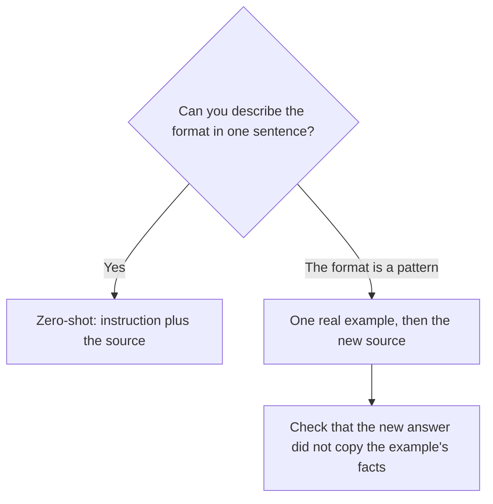

**Few-shot prompting means the prompt includes one or more finished examples, and then the new task.** The model is supposed to copy the shape of the example. "Shot" means an example. Zero examples is [zero-shot prompting](/blog/what-is-zero-shot-prompting-2026/). A handful of examples is few-shot. The examples teach a format. They do not add a fact that was never in the source.

Use few-shot when the format is easy to miss: a subject line, a support macro, a table your team already uses, a voice you can show in one paragraph. Skip it when the instruction is already unambiguous and the example would only spend tokens. The wider craft is [what prompt engineering is](/blog/what-is-prompt-engineering-2026/).

Prices are US list prices excluding tax from directory pages checked October 16, 2026. Published October 24, 2026.

## How many examples the job needs

| Job | Examples to include | Why |
|---|---|---|
| "Summarize these notes in three bullets" | Zero, if you also name the three labels | The instruction is the format |
| A subject line your team already likes | One real subject line, plus the email it came from | The pattern is easier to show than to describe |
| A support reply with a required order: empathy, fact, next step | One full reply, with the fact taken from a policy you also paste | The order is the thing people skip |
| A voice across a month of posts | A short voice card, and one on-voice paragraph you wrote | More than three examples usually repeats itself. Store the voice if a second writer needs it |
| A calculation | Zero examples, and a request to show the steps | The steps are [chain-of-thought prompting](/blog/what-is-chain-of-thought-prompting-2026/). An example of arithmetic helps less than the source numbers |

Examples are tokens. The meter is [what AI tokens are](/blog/what-are-ai-tokens-explained-2026/). Three long essays as "examples" can crowd out the source. Prefer one short example that shows the shape, then the full source for the new task.

## What a usable example contains

A usable example has three parts: the input, the output, and nothing else the model might treat as a fact about the new task. Label them.

"Example input: a customer asks for a refund on an opened item. Example output: one sentence acknowledging the request, one sentence quoting the 30-day policy, one sentence naming the next step. Now do the same for the ticket below. Use only the policy in the ticket. If the policy is silent, say so."

That is few-shot. "Write it like a friendly brand" is a mood. The example is the friendly brand, in words you already approved.

| Where the example lives | When to put it there | Price to know |
|---|---|---|
| In the prompt, once | A format you will use a few times | [Claude](/tools/claude/) Pro is $20/month, or $17 billed annually. [ChatGPT](/tools/chatgpt/) Plus is $20. [Gemini](/tools/gemini/) on Google AI Plus is $4.99 |
| In a saved prompt or a project | The same format every week | ChatGPT Plus lists projects. You still paste the new source each time |
| In a brand product | Two writers must match a stored voice | [Jasper](/tools/jasper/) Pro is $59/seat/month billed yearly, with two Brand Voices |

Jasper is the point where the example has graduated into a system. The switch guide is [Jasper alternatives](/blog/jasper-alternatives-2026/). Building the card the example comes from is [how to create a brand voice with AI](/blog/how-to-create-a-brand-voice-with-ai-2026/).

## Where few-shot copies the wrong thing

**The example's facts leak into the new answer.** Your sample refund reply mentioned a blue jacket. The new ticket is about a lamp, and the draft still says jacket. State that the example's nouns are not facts about the new task. Then read the draft for those nouns.

**The example is better than anything you will check.** A polished sample teaches polish, and it also teaches claims you did not mean to standardize. Use an example you would sign, with the cautious sentences included.

**You add examples instead of the source.** Five on-brand paragraphs and no policy still produce an on-brand invention. The source has to be in the prompt. The format lesson is the example. The truth is the source.

**You pay for a brand platform to store one example.** One writer, one format, one prompt: keep it in the chat you already pay for. Move the example into Jasper when a second person cannot find the prompt, or when the voice has to be administered.

## FAQ

### How many shots is "few"?

One to three is the useful range for a format. Past that, you are often repeating the same shape and spending tokens. If you need dozens of examples, you are describing a dataset, which is a different project from a prompt.

### Is few-shot the same as fine-tuning?

No. Few-shot puts examples in the prompt for this run. Fine-tuning changes the model with a training job. Start with the prompt. The training version is [what fine-tuning is](/blog/what-is-fine-tuning-ai-2026/).

### Does a better model need fewer examples?

Often, yes, for ordinary formats. A clearer model still misses a house style it has never seen. Show the style when the style matters, including on a strong model.

### Can the example be in another language?

Yes, if the output should follow that language's pattern. Label the language you want for the new task. An English example plus a request for Spanish is a translation task wearing a format task. Say which one you want.

## Last verified

October 16, 2026 for Claude, ChatGPT, Gemini, and Jasper prices. Published October 24, 2026.

**Sources:** [Claude pricing](https://claude.com/pricing), [OpenAI ChatGPT pricing](https://openai.com/chatgpt/pricing/), [Jasper pricing](https://www.jasper.ai/pricing).

*Published by Andrew for [AI Tools Optimizer](https://aitoolsoptimizer.com).*

[Claude](/tools/claude/) and [ChatGPT](/tools/chatgpt/) are in the [chatbots directory](/tools/category/chatbots-assistants/). [Jasper](/tools/jasper/) is in the [writing directory](/tools/category/writing/). Directory pages may use affiliate links. A purchase through them may earn us a commission at no extra cost to you.
