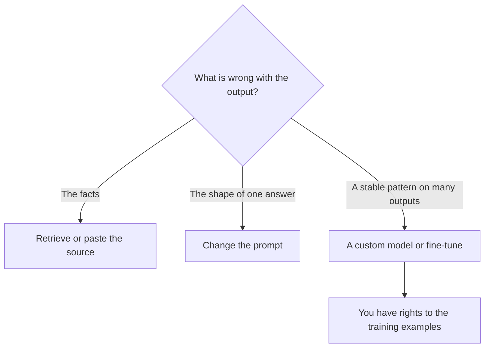

**Fine-tuning means you train a model further on your own examples so a pattern becomes the default.** The pattern might be a visual style, a voice, or a way of formatting answers. It is a training job. It is not a longer prompt, and it is not a search over your documents.

Most teams never need it. A prompt with two examples fixes a format. Retrieval fixes a fact that lives in a file. Fine-tuning is the expensive option you consider when the same behavior has to show up across a large number of calls, the examples are stable, and prompting has already failed in a way you can describe.

We do not publish a recipe, a learning rate, or a dataset size. Those belong in the vendor's current training docs. This page is the buying decision. Prices are US list prices excluding tax from directory pages checked October 16, 2026.

## Three ways to change what the model does

| You need | Do this | Why |
|---|---|---|
| A different tone on this draft | Prompt, or paste a short sample | No training job. You can change the instruction tomorrow |
| Answers that follow a document which changes | Retrieval. See [what RAG is](/blog/what-is-rag-explained-2026/) | The document stays the source. A tuned model would freeze an old copy |
| The same house style, character, or voice on a large volume of outputs | Fine-tuning, or the product's "custom model" feature | The examples become weights, not a paragraph you resend |
| One image that looks like a reference | A reference or a style control inside the generator | That is conditioning at generation time. It is not the same bill as training |

A coding model you steer with a repository is still mostly context, not fine-tuning. The tool choice is [Cursor vs Claude Code vs Codex](/blog/cursor-vs-claude-code-vs-codex-2026/). [Claude](/tools/claude/) Pro at $20 a month, or $17 billed annually, and [ChatGPT](/tools/chatgpt/) Plus at $20 a month are the everyday seats. Neither price is a fine-tuning product.

## Where this directory already sells a custom model

These are product features with published prices. They are not a claim that the training method is identical.

| Product | What you customize | Price signal recorded October 16, 2026 |
|---|---|---|
| [Leonardo.Ai](/tools/leonardo-ai/) | Personal models trained on your images | Premium is $30/month for unlimited relaxed images on select models. Ultimate is $60/month and lists a higher personal-model allowance |
| [Krea](/tools/krea/) | LoRA-style training inside a multi-model app | Paid plans include a commercial license. Pro is $35/month or $21/month billed yearly |
| [Adobe Firefly](/tools/adobe-firefly/) | A custom model on your assets | The tool page records 500 credits per training and 20 credits per generation. Standard is $9.99/month with 2,000 credits |
| [ElevenLabs](/tools/elevenlabs/) | A voice, which is a custom voice model, not a text model | Professional voice cloning starts on Creator at $22/month. Starter at $6/month is the first plan with a commercial license |
| [FLUX](/tools/flux/) | Open weights you can run yourself, under a separate license from the API | API images start at $0.008 for FLUX 3 Klein at 768×768. One credit is $0.01. There is no seat fee |

The image decision among look, trained model, and a per-image API is [Midjourney vs Leonardo vs FLUX](/blog/midjourney-vs-leonardo-vs-flux-2026/). Krea as the app around many models is [Krea review](/blog/krea-review-2026/). Firefly's credit split is [Adobe Firefly review](/blog/adobe-firefly-review-2026/). Voice cloning steps, including consent, are [how to clone a voice with ElevenLabs](/blog/how-to-clone-a-voice-with-elevenlabs/). The credit ladder is [ElevenLabs pricing explained](/blog/elevenlabs-pricing-explained-2026/).

## When fine-tuning is the wrong project

- **The facts change.** Prices, policies, and headlines belong in a document the system can retrieve. A tuned model will repeat the fact you trained.
- **You have ten examples and a deadline this week.** Prompt with the examples. Training data that small is a style guide, not a dataset.
- **You do not have rights to the examples.** A client's photos, a private voice, or scraped work are a legal problem before they are a technical one. Firefly's pitch is licensed training data for its own models. Your custom model is only as clean as the assets you upload.
- **You wanted a chatbot that knows the wiki.** That is retrieval. [Chatbase](/tools/chatbase/) and [Notion AI](/tools/notion-ai/) are productized versions. See [what an AI agent is](/blog/what-is-an-ai-agent-2026/) if the next step is actions, not just answers.
- **You wanted higher quality in general.** Fine-tuning on random good answers does not mint a smarter base model. It biases the model toward your set.

Leonardo is the directory tool aimed at a character or product look you need again next month. Ultimate's personal-model count is the constraint the plan comparison describes. Buy it when you are training, not when you liked one generation.

Krea's paid commercial license is a plan feature. Free includes 100 compute units a day and does not include that license. If the output is client work, the license line matters as much as the training toggle.

Firefly's 500-credit training cost is 25% of a Standard month before you have generated anything. Pro at $19.99 a month includes 4,000 credits. Budget the training and the generations as two lines.

## FAQ

### Is fine-tuning the same as training an AI from scratch?

No. Fine-tuning starts from a model that already exists and continues training on your examples. Training from scratch is a lab-scale project. The products above are the small, productized version.

### Can I fine-tune ChatGPT or Claude from the chat window?

The chat window is prompting. Custom model training, if the vendor offers it, is a separate product with its own docs and its own bill. We are not quoting an API training price here, because the pages this article relies on do not print one we should copy into a table.

### Is a custom image model fine-tuning?

In the buying sense, yes: you supply examples and the tool produces a model that favors them. The vendor may call it a custom model, a LoRA, or personal training. Read that vendor's license before the outputs go to a client.

### Should a small team fine-tune a writing model?

Start with a prompt and a style sample in [Claude](/tools/claude/) or [ChatGPT](/tools/chatgpt/). Move to a stored brand system, such as [Jasper](/tools/jasper/), when several people must sound the same. The comparison is [Jasper vs Copy.ai vs Writesonic](/blog/jasper-vs-copy-ai-vs-writesonic-2026/). Fine-tuning is later, and only if that stack still fails in a way examples would fix.

## Last verified

October 16, 2026 for the prices and the Firefly training credit figures. Published October 24, 2026. Training availability changes. Confirm the custom-model control inside the product before you upload a dataset.

**Sources:** [Leonardo pricing](https://leonardo.ai/pricing/), [Krea pricing](https://www.krea.ai/pricing), [Adobe Firefly plans](https://www.adobe.com/products/firefly/plans.html), [ElevenLabs pricing](https://elevenlabs.io/pricing).

[Leonardo](/tools/leonardo-ai/), [Krea](/tools/krea/), and [Adobe Firefly](/tools/adobe-firefly/) are in the [image generation directory](/tools/category/image-generation/). Directory pages may use affiliate links. A purchase through them may earn us a commission at no extra cost to you.
