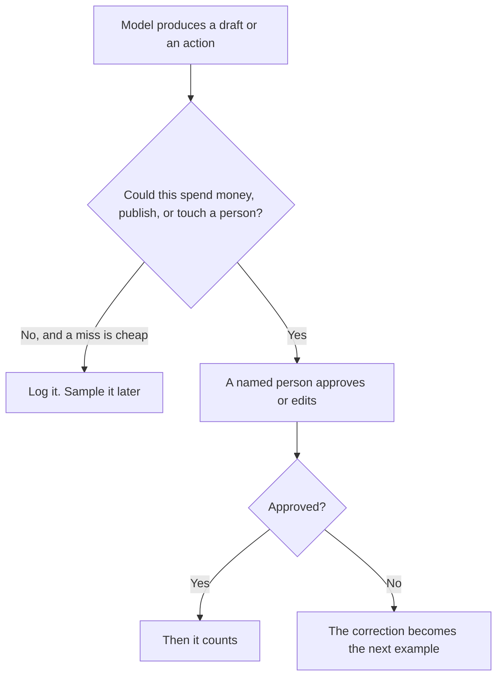

**Human-in-the-loop AI means a named person has to approve, edit, or label the result before it counts as done.** The model can draft the reply. It should not be the one that sends a refund, publishes the policy, or scores an employee. The loop is the step where a human can say no, and that no sticks.

The fence around what the model may attempt is [what AI guardrails are](/blog/what-is-ai-guardrails-2026/). The check you run on a set of examples is [what AI eval testing is](/blog/what-is-ai-eval-testing-2026/). The record of what happened on one live request is [what AI observability is](/blog/what-is-ai-observability-2026/).

Prices are US list prices excluding tax from directory pages checked October 16, 2026. Published October 24, 2026. This page does not score how often a model is right.

## Where the person has to sit

| The action | The model may | The person must |
|---|---|---|
| A help answer on your site | Draft from the articles you supplied | Take over when the answer would promise money, legal terms, or an account change |
| A customer email | Draft in your voice | Send it, after the facts are checked |
| A wiki page | Propose an edit | Publish it, under their name |
| An eval set | Propose a label | Confirm the label you will manage to |
| A code change | Suggest the diff | Read it before it merges |
| A scheduled agent | Prepare the packet | Be the one who turned the schedule on, and the one who can turn it off |

"Someone might look at it later" is not a loop. A loop has a name, a queue, and a way to stop the action. If the only reviewer is the model, you have a second model, not a human.

## What this looks like on a support bot

[Chatbase](/tools/chatbase/) bills message credits. Hobby is $32 a month billed yearly for 700 credits, or $40 month to month. A credit is a response, not a proof that the response was right. The human loop is the escalation path and the person who reads the bad ones. The card is [Chatbase pricing explained](/blog/chatbase-pricing-explained-2026/).

[Intercom Fin](/tools/intercom-fin/) bills outcomes. The base plan is $49 a month including 50 outcomes, then $0.99 each. An outcome is a resolution or a procedure handoff, on the directory page. A handoff to a person is part of the product, not a failure of the idea. The comparison of the two meters is [Chatbase vs Intercom Fin pricing](/blog/chatbase-vs-intercom-fin-pricing-2026/). The product page is [Intercom Fin review](/blog/intercom-fin-review-2026/).

[Zendesk AI](/tools/zendesk-ai/) sits on a help desk. Suite Team is $55 per agent per month paid yearly, on the directory page, with automated resolutions able to bill on top. The agent seat is the human loop you already pay for. Do not remove it because a bot answered the easy tickets. The stack around that choice is [best AI tools for support teams](/blog/best-ai-tools-for-support-teams-2026/).

## What this looks like on a draft

[Claude](/tools/claude/) Pro is $20 a month, or $17 billed annually. [ChatGPT](/tools/chatgpt/) Plus is $20. Either one can draft. The loop is the editor who checks names, numbers, and promises before the text leaves the building. The writing split is [ChatGPT vs Claude for writing](/blog/chatgpt-vs-claude-for-writing-2026/). The failure you are checking for is [what an AI hallucination is](/blog/what-is-ai-hallucination-2026/).

[Notion AI](/tools/notion-ai/) Business at $20 a seat is a reasonable place for the loop to live, because the page has a history and a comment. A chat transcript does not. Custom Agents that run on a schedule still need an owner. The price shape is [Notion AI pricing explained](/blog/notion-ai-pricing-explained-2026/).

A copilot that only suggests, and waits, is the small version of this loop. The definition is [what an AI copilot is](/blog/what-is-an-ai-copilot-2026/). An agent that acts across tools needs a tighter loop, not a looser one. That product shape is [what an AI agent is](/blog/what-is-an-ai-agent-2026/).

## FAQ

### Is rereading my own ChatGPT answer "human in the loop"?

It is a review habit. Use the phrase for a step in a system: a queue, a role, and a block on the action. A personal chat you might skim is not an operations control.

### Does a human have to see every message?

No. Put the person on the actions that spend money, change an account, publish, or judge a person. Sample the rest. A loop on every punctuation edit will be ignored, and then you have no loop at all.

### Can the human be the model's second pass?

No. A second prompt is still the model. The point of the loop is a person who can be wrong in a different way, and who is accountable for the send button.

### Where do the corrections go?

Into the source the model reads next: the help article, the style note, the eval example. A correction that lives only in a chat will be repeated tomorrow. The trace of the bad answer belongs with [observability](/blog/what-is-ai-observability-2026/).

## Last verified

October 16, 2026 for Chatbase, Fin, Zendesk, Claude, ChatGPT, and Notion prices named above. Published October 24, 2026. The definition does not depend on a price change.

**Sources:** [Chatbase pricing](https://www.chatbase.co/pricing), [Intercom Fin](https://www.intercom.com/fin), [Zendesk pricing](https://www.zendesk.com/pricing).

*Published by Andrew for [AI Tools Optimizer](https://aitoolsoptimizer.com).*

[Chatbase](/tools/chatbase/) is in the [customer support directory](/tools/category/customer-support/). Directory pages may use affiliate links. A purchase through them may earn us a commission at no extra cost to you.
