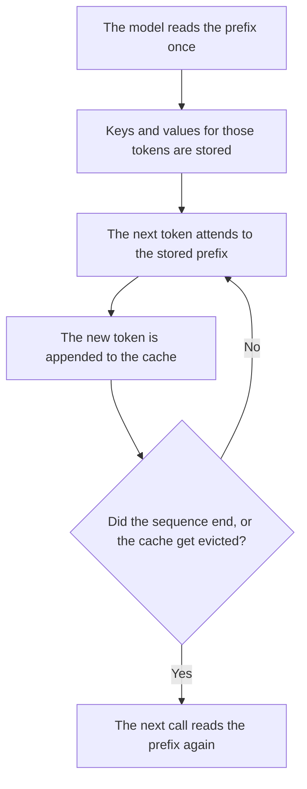

**A KV cache is the stored attention state for tokens a model has already read, so the next token can reuse that work instead of reading the prefix again.** "KV" means the keys and values inside the attention step. The cache is an inference detail. It is not a memory of your life, and it is not a discount until a vendor's invoice says the prefix was billed as a cache hit.

The bill you are trying to understand is [what prompt caching is](/blog/what-is-prompt-caching-2026/). A vendor feature that holds a repeated prefix across calls is [what a context cache is](/blog/what-is-a-context-cache-2026/). The unit being stored is [what AI tokens are](/blog/what-are-ai-tokens-explained-2026/). The ceiling on how much prefix you can keep is [what a context window is](/blog/what-is-a-context-window-2026/).

Prices are US list prices excluding tax from directory pages checked October 16, 2026. Published October 24, 2026. We did not measure speedups. This page does not invent a cache-hit rate.

## What is stored, and what is not

| Item | The KV cache holds | The KV cache does not hold |
|---|---|---|
| Prior tokens in this sequence | Attention keys and values for those tokens | A summary a person can read |
| The next token | Nothing yet. It is computed using the cache | A promise that the next token is correct |
| A later conversation | Only if the product kept this sequence's state | Your preferences, unless a separate memory feature says so |
| A secret in the prefix | The same secret, in model state | A safer copy. Delete the secret from the prompt |
| The bill | Whatever the vendor meters as a hit or a miss | A discount you assumed |

If the cache is dropped, the answer can still be right. It costs the full prefix again. If you needed that prefix to stay cheap, the eviction is a billing event. Log it if the vendor gives you a cache-hit field. Those fields are [what AI telemetry is](/blog/what-is-ai-telemetry-2026/).

## How this shows up on an invoice

**A chat plan hides the cache.** [Claude](/tools/claude/) Pro is $20 a month, or $17 billed annually. [ChatGPT](/tools/chatgpt/) Plus is $20 a month. [Gemini](/tools/gemini/) on Google AI Pro is $19.99 a month. You pay the seat. You do not see keys and values. A long thread can still hit a limit, and the product may shorten it. Shortening on purpose, with a list of what you dropped, is [what prompt compaction is](/blog/what-is-prompt-compaction-2026/).

**An API may bill the miss.** The directory records [DeepSeek](/tools/deepseek/) input from $0.15 per 1 million tokens off-peak on a cache miss, checked October 16, 2026. The phrase "cache miss" is the vendor's meter. Read their current card before you forecast. A hit on their cache is not the same object as a context cache you configured, and it is not the KV cache inside a paper. Three names, three scopes.

**Your own server.** If you serve the model, the cache lives in GPU memory. A longer prefix means a larger cache. That memory is capacity you cannot also give to another request. The system around it is [what model serving is](/blog/what-is-model-serving-2026/). The split you still budget is [what token budgeting is](/blog/what-is-token-budgeting-2026/).

## What a cache hit does not prove

A cache hit proves the prefix was reused. It does not prove the prefix was true. A wrong price in the first message is still wrong on token fifty, and it was cheaper to repeat. Correct the fact in the source. The failure mode is [what an AI hallucination is](/blog/what-is-ai-hallucination-2026/).

Do not put a secret in a prefix you plan to cache across users. A shared cache is a shared prefix. Isolate tenants the way you isolate any other computed state.

## FAQ

### Is the KV cache the same as prompt caching?

Prompt caching is the product and the invoice: you send a repeated prefix, and the vendor may charge a hit differently from a miss. The KV cache is the model-internal state that makes that reuse possible. You can have the state with no discount, and a discount line with no view of the tensors.

### Does a bigger cache make answers better?

It lets the model attend to a longer prefix without redoing that work. Quality still depends on whether the prefix should have been there. A long wrong document is a fast wrong answer.

### Will my chat app show cache hits?

Usually no. API bills sometimes do. If the field is missing, do not invent a savings. Ask the vendor, or read the usage object they document.

### Should we cache every system prompt?

Cache a prefix that is identical across many calls and large enough that the vendor's minimum is met. A short prompt that changes every time will miss. Read the vendor's minimum token count before you redesign the prompt around a discount you have not seen.

## Last verified

October 16, 2026 for Claude, ChatGPT, Gemini, and the DeepSeek cache-miss rate named above. Published October 24, 2026.

**Sources:** [Claude pricing](https://claude.com/pricing), [ChatGPT pricing](https://chatgpt.com/pricing/), [Google AI subscriptions](https://gemini.google/subscriptions/), [DeepSeek API docs](https://api-docs.deepseek.com/).

*Published by Andrew for [AI Tools Optimizer](https://aitoolsoptimizer.com).*

[DeepSeek](/tools/deepseek/) is in the [chatbots and assistants directory](/tools/category/chatbots-assistants/). Directory pages may use affiliate links. A purchase through them may earn us a commission at no extra cost to you.
