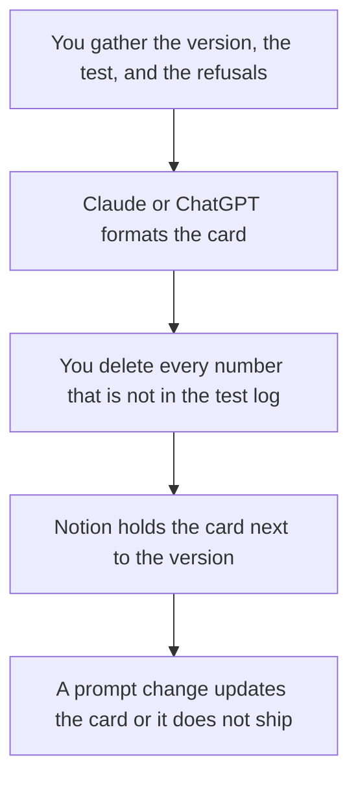

**A model card is a short document that says what a model is for, what you tested, what data that test used, and which uses you will not support.** It is a label a buyer, a teammate, or a later you can read without opening the training job. A chat transcript is not a card. A leaderboard row is not a card. If the card claims a number you did not measure, the card is a brochure.

The repeatable check the card should point at is [what AI eval testing is](/blog/what-is-ai-eval-testing-2026/). The failure mode the card should name in plain language is [what an AI hallucination is](/blog/what-is-ai-hallucination-2026/). The rules you will actually enforce are [what AI guardrails are](/blog/what-is-ai-guardrails-2026/). The file that can fail a build is [what AI policy as code is](/blog/what-is-ai-policy-as-code-2026/).

Prices are US list prices excluding tax from directory pages checked October 16, 2026. Published October 24, 2026. The directory does not list a model-card product, so this page does not invent a fee for one. We did not score any model.

## What a card has to contain

| Section | Write it from | Leave the cell blank when |
|---|---|---|
| What it is | The model name, the version, the date, and who owns it | You are comparing vendors and have not picked one |
| Intended use | The job you will actually ship: support replies, SQL drafts, a summary | You hope a future team will "figure out use cases" |
| Out of scope | The jobs you refuse: legal advice, medical advice, an unsupervised refund | The refusal is still a debate |
| Evaluation | The set, the date, and the score rule you ran | You only have a demo |
| Data the test used | The source of the cases, and whether customers consented | The cases are production text you may not describe |
| Limits | Languages, regions, and inputs where you saw it fail | You have not looked |

A card that says "state of the art" without a test name is advertising. The person who signs the card is [what human-in-the-loop AI is](/blog/what-is-human-in-the-loop-ai-2026/).

## Where the card is drafted

**The long write-up.** [Claude](/tools/claude/) Pro is $20 a month, or $17 billed annually. The directory records a context window of up to 1 million tokens depending on the model, which is why a long eval log fits in one thread. The card still only includes the lines you can point to. The review is [Claude review](/blog/claude-review-2026/).

**A shared Project for the version history.** [ChatGPT](/tools/chatgpt/) Plus is $20 a month. Business is $20 a user a month billed annually, minimum two users, when the card describes customer data and you need admin controls. The container is [Claude Projects vs ChatGPT Projects](/blog/claude-projects-vs-chatgpt-projects-2026/).

**The page that outlives the chat.** [Notion AI](/tools/notion-ai/) Business is $20 a seat a month and includes Notion Agent. Free includes a trial of Notion AI. The card belongs next to the prompt version, not in a private chat. The invoice is [Notion AI pricing explained](/blog/notion-ai-pricing-explained-2026/).

**The line edit.** [Grammarly](/tools/grammarly/) Pro is $12 a member a month billed annually ($144 a year), or $30 month to month. It will not know whether your metric is real. The invoice is not a substitute for the test log.

A prompt that holds the line:

"Draft a model card with these sections: identity, intended use, out of scope, evaluation, data, limits. Use only the notes I paste. If a metric, a date, or an owner is missing, write Missing. Do not add benchmark claims."

## What the card is not allowed to do

It does not approve a use by itself. A salesperson cannot wave the card and skip a security review. It does not replace the regression you run when the prompt changes. That re-run is [what prompt regression testing is](/blog/what-is-prompt-regression-testing-2026/). It does not describe a vendor model you do not operate unless you are quoting that vendor's own card and the date you read it.

If you retrieve documents and then answer, say so, and point at the fetch check. The method is [what RAG is](/blog/what-is-rag-explained-2026/). The fetch check is [what retrieval evaluation is](/blog/what-is-retrieval-evaluation-2026/).

## FAQ

### Do I need a model card if I only wrap a vendor model?

Yes, for the behavior you added: the prompt, the tools, the documents, and the refusals. The vendor's card covers the base model. Your card covers the product. Quote the vendor. Date the quote. Do not merge their marketing line into your eval.

### How long should it be?

One to three pages a new teammate can finish. A forty-page card that hides the out-of-scope list is a wiki, and the list will not be read. Put the refusal in the first screen.

### Can I copy a public benchmark into the card?

Only as a citation, with the source and the date, and only if you ran it or you are explicit that you did not. A number you did not reproduce is their number. Label it.

### Who updates the card?

The person who ships the prompt or model change. A card with last quarter's version and this week's prompt is a stale label. Tie the update to the same review as the change.

## Last verified

October 16, 2026 for Claude, ChatGPT, Notion, and Grammarly. No model-card vendor fee is recorded in the directory. Published October 24, 2026.

**Sources:** [Claude pricing](https://claude.com/pricing), [ChatGPT pricing](https://chatgpt.com/pricing/), [Notion pricing](https://www.notion.com/pricing).

*Published by Andrew for [AI Tools Optimizer](https://aitoolsoptimizer.com).*

[Claude](/tools/claude/) is in the [chatbots and assistants directory](/tools/category/chatbots-assistants/). Directory pages may use affiliate links. A purchase through them may earn us a commission at no extra cost to you.
