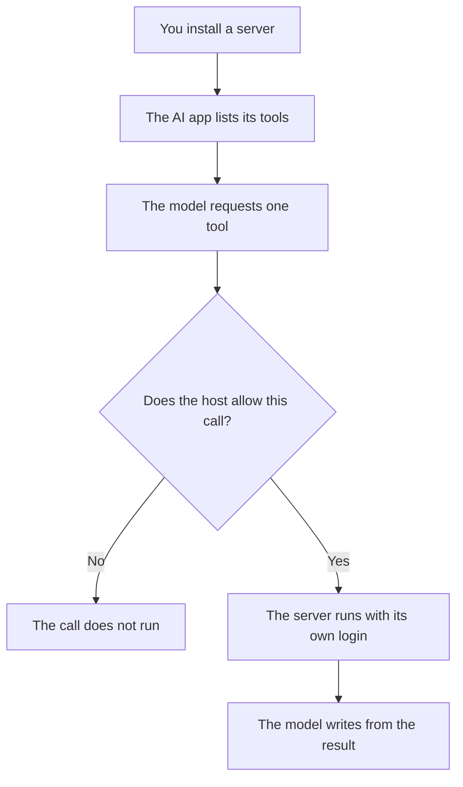

**The Model Context Protocol, MCP, is a shared contract so an AI app can list and use tools and data sources without a custom plugin for every pair.** The app is the client. The tool or the file system is the server. The client asks what the server offers, calls a tool or reads a resource, and passes the result to the model. You still decide what the server is allowed to touch.

Anthropic published the protocol. Other clients have adopted it since. This directory does not inventory every client. Where a product page we recorded names connectors, that is the claim. A price for "MCP" does not exist. You pay for the client seat and for whatever the server connects to.

The model-side request is [what function calling is](/blog/what-is-function-calling-in-ai-2026/). A product that chains those requests toward a goal is [what an AI agent is](/blog/what-is-an-ai-agent-2026/). MCP is the plug shape. It is not, by itself, a reason to trust the tool.

## The three roles

| Role | Who it is | What it is responsible for |
|---|---|---|
| Client | The AI app the person is using | Listing servers, asking the model when a tool is relevant, showing the call |
| Server | The connector you run or a vendor runs | Exposing a small set of tools and resources, with its own permissions |
| Host permissions | You, or your admin | Which servers are installed, and which calls may run without a person |

A server that can send mail is a mail account with a new front door. Read the scope before you approve it. The failure where a document tells the model to ignore its instructions is [what prompt injection is](/blog/what-is-prompt-injection-2026/). MCP does not remove that. A tool result is untrusted text until you treat it as untrusted text.

## What to use instead of hoping one acronym covers it

| The job | Use this | Why it matches | Price to know |
|---|---|---|---|
| A chat client whose card lists connectors | [Claude](/tools/claude/) | Free already lists connectors, memory, and Artifacts. Pro adds more usage and Claude Code | Pro is $20/month, or $17 billed annually |
| A chat seat you already standardize on | [ChatGPT](/tools/chatgpt/) | Plus is where projects, custom GPTs, and expanded tools live. Confirm any connector on the plan you buy | Plus is $20/month. Business is $20/user billed annually |
| A path you drew, with no model choosing the branch | [Zapier](/tools/zapier/) or [Make](/tools/make/) | The steps are the product. A protocol is optional | Zapier Professional is $19.99/month billed annually for 750 tasks. Make Core is from $9/month billed annually |
| A self-hosted path, billed per execution | [n8n](/tools/n8n/) | One run is one execution, however many steps | Starter was shown in euros, from €20/month billed annually. This page does not convert it |
| An editor, if the coding seat is the client | [Cursor](/tools/cursor/) | Plus is $8/month on The X Subscription. Any external tool still needs a permission you can name | Premium is $30/month |

Claude's plan split is [Claude Pro vs Max](/blog/claude-pro-vs-max-2026/). The drawn-workflow choice is [Zapier vs Make vs n8n](/blog/zapier-vs-make-vs-n8n/). If the "connector" is really a bot on your help center, that product is [Chatbase](/tools/chatbase/), covered in [how to build a knowledge-base chatbot](/blog/how-to-build-a-knowledge-base-chatbot-2026/).

## When MCP is the wrong project

**The steps never change.** A form that should always file a row and notify one channel is a Zap or an n8n workflow. Putting a model in the middle adds a trace you must read and a bill you must explain. Observability for that trace is [what AI observability is](/blog/what-is-ai-observability-2026/).

**You only have one app and one tool.** A native integration you already pay for is finished. A protocol helps when a second client should reuse the same server. It is overhead when it will not.

**The server is broad.** "Access the drive" will be used broadly. "Read this folder" can be reviewed. Narrow the server before you debate which model is smart enough to call it.

**You wanted the model to remember you.** That is a product memory setting, not a protocol. The distinction is [what AI memory is](/blog/what-is-ai-memory-2026/).

Check the client's own docs for an MCP toggle the day you install a server. This article does not claim every coding tool in the directory exposes one. A connector list on a pricing card is a feature. A local server you run is an operations task, with secrets, updates, and a person who can turn it off.

## FAQ

### Is MCP the same as an API?

An API is how a specific service talks. MCP is a convention for how an AI client discovers tools and resources on a server. The server usually calls an API behind that convention. You still need the service's login.

### Does Claude include MCP?

Claude's recorded plan cards list connectors. Treat a connector you can point at a source as the product feature. Whether a given connector speaks MCP is a docs question for that client version, not a line this directory reprints as a price.

### Do I pay extra for the protocol?

No protocol fee is recorded here. You pay for the chat or coding seat, and for the app the server reaches. A Zapier task and a Claude seat can both be true in the same month. That is two meters on purpose.

### Is a custom GPT an MCP server?

A custom GPT is a ChatGPT container with instructions and, sometimes, actions. It is not automatically a server other clients can reuse. The container choice is [ChatGPT Projects vs custom GPTs](/blog/chatgpt-projects-vs-custom-gpts-2026/).

## Last verified

October 16, 2026 for the seat prices. Published October 24, 2026. The protocol description does not depend on a plan change.

**Sources:** [Claude pricing](https://claude.com/pricing), [ChatGPT pricing](https://chatgpt.com/pricing/), [Zapier pricing](https://zapier.com/pricing).

*Published by Andrew for [AI Tools Optimizer](https://aitoolsoptimizer.com).*

[Claude](/tools/claude/) is in the [chatbots directory](/tools/category/chatbots-assistants/). Directory pages may use affiliate links. A purchase through them may earn us a commission at no extra cost to you.
