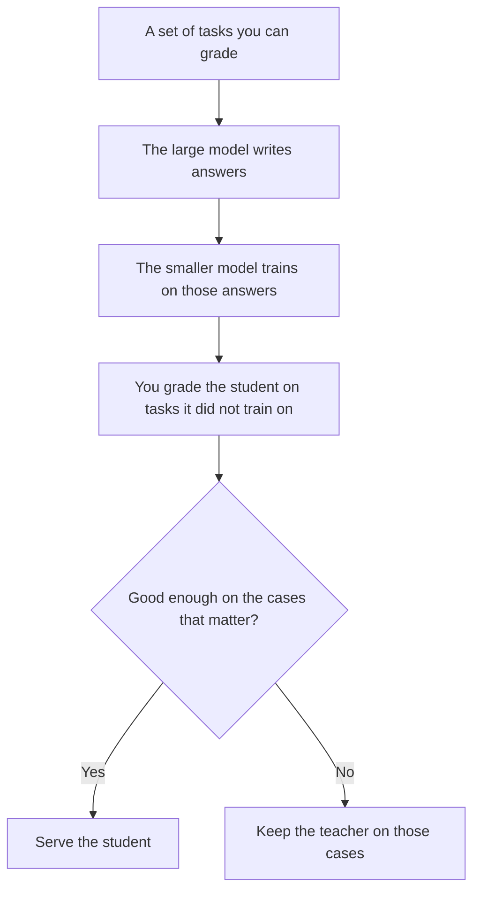

**Model distillation trains a smaller model to imitate a larger model's answers, so you can serve similar behavior at a lower inference cost.** The large model is the teacher. The small model is the student. You keep the student if a held-out set of tasks still looks acceptable. You keep the teacher if the student drops the cases you actually care about.

Distillation is a training method. It is a different purchase from chatting with [Claude](/tools/claude/) or [ChatGPT](/tools/chatgpt/). Adapting one model on your own examples is [what fine-tuning is](/blog/what-is-fine-tuning-ai-2026/). The bill for running the model after training is [what AI inference vs training is](/blog/what-is-ai-inference-vs-training-2026/). The architecture most of these models share is [what a transformer model is](/blog/what-is-a-transformer-model-2026/).

Published October 24, 2026. This page does not score a distilled model against its teacher.

## Four ways to get a cheaper answer

| Method | What you change | What you still have to check |
|---|---|---|
| Prompt the large model | Nothing in the weights. You pay the teacher's inference price | The prompt, and the source of any fact |
| Fine-tune | One model's weights, on examples you labeled | Whether your labels were right, and whether the model forgot other jobs |
| Distill | A smaller model's weights, on the teacher's outputs | A held-out set the student did not train on |
| Retrieve, then answer | The corpus, not the weights | The passage. See [what RAG is](/blog/what-is-rag-explained-2026/) |

The rows the teacher writes can be [synthetic data](/blog/what-is-synthetic-data-2026/). They are useful for imitation. They are a poor substitute for a real customer ticket if the ticket was never in the set.

## What the student is allowed to lose

A distilled model is supposed to be close on the tasks you listed. It will be worse on tasks you left out. That is the trade. A support bot that copies a large model's tone and misses a refund exception is a failed distillation, even if the average answer looks fluent. The check is [what AI eval testing is](/blog/what-is-ai-eval-testing-2026/).

Latency and price are why teams distill. A smaller model uses fewer [tokens](/blog/what-are-ai-tokens-explained-2026/) of compute per reply, or it fits on cheaper hardware. [DeepSeek](/tools/deepseek/) is in the directory as an API priced from $0.15 per million tokens on the October 16, 2026 card. That figure is an API rate for that vendor. It is not a distillation fee, and it is not a quality score.

Open weights are a separate decision. A student you can download is [open-source AI](/blog/what-is-open-source-ai-2026/) only to the extent the license says you may use the weights. Distillation does not grant that license. If the teacher's terms forbid using its outputs to train another model, the project stops before the first training run. Read the teacher's terms. This article is not legal advice.

## Where a product team actually meets this

Most buyers never run distillation. They meet it when a vendor says the cheap plan "uses a smaller model." Ask which tasks were in the eval, and whether the hard cases still go to the larger model. A routing setup that sends easy questions to the student and refunds to the teacher is a product decision. It belongs in the spec next to the price.

[Cursor](/tools/cursor/) and other coding tools pick models per request. That picker is not distillation. It is a menu. Distillation would be a vendor training one model to behave like another, then serving the result. Your job as a buyer is to test the model you will actually call, on your repository or your help center, and to keep the cases that failed.

If the goal is a style match on a few examples, you do not need a student model. Put the examples in the prompt. That is [few-shot prompting](/blog/what-is-few-shot-prompting-2026/).

## FAQ

### Is distillation the same as compression?

People use both words for "a smaller model." Compression often means shrinking a model you already have, for example by lowering numeric precision. Distillation means training a student on a teacher's behavior. You can do both. They fail in different ways, so the eval should name which one you did.

### Do I need the teacher's weights?

No. You need the teacher's answers on your task list, and the right to train on them. The student's starting weights are a separate file, often a smaller open model.

### Will the student match the teacher on every prompt?

Only on the distribution you trained and tested. A new policy, a new product name, or a hostile input is outside that promise. Treat a distilled support model as a draft until the eval covers the new policy.

### Should a small team distill its own model?

Usually no. The teacher subscription plus a careful prompt is the smaller project. Distill when inference volume makes the teacher's bill the constraint, and when you already have an eval set you trust.

## Last verified

Published October 24, 2026. DeepSeek's API floor is from the directory page checked October 16, 2026. No model in this article was scored.

**Sources:** [Claude](https://claude.ai), [OpenAI](https://openai.com), [DeepSeek API](https://api-docs.deepseek.com/).

*Published by Andrew for [AI Tools Optimizer](https://aitoolsoptimizer.com).*

[Claude](/tools/claude/) and [ChatGPT](/tools/chatgpt/) are in the [assistants directory](/tools/category/chatbots-assistants/). Directory pages may use affiliate links. A purchase through them may earn us a commission at no extra cost to you.
