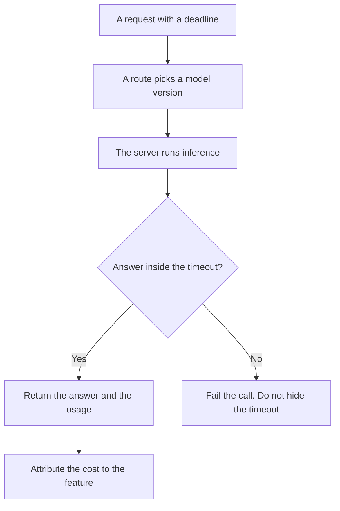

**Model serving is the system that takes a model you already trained, or a model a vendor trained, and returns an answer to a request.** Training changes the weights. Serving holds the weights still and spends compute on the next prompt. A chat subscription is one way to buy serving. An API endpoint is another. A nightly job that waits is a third.

The split between those clocks is [what AI inference versus training is](/blog/what-is-ai-inference-vs-training-2026/). The door in front of several models is [what a model gateway is](/blog/what-is-a-model-gateway-2026/). Work you allow to wait is [what AI batch inference is](/blog/what-is-ai-batch-inference-2026/). Sending the cheap model the easy job is [what AI routing is](/blog/what-is-ai-routing-2026/).

Prices below are US list prices excluding tax from directory pages checked October 16, 2026. Published October 24, 2026. A chat plan is not an API rate. This page does not invent a token price, and it does not score latency.

## What you have to name

| Piece | A serving setup has it | A demo does not |
|---|---|---|
| The model version | A name and a date you can roll back | "The latest" with no record |
| The request | A prompt, tools, and a max length | A screenshot of one good reply |
| The deadline | A timeout you chose | A spinner with no end |
| The capacity | How many requests you will hold at once | Hope that Tuesday looks like the launch |
| The bill | The invoice unit, tokens or a seat | A vibe that it is cheap |
| The owner | A person who can stop the endpoint | A channel where charts are posted |

A technique that drafts the next tokens with a small model and checks them with the large one is [what speculative decoding is](/blog/what-is-speculative-decoding-2026/). That is one serving optimization. It is not the definition of serving. The two clocks you still measure, time to answer and answers per second, are [latency versus throughput](/blog/what-is-ai-latency-vs-throughput-2026/).

## What people buy, and what they still operate

**A chat seat.** [ChatGPT](/tools/chatgpt/) Plus is $20 a month. [Claude](/tools/claude/) Pro is $20 a month, or $17 billed annually. [Gemini](/tools/gemini/) on Google AI Pro is $19.99 a month. You are buying the vendor's serving, with limits the vendor sets. You do not operate the GPUs. You still own the prompt, the data you paste, and the decision to trust the reply.

**An API you call from your product.** The directory records [DeepSeek](/tools/deepseek/) API input from $0.15 per 1 million tokens off-peak on a cache miss, and output at $0.60 off-peak, checked October 16, 2026. That number is a vendor price. It is not your latency, and it is not a promise that the endpoint stays up. The target you write for your feature is [what an AI SLO is](/blog/what-is-ai-slo-2026/).

**A batch window.** If the user is not waiting, serving can be a queue. Mix that queue into the chat timeout and you will page someone for work that was allowed to be slow.

The record of which team spent the call is [what AI cost attribution is](/blog/what-is-ai-cost-attribution-2026/). The fields that let you compute it are [what AI telemetry is](/blog/what-is-ai-telemetry-2026/).

## What serving is allowed to hide

Serving may batch tokens from several users on one machine when the vendor does that inside their cloud. Your product should still log one request id per user action. A shared GPU is their efficiency. A shared log line is your incident, and you will not be able to explain it.

Do not treat the vendor status page as your serving story. Their page can be green while your prompt, your tools, or your timeout is the failure. That difference is the point of an SLO you compute yourself.

## FAQ

### Is model serving the same as hosting a chatbot?

A chatbot is one product on top of serving. Serving is the path from a request to model output. A chatbot also has a login, a history, and a policy. Those are product choices. They are not the GPU.

### Do we need our own servers to be "doing serving"?

You need an owner for the request, the timeout, and the bill. The GPUs can be yours or a vendor's. If nobody can name the model version a customer hit on Tuesday, you are consuming a product. You are not operating a feature.

### Does a chat subscription include an API?

Not by default. Plus, Pro, and a Google AI plan are seat products. An API key is a separate invoice unless the vendor's current card says otherwise. This page does not invent that bundle.

### Where does speculative decoding fit?

It is one way a server can answer faster. You can serve a model without it. If a vendor uses it, your contract is still the timeout and the answer, not the internal trick.

## Last verified

October 16, 2026 for ChatGPT, Claude, Gemini, and DeepSeek prices named above. Published October 24, 2026. The definition does not depend on a price change.

**Sources:** [ChatGPT pricing](https://chatgpt.com/pricing/), [Claude pricing](https://claude.com/pricing), [Google AI subscriptions](https://gemini.google/subscriptions/), [DeepSeek API docs](https://api-docs.deepseek.com/).

*Published by Andrew for [AI Tools Optimizer](https://aitoolsoptimizer.com).*

[Claude](/tools/claude/) is in the [chatbots and assistants directory](/tools/category/chatbots-assistants/). Directory pages may use affiliate links. A purchase through them may earn us a commission at no extra cost to you.
