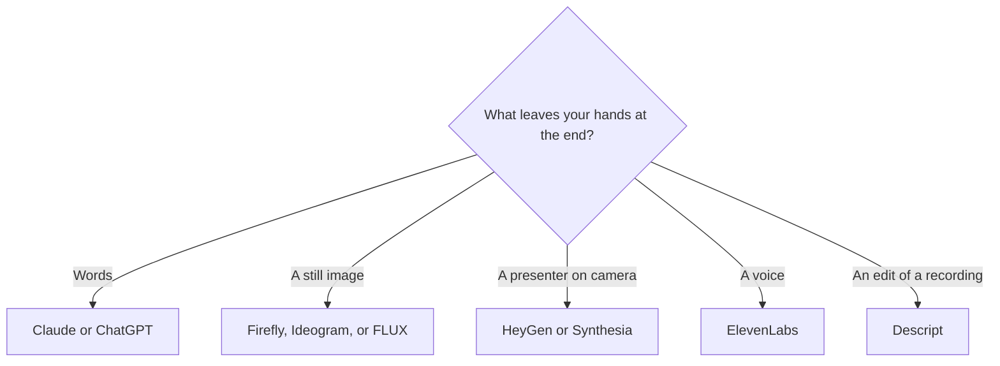

**Multimodal AI is a system that accepts or produces more than one kind of media: text, images, audio, video, or a combination.** The practical question is narrower. Which direction do you need? Reading a screenshot is not the same product as generating a video. A voice that reads your draft is not the same product as a cloned voice on a commercial ad.

"Multimodal" on a homepage often means the chat box can take a picture. That is useful. It does not mean the subscription includes a video studio, a music model, and an avatar. Buy the mode you will ship this month.

We did not score image or video quality. The table follows what each directory page says the product does. Prices are US list prices excluding tax, recorded October 16, 2026 unless a linked review names a later read.

## The mode, then the tool

| You need | Start here | What the directory page supports | First price |
|---|---|---|---|
| Text in, text out | [Claude](/tools/claude/) or [ChatGPT](/tools/chatgpt/) | Writing, analysis, coding. ChatGPT's page also lists images and voice | Claude Pro $20/month ($17 annual). ChatGPT Plus $20/month |
| Text in, images out | [Adobe Firefly](/tools/adobe-firefly/), or the image aisle | Firefly generates images, and video and audio as credit-priced features | Firefly Standard $9.99/month |
| An image in, an answer out | [ChatGPT](/tools/chatgpt/) or [Gemini](/tools/gemini/) | Both are sold as assistants that go beyond text. Gemini's page includes image and video generation | Gemini is free with a Google account. Google AI Plus is $4.99/month |
| Text in, a presenter video out | [HeyGen](/tools/heygen/) or [Synthesia](/tools/synthesia/) | Script to avatar | HeyGen Creator $29/month. Synthesia Starter $29/month billed monthly |
| Text in, speech out | [ElevenLabs](/tools/elevenlabs/) | Text to speech, cloning, dubbing | Starter $6/month, the first plan with a commercial license |
| A recording in, an edited cut out | [Descript](/tools/descript/) | Transcript and picture stay tied | Hobbyist $16/person/month billed annually |
| API vision on a cheap model | [DeepSeek](/tools/deepseek/) | The review records vision on Flash, and not on Pro | API rates are in the review. Chat is free |

The assistant choice is [ChatGPT vs Gemini vs Claude](/blog/chatgpt-vs-gemini-vs-claude-2026/). Claude's own directory page lists image and video generation as a reason to look at ChatGPT or Gemini. Use Claude when the deliverable is writing and analysis. Do not buy it to render a campaign still.

## What "one model" changes, and what it does not

A multimodal model can look at a screenshot and a paragraph in the same request, which removes a conversion step. Designers paste a board. Support teams paste an error image. Analysts paste a chart. The [context window](/blog/what-is-a-context-window-2026/) still caps how much of that material fits. A 40-page slide deck may need to be split even when the model accepts images.

Generation is a separate meter. Firefly's paid plans include unlimited standard image and vector generations, and they spend credits on video, audio, partner models, and higher image models. A 1080p video second is 100 credits on the rate card recorded with the [Adobe Firefly review](/blog/adobe-firefly-review-2026/). Standard's 2,000 credits are 20 seconds at that setting. "The plan is multimodal" does not mean video is free.

DeepSeek is the recorded split inside one vendor: Flash lists vision, Pro does not, in the [DeepSeek review](/blog/deepseek-review-2026/). If you needed pictures and you called Pro, the missing mode is on the model card, not a bug in your prompt.

Avatars are multimodal in the marketing sense, and they are their own products. [HeyGen vs Synthesia](/blog/heygen-vs-synthesia-2026/) is the buyer split: a self-serve presenter versus an L&D stack. Neither edits footage you already shot. That job is Descript or [CapCut](/tools/capcut/).

## A small stack, by the file you must deliver

**A written answer that may include a chart you upload.** ChatGPT Plus or Gemini. Paste the chart. Ask for the claim in words. Open any number the model reads off the image. Vision misreads axes. The writing method, which still applies, is [how to write a blog post with Claude](/blog/how-to-write-a-blog-post-with-claude-2026/).

**A still for a campaign.** Leave the chatbot. The image field is [best AI image generators](/blog/best-ai-image-generators-2026/). Firefly is the licensed-training conversation. [Ideogram](/tools/ideogram/) is the text-in-image tool. [FLUX](/tools/flux/) is pay per image. That three-way is [FLUX vs Ideogram vs Firefly](/blog/flux-vs-ideogram-vs-firefly-2026/).

**A voice on a video you will publish.** ElevenLabs Starter at $6 a month is the commercial-license step. Free includes 10,000 credits and does not include that license. The aisle is [best AI voice generators](/blog/best-ai-voice-generators/).

**A training video of a presenter.** HeyGen or Synthesia, after you have a script and consent for any likeness. Generators that invent footage are a different list: [best AI video generators](/blog/best-ai-video-generators-2026/).

## FAQ

### Is ChatGPT multimodal?

The directory describes ChatGPT as an assistant for chat, research, writing, coding, images, and voice. That is more than one mode. Which of those are included on Free, Go, Plus, or Pro is a plan question. Plus is $20 a month. The ladder is [ChatGPT Go vs Plus vs Pro](/blog/chatgpt-go-vs-plus-vs-pro-2026/).

### Does multimodal mean one subscription covers images and video?

It means the product claims more than one mode. Video is often credit-priced or capped on a higher tier. Read the line for the mode you will export, not the word on the hero banner.

### Is an AI avatar the same as image generation?

No. An avatar tool turns a script into a presenter. An image tool returns a still. A video generator returns footage that may not be a consistent person. Pick from the file you owe someone.

### Can Claude generate images?

This directory's Claude page points image and video generation to ChatGPT or Gemini. Claude is the writing and analysis seat. Pro is $20 a month, or $17 billed annually.

## Last verified

October 16, 2026 for the plan prices and the product descriptions used above. Firefly's per-second video rate is the figure in the Firefly review. Published October 24, 2026.

**Sources:** [ChatGPT pricing](https://chatgpt.com/pricing/), [Google Gemini](https://gemini.google.com/), [Adobe Firefly plans](https://www.adobe.com/products/firefly/plans.html), [HeyGen pricing](https://www.heygen.com/pricing), [ElevenLabs pricing](https://elevenlabs.io/pricing).

[ChatGPT](/tools/chatgpt/) and [Gemini](/tools/gemini/) are in the [chatbots directory](/tools/category/chatbots-assistants/). Directory pages may use affiliate links. A purchase through them may earn us a commission at no extra cost to you.
