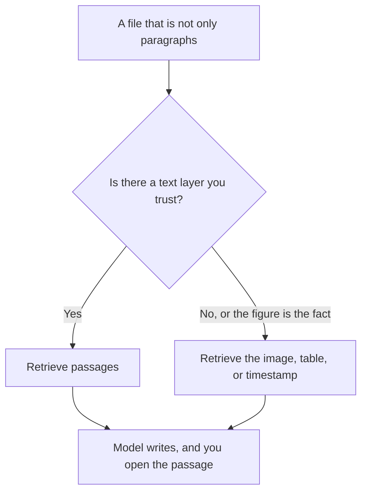

**Multimodal RAG is retrieval-augmented generation where the source is not only paragraphs.** The system finds a page, a figure, a table, a slide, or a transcript segment, and the model writes from that material. You still have to open the source. A chart described in a sentence is not the chart.

Text-only RAG is [what RAG is](/blog/what-is-rag-explained-2026/). A model that can accept an image at all is [what multimodal AI is](/blog/what-is-multimodal-ai-2026/). Multimodal RAG is the combination that matters for a scanned PDF, a slide deck, or a meeting recording: the lookup has to reach the non-text part, and the answer has to point back to it.

Prices are US list prices excluding tax from directory pages checked October 16, 2026. Published October 24, 2026. We did not score retrieval on figures.

## What "the source" can be

| Source | What retrieval has to return | What fails if you only embed the words |
|---|---|---|
| A text PDF | Passages | Nothing, if the text layer is real |
| A scan or a photo of a whiteboard | The image, or text from a transcription you trust | The page looks empty to a text index |
| A table in a spreadsheet or a paper | The cells, not a paragraph about the cells | The model invents a total |
| A slide | The slide image plus any speaker note | The title is retrieved and the chart is ignored |
| A meeting recording | A timestamped transcript, and the audio only if you will listen | A summary with no time to check |

The index behind a text corpus is often [embeddings](/blog/what-is-embeddings-in-ai-2026/) in [a vector database](/blog/what-is-a-vector-database-2026/). You do not need to stand one up to use the products below. You do need to notice when a product only searched the words.

## Products that already keep you on a source

| The file | Use this | Why it matches | Price to know |
|---|---|---|---|
| A folder of PDFs, slides, and notes you trust | [Gemini Notebook](/tools/gemini-notebook/) | The notebook stays on your sources | Free with a Google account. Google AI Plus is $4.99/month |
| One long document you upload | [Claude](/tools/claude/) | File upload and Projects. Recorded context up to 1 million tokens depending on the model | Pro is $20/month, or $17 billed annually. Free includes files, with usage limits |
| A chat where the team already works, plus an upload | [ChatGPT](/tools/chatgpt/) | File upload. Plus adds projects. The reasoning window recorded for Plus is 256K, and your file shares it | Plus is $20/month |
| The public web, as pages | [Perplexity](/tools/perplexity/) | Citations you can open. It is not your private slide folder | Pro is $17/month billed annually |
| Papers, as rows and columns | [Elicit](/tools/elicit/) | Extracted fields. Figures are only as good as the column you defined | Plus is $11/user/month billed annually on the non-Industry card |
| A wiki the team edits | [Notion AI](/tools/notion-ai/) | The page is the source of record | Business is $20/seat/month |

The long-document habit, Claude against Gemini, is [Claude vs Gemini for long documents](/blog/claude-vs-gemini-for-long-documents-2026/). The notebook workflow is [how to study with Gemini Notebook](/blog/gemini-notebook-study-workflows/). Paper tables are [how to research with Elicit and Consensus](/blog/how-to-research-with-elicit-and-consensus-2026/).

A screenshot pasted into chat is manual multimodal RAG. It works for one figure. It falls over when the deck has forty slides and you ask a question that depends on slide twelve. The limit on how much you can attach is the [context window](/blog/what-is-a-context-window-2026/).

## What to check before you trust a figure

**Ask for the location.** "Which file and which page?" A model that describes a chart without a location did not retrieve it. It guessed a chart.

**Ask for the cell, not the trend.** "What is the March number in column B?" is a check. "Summarize the table" hides a misread. The spreadsheet tools are [best AI for Excel and Google Sheets](/blog/best-ai-for-excel-and-google-sheets-2026/).

**Transcribe audio before you ask for themes.** A meeting tool that gives you a transcript with times is the retrieval layer. [How to summarize meetings with AI](/blog/how-to-summarize-meetings-with-ai-2026/) is that workflow. The summary is not the source.

**Do not mix the web into a private folder by accident.** Perplexity is the right tool for a public page. It is the wrong tool for a deck you have not published. Notebook or a Project is the private case.

If you are building this, an image embedding and a text embedding are different indexes. This glossary does not pick a model for you. The product decision for most teams is still "which folder, and can I open the hit?"

## FAQ

### Is uploading a PDF multimodal RAG?

Only if the system retrieves a relevant part and shows it to you. Uploading a file into a window and hoping is a long prompt. That works until the file, or the figure inside it, does not fit.

### Does Claude read images in a PDF?

Claude's recorded card includes file upload. Whether a given PDF's figures are visible is something you test on one page: ask for a number that appears only in a chart. If the answer misses it, you have a text layer, not multimodal retrieval. Do not assume the 1 million token figure covers a scan with no text.

### Is Perplexity multimodal RAG?

It retrieves web sources and cites them. Use it for public pages. Use a notebook for the files on your drive. They answer different questions. Stacking them is reasonable. Expecting one subscription to see your private slides is not.

### Do I need a vector database?

You need one if you are building retrieval into your own product and the corpus does not fit a window. You do not need to operate one to use Notebook, Claude, ChatGPT, Perplexity, Elicit, or Notion.

## Last verified

October 16, 2026 for plan prices. October 24, 2026 for the Plus reasoning-window figure as recorded in the ChatGPT plan comparison, and for Claude's up-to-1-million-token note as recorded on the context-window page. Published October 24, 2026.

**Sources:** [Claude pricing](https://claude.com/pricing), [Gemini Notebook](https://workspace.google.com/products/gemini-notebook/), [Elicit pricing](https://elicit.com/pricing).

*Published by Andrew for [AI Tools Optimizer](https://aitoolsoptimizer.com).*

[Gemini Notebook](/tools/gemini-notebook/) and [Perplexity](/tools/perplexity/) are in the [research directory](/tools/category/research-search/). Directory pages may use affiliate links. A purchase through them may earn us a commission at no extra cost to you.
