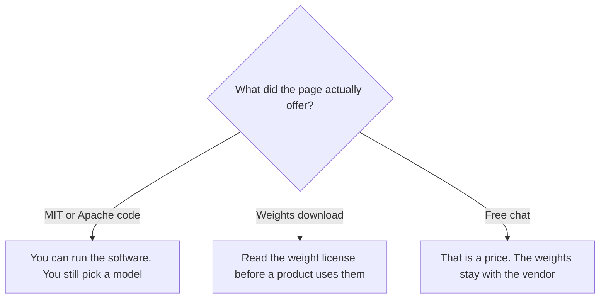

**Open-source AI means the software is published under a license that lets you inspect, modify, and run it.** A free chat app is a price. Open weights are a model file under whatever license the lab attached. Those three phrases get swapped in marketing. The license is the part that decides whether you can ship the thing.

This site's model table, updated October 19, 2026, marks some models as open weights and leaves their hosted prices blank when a provider sets the bill. The model class is [what an LLM is](/blog/what-is-an-llm-2026/). Changing weights you downloaded is [what fine-tuning is](/blog/what-is-fine-tuning-ai-2026/).

Prices below are US list prices excluding tax from directory pages checked October 16, 2026, unless noted. Published October 24, 2026. We did not audit a license the way counsel would. Read the license before you ship.

## Three phrases, three artifacts

| Phrase | What you receive | What you still pay |
|---|---|---|
| Open-source software | Code under a license such as MIT | Hosting, and the model you plug in |
| Open weights | A model file you can download, under that file's license | GPUs or a host, plus the license terms for commercial use |
| A free chat app | An account on someone else's product | Nothing until a cap, then a seat or an API |

[OpenClaw](/tools/openclaw/) is the clearest directory example of the first row. The project states it is MIT licensed, with no paid tier and no hosted service. You run a Gateway on hardware you control and connect a model. The model bill belongs to the provider you attach. Claude, ChatGPT, or a local model are plugins in that design. The software price is $0. The inference price is separate, and that split is [inference vs training](/blog/what-is-ai-inference-vs-training-2026/).

## Open weights are a file, plus a license

[FLUX](/tools/flux/), from Black Forest Labs, documents open weights: download, customize, and deploy, or license them for a product through an enterprise agreement. The hosted API is a different purchase. FLUX 3 Klein starts at $0.008 per image at 768×768. One credit equals $0.01. "Open weights" on that page is the download path. The per-image price is the hosted path. Using the weights inside a product is the license path. Quote the path you mean.

The model table records other open-weight releases with hosted API rates beside them. DeepSeek-V4.1-Flash is marked open weights there, with a peak API price of $0.30 per 1 million input tokens and $1.20 per 1 million output tokens, and off-peak at half. [DeepSeek](/tools/deepseek/)'s chat app is free. The free app does not, by itself, deliver the weights to your server. If you need the file, follow the lab's weight release and its license. The product review is [DeepSeek review](/blog/deepseek-review-2026/).

Mistral Large 4 is marked open weights on the same model table, with a list API price of $1.36 per 1 million input tokens and $4.18 per 1 million output tokens at the time of that update, and a note that the weights were announced with an API-only preview until release. [Mistral Vibe](/tools/mistral-vibe/) is the chat product in this directory, at $14.99 a month excluding tax for Pro. Vibe's seat is the app. Large 4's weights are a model release. Keep them separate.

Meta's consumer assistant, [Meta AI](/tools/meta-ai/), is a product. The model table lists Muse Spark Open as a separate open-weight model with no single hosted price. A free assistant inside Instagram is the product row.

## Free to run is its own column

[n8n](/tools/n8n/) Community Edition is free to self-host. Cloud Starter was displayed at €20 a month billed annually. This article does not convert euros, and it does not relabel the Community Edition as a particular open-source license. Read the license file in the edition you install. The workflow comparison is [Zapier vs Make vs n8n](/blog/zapier-vs-make-vs-n8n/).

A self-hosted tool still calls a model. That call is an [API](/blog/what-is-an-api-for-ai-tools-2026/) or a local process, and the tokens are [what AI tokens are](/blog/what-are-ai-tokens-explained-2026/). Open-source software with a closed model behind it is a normal architecture. Say which half you mean when you tell a customer their data "stays local."

## FAQ

### If the chat is free, is the model open source?

No. A free tier is a price of $0 for a limited product. Open source is a license on code. Open weights are a license on a model file. [ChatGPT](/tools/chatgpt/) has a free tier. The weights are OpenAI's.

### Can I fine-tune an open-weight model and sell the result?

Only inside the license that came with the weights. Some licenses allow commercial use. Some require a separate agreement once you embed the model in a product. FLUX's directory page points commercial product use at an enterprise license. Have counsel read the one you downloaded.

### Is OpenClaw a model?

OpenClaw is the assistant software. You bring the model. There is no OpenClaw token and no hosted plan on the directory page checked October 16, 2026.

### Why do open-weight models still have API prices?

Because a hosted copy is a service. You pay the host for GPUs and uptime. Downloading weights moves that cost to hardware you operate. The arithmetic only favors the download when you already have the machines and the people to run them.

## Last verified

October 16, 2026 for directory plan prices. October 19, 2026 for the open-weight flags on this site's model table. Published October 24, 2026.

**Sources:** [OpenClaw](https://openclaw.ai), [Black Forest Labs](https://bfl.ai), [DeepSeek API pricing](https://api-docs.deepseek.com/quick_start/pricing/).

*Published by Andrew for [AI Tools Optimizer](https://aitoolsoptimizer.com).*

[OpenClaw](/tools/openclaw/) is in the [automation directory](/tools/category/automation-agents/). [DeepSeek](/tools/deepseek/) is in the [chatbots directory](/tools/category/chatbots-assistants/). Directory pages may use affiliate links. A purchase through them may earn us a commission at no extra cost to you.
