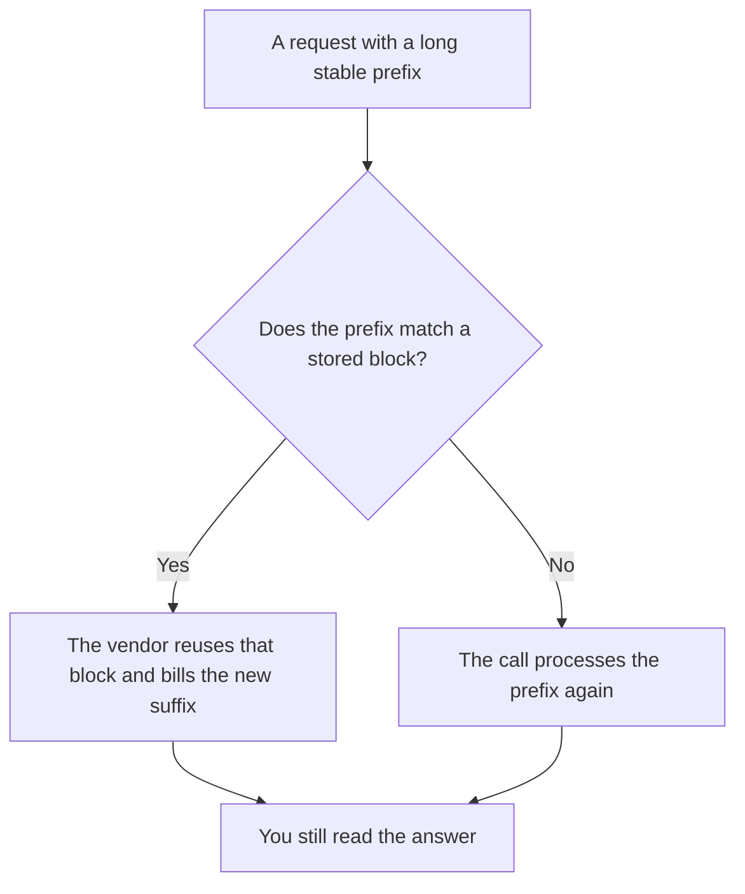

**Prompt caching is a vendor feature that stores the computed form of a repeated prompt prefix, such as a system prompt or a long document, and charges less to reuse it on the next call.** The prefix has to match. A reworded paragraph is a different prefix. Caching is a billing and latency lever. It is not a memory of your user's last answer, and it is not a guarantee the model will say the same thing.

The unit on the bill is still [what AI tokens are](/blog/what-are-ai-tokens-explained-2026/). The length of what you can attach is [what a context window is](/blog/what-is-a-context-window-2026/). A cache that matches by meaning, which is a different mechanism and a different risk, is [what semantic caching for an LLM is](/blog/what-is-semantic-caching-for-llm-2026/). The text you hope stays stable across versions is [what prompt versioning is](/blog/what-is-prompt-versioning-2026/).

Prices below are US list prices from directory pages checked October 16, 2026. Published October 24, 2026. This page does not publish a per-token cache discount, because the directory does not record one for these seats. We did not benchmark latency.

## What can hit, and what will miss

| What you send | Cache behavior you can plan for | What breaks the reuse |
|---|---|---|
| A system prompt that is byte-for-byte the same | A prefix cache can reuse that block | You edited one sentence and shipped it |
| A long policy pasted at the top of every call | Same, if the vendor caches prefixes | The policy moved to the end, or a timestamp was prepended |
| The user's new question | Usually the part you still pay to process | Treating the question as if it were free |
| Two questions that mean the same thing in different words | A prefix cache misses | That job belongs to a semantic cache, with a human rule for when a miss is safer |

A cache hit does not mean the answer was checked. It means the prefix was not recomputed from scratch. The person who accepts the answer is [what human-in-the-loop AI is](/blog/what-is-human-in-the-loop-ai-2026/).

## Where teams meet this, without a made-up cache price

**A long Project.** [Claude](/tools/claude/) Pro is $20 a month, or $17 billed annually ($200 up front). A Project that repeats the same instructions is the shape a prefix cache is built for, when the API or the product offers it. The seat price is not an API cache rate. The directory records Team as a per-seat plan and does not print a Team price. The review is [Claude review](/blog/claude-review-2026/). The container is [Claude Projects vs ChatGPT Projects](/blog/claude-projects-vs-chatgpt-projects-2026/).

**A repeating custom GPT or Project.** [ChatGPT](/tools/chatgpt/) Plus is $20 a month. Business is $20 a user a month billed annually, or $25 monthly, for two or more users, and does not train on business data by default. Put the stable instructions in the Project. Put the variable question after them. A date stamp at the top of the prompt will defeat a prefix match on purpose. The ladder is [ChatGPT Go vs Plus vs Pro](/blog/chatgpt-go-vs-plus-vs-pro-2026/).

**An editor that sends the same repo context.** [Cursor](/tools/cursor/) Plus for new individuals is $8 a month, or $80 a year, on The X Subscription. Repeated file context is a caching candidate only if the product documents a cache. Do not assume the seat includes one. The seat math is [Cursor pricing explained](/blog/cursor-pricing-explained-2026/).

The door for many API calls, when you have one, is [what a model gateway is](/blog/what-is-a-model-gateway-2026/). The choice of which model runs is [what AI routing is](/blog/what-is-ai-routing-2026/). Routing to a different model can change whether a cached prefix is valid. Read the vendor note before you budget a discount.

## How to tell if it is working

Log the cache-hit field the vendor returns, if they return one. If they do not return one, you do not have a number, and you should not invent a savings percent for finance. Compare two calls that share a prefix against two calls that do not, on the usage export, and keep the raw rows. A chart without the raw field is a story.

Keep the prefix stable on purpose. Move dates, user names, and the question into the suffix. Version the prefix when you change policy, which is the point of prompt versioning. A cached old policy is a bug with a discount attached.

## FAQ

### Is prompt caching the same as chat memory?

No. Memory is a product feature that stores facts about a user. A prompt cache stores a computed prefix so the next identical prefix costs less to process. Turning memory on does not create a cache hit.

### Will a cache make answers identical?

It can make the prefix cheaper. The new tokens are still generated. Temperature, a tool result, and the suffix can all change the answer. Do not use a cache as your regression test. That test is [what AI eval testing is](/blog/what-is-ai-eval-testing-2026/).

### Should I cache user documents?

Only if your privacy review allows that vendor to retain the prefix for the cache window they document. A contract file in a cache is still a contract file. The seat's training setting is a separate switch.

### Does every plan include it?

The directory pages checked for this article do not list a cache add-on price. If the pricing card does not name caching, do not put a savings line in the budget. Confirm it on the API docs you will actually call.

## Last verified

October 16, 2026 for Claude, ChatGPT, and Cursor prices named above. No cache discount rate is recorded in the directory for those seats. Published October 24, 2026.

**Sources:** [Claude pricing](https://claude.com/pricing), [ChatGPT pricing](https://chatgpt.com/pricing), [Cursor pricing](https://cursor.com/help/account-and-billing/pricing).

*Published by Andrew for [AI Tools Optimizer](https://aitoolsoptimizer.com).*

[Claude](/tools/claude/) is in the [chatbots and assistants directory](/tools/category/chatbots-assistants/). Directory pages may use affiliate links. A purchase through them may earn us a commission at no extra cost to you.
