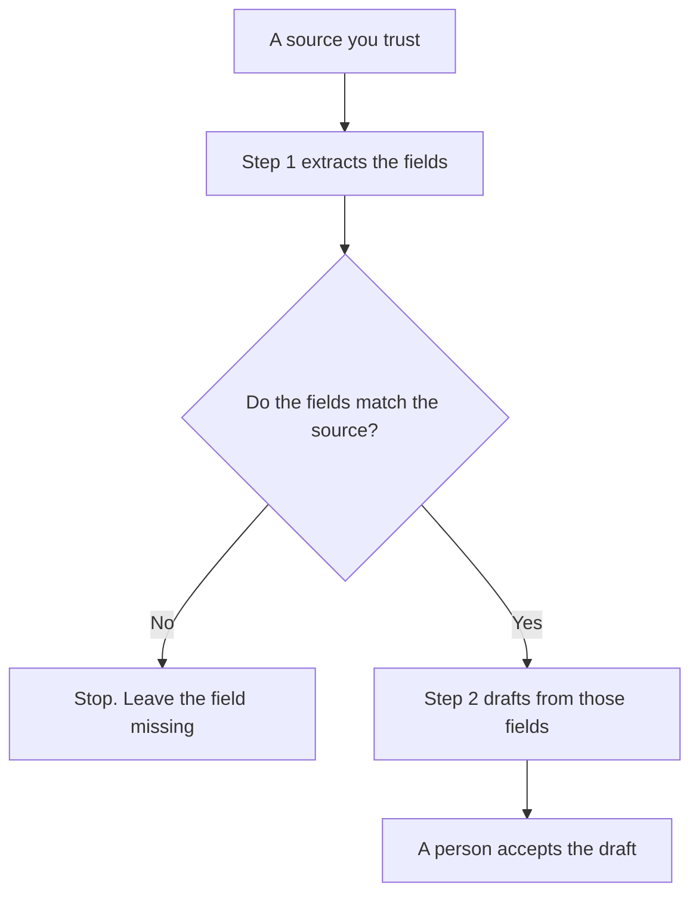

**Prompt chaining is a sequence of model calls where the output of one step is the input of the next, and a check you wrote sits between them.** A single long prompt asks for everything at once. A chain splits the job into steps you can stop. An agent that picks its own tools is a different design. A chain has an order you decided before the first call.

The wording of one step is [what prompt engineering is](/blog/what-is-prompt-engineering-2026/). A product that chooses the next tool is [what an AI agent is](/blog/what-is-an-ai-agent-2026/). The order of those tool calls is [what tool-calling orchestration is](/blog/what-is-tool-calling-orchestration-2026/). The number on a step's wording is [what prompt versioning is](/blog/what-is-prompt-versioning-2026/).

Prices are US list prices excluding tax from directory pages checked October 16, 2026. Published October 24, 2026. We did not score which chain writes better prose.

## What each step is allowed to do

| Step | It may | It may not |
|---|---|---|
| Extract | Copy fields you named from a source you pasted | Add a field that was not in the source |
| Check | Pass or fail against a rule you wrote | Change the rule to make the draft pass |
| Transform | Format the passing fields into the next template | Invent a missing number so the template looks full |
| Draft | Write from the checked fields only | Pull in a fact from a different job |
| Stop | Halt when a check fails | "Fix" the failure by guessing |

The check is the product. A chain that always continues is a long prompt with extra invoices. The scored version of that check, when you run it on a set, is [what prompt regression testing is](/blog/what-is-prompt-regression-testing-2026/).

## Where a chain is worth the calls

**A document with a decision in the middle.** Extract the numbers. A person confirms them. Then draft the paragraph. [Claude](/tools/claude/) Pro is $20 a month, or $17 billed annually, and includes Projects, which is a place to keep the source next to the steps. Free can run a short chain until the limit. The review is [Claude review](/blog/claude-review-2026/).

**A chat you already pay for.** [ChatGPT](/tools/chatgpt/) Plus is $20 a month and includes projects. You can paste step 2 only after you have read step 1. That is a chain even when you click Send yourself. Plus is the seat. It is not a workflow engine.

**A workflow tool that calls the model twice.** [Zapier](/tools/zapier/) Professional is $19.99 a month billed annually. [n8n](/tools/n8n/) Cloud Starter is €20 a month billed annually on the directory card. Use them when the handoff between steps is a system, not a person copying a box. Each model call can be a task or an execution. Read the meter before you add a third step. A side effect inside a step still needs a key: [what AI idempotency is](/blog/what-is-ai-idempotency-2026/).

A prompt that holds one step:

"From the source below, list only the dates, owners, and amounts that appear. If a field is absent, write Missing. Do not draft the email yet."

The person who lets the next step run is [what human-in-the-loop AI is](/blog/what-is-human-in-the-loop-ai-2026/).

## When one prompt is the better design

Use one prompt when the job is small, the source is short, and a failure is cheap to reread. A chain adds latency, cost, and a place to drop a constraint between steps. Split the job when you need a stop, an audit of the middle, or a different instruction that would confuse a single call.

Do not chain a step that is allowed to browse into a step that is supposed to stay on your file, unless the check names which sentences came from the web. A sourced sentence and a drafted sentence are different objects. Grounding the difference is [what AI grounding is](/blog/what-is-ai-grounding-2026/).

## FAQ

### Is a chain an agent?

A chain has an order you fixed. An agent chooses a next action from a set of tools, and it can loop. You can put a chain inside an agent. You should not describe a fixed three-step draft as an agent just because a vendor's menu says Agent.

### How many steps is too many?

As many as you will actually inspect. Three steps with a check beat eight steps nobody reads. Every extra call is a place for a dropped number and a line on the bill.

### Can step 2 see the original source?

Yes, and it should, when the draft must stay faithful. Passing only the extract is fine when the extract is the contract and a person signed it. Passing a summary of a summary is how a limit disappears.

### What do we version?

Each step's instructions, separately. A change to the extractor is not a change to the drafter. The version number is how you know which wording produced Tuesday's bad field. Store the source id next to it.

## Last verified

October 16, 2026 for Claude, ChatGPT, Zapier, and n8n. Published October 24, 2026. n8n's recorded price is in euros.

**Sources:** [Claude pricing](https://claude.com/pricing), [ChatGPT pricing](https://chatgpt.com/pricing/), [Zapier pricing](https://zapier.com/pricing).

*Published by Andrew for [AI Tools Optimizer](https://aitoolsoptimizer.com).*

[ChatGPT](/tools/chatgpt/) is in the [chatbots and assistants directory](/tools/category/chatbots-assistants/). Directory pages may use affiliate links. A purchase through them may earn us a commission at no extra cost to you.
