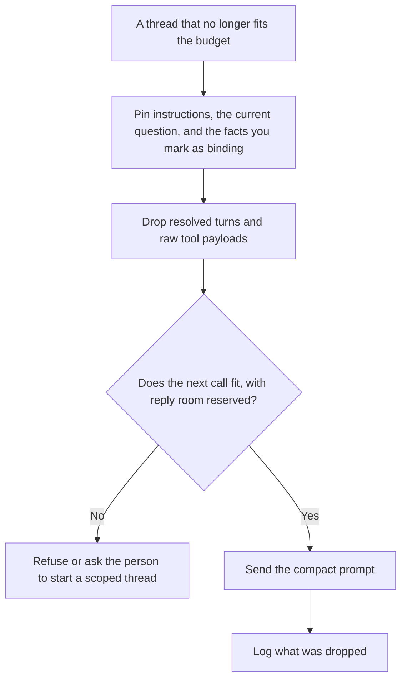

**Prompt compaction is the step that shrinks a prompt so the next model call fits the token budget, while keeping the instructions and the facts this turn still needs.** A summary written for a person is a document they will read. Compaction is an input to a machine. If the machine loses the constraint, the shorter prompt failed.

The split you are trying to fit is [what token budgeting is](/blog/what-is-token-budgeting-2026/). Memory that is supposed to last across sessions is [what AI memory is](/blog/what-is-ai-memory-2026/). A file check that catches a broken template before you compact it is [what a prompt linter is](/blog/what-is-prompt-linter-2026/). Retrieved passages you should rank before you paste them are [what RAG is](/blog/what-is-rag-explained-2026/).

Prices are US list prices excluding tax from directory pages checked October 16, 2026. Published October 24, 2026. We did not score which product summarizes a thread more faithfully. This page does not invent a token limit for a chat plan.

## What you may drop, and what you keep

| Piece | Compaction may | Compaction may not |
|---|---|---|
| Resolved tangents | Drop them when the decision is already in a sentence you keep | Drop the decision and keep the debate |
| Old tool output | Keep the field that still binds the answer | Paste the raw payload again |
| Instructions | Leave them intact, or shorten them in a reviewed edit | Paraphrase a safety or pricing rule you did not approve |
| The current user message | Leave it intact | "Summarize" the question into a different question |
| Numbers, ids, and dates | Copy them exactly into the kept note | Round them for brevity |
| A secret that should not have been in the thread | Delete it | Repeat it in the compact form |

Log the drop. A later incident will ask why the model "forgot" a limit. The answer should be a list: these turns were removed, these ids were kept. That list is part of [structured logging for AI](/blog/what-is-structured-logging-for-ai-2026/).

## Where the long prompt comes from

**A project that accumulates files.** [Claude](/tools/claude/) Pro is $20 a month, or $17 billed annually, and includes Projects on the directory card. A Project is a place to keep the source. Compaction is what you do when the source plus the thread still exceeds the call you want to make. The review is [Claude review](/blog/claude-review-2026/).

**A chat product with history.** [ChatGPT](/tools/chatgpt/) Plus is $20 a month and includes projects. Free can hold a conversation with limits the card describes as limits. If you depend on a long thread, start a new one with the kept facts pasted on purpose. The product's automatic shortening, if it has one, is the vendor's policy. Read it. Do not assume it preserved the price you set in message four.

**A file in Google's notebook.** [Gemini Notebook](/tools/gemini-notebook/) is free with a Google account. It answers from sources you upload. Compaction inside a general chat is a different path from "ask only this notebook." Prefer the notebook when the source is the file. The long-file comparison is [Gemini vs Claude for long PDFs](/blog/gemini-vs-claude-for-long-pdfs-2026/).

**The note a team keeps.** [Notion AI](/tools/notion-ai/) Business is $20 a seat a month, which is the tier with the full agent on the directory card. Plus is $10 and is not that full AI tier. A pinned decision log in Notion is a better compact form than an ever-growing chat, because a person can edit the pin. The invoice is [Notion AI pricing explained](/blog/notion-ai-pricing-explained-2026/).

A prompt that holds the line, when you do ask a model to compact:

"Keep the instructions unchanged. Keep the current user message unchanged. Keep every id, price, date, and limit exactly. Drop turns that are already resolved. List what you dropped. If a binding fact does not fit, say so. Do not add a new fact."

The person who accepts the compact prompt is [what human-in-the-loop AI is](/blog/what-is-human-in-the-loop-ai-2026/).

## A compact prompt can still be wrong

Compaction preserves what you marked. If the thread contained a hallucinated price, the compact form will preserve it too, neatly. Correct the fact first. The failure mode is [what an AI hallucination is](/blog/what-is-ai-hallucination-2026/).

Compaction is also the wrong tool for a record you must keep. A support case, a contract, and a medical note need the original. Compact a copy for the next model call. Leave the record intact. That record is [what a system of record for AI is](/blog/what-is-a-system-of-record-for-ai-2026/).

## FAQ

### Is compaction the same as memory?

Memory is what the product claims to recall later, under its own rules. Compaction is a deliberate shrink of this prompt, with a list of what you dropped. You can compact without granting the product a long-term memory.

### Should we compact every turn?

Compact when the next call would otherwise truncate the question or the reply reserve. Compacting a short thread adds a chance to drop the constraint, and it spends a call to do it.

### Can the model compact itself safely?

It can draft the short form. You still compare the kept numbers to the source thread before you rely on the short form for a price, a limit, or a customer commitment. A model that both writes the summary and approves it has not been checked.

### What if the instructions themselves are too long?

That is an edit, not an automatic compact. Shorten the instructions in review, and run them through the linter if the template has variables. Automatic paraphrase of a policy is how the policy changes without a decision.

## Last verified

October 16, 2026 for Claude, ChatGPT, Gemini Notebook, and Notion AI. Published October 24, 2026.

**Sources:** [Claude pricing](https://claude.com/pricing), [ChatGPT pricing](https://chatgpt.com/pricing/), [Notion pricing](https://www.notion.com/pricing).

*Published by Andrew for [AI Tools Optimizer](https://aitoolsoptimizer.com).*

[Claude](/tools/claude/) is in the [chatbots and assistants directory](/tools/category/chatbots-assistants/). Directory pages may use affiliate links. A purchase through them may earn us a commission at no extra cost to you.
