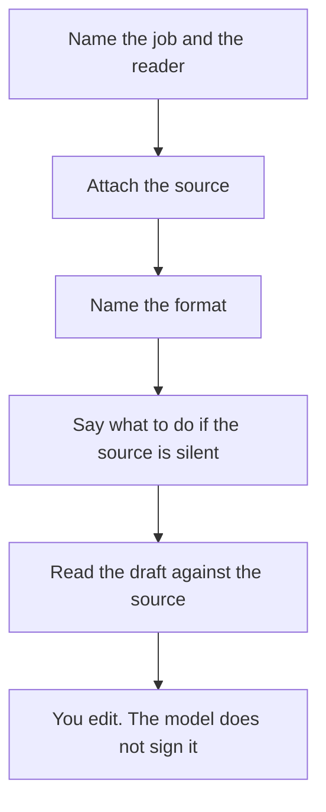

**Prompt engineering is the work of writing the instruction a model will follow for this task.** It includes the job, the source material, the format you want back, and an example when the format is easy to miss. It is a writing skill. It is not a list of magic words, and it does not make a false source true.

The useful prompt names the audience, the constraint, and what to do when the source is silent. A vague prompt produces a vague draft you then have to edit. The editing standard for a published piece is [how to write a blog post with Claude](/blog/how-to-write-a-blog-post-with-claude-2026/).

Nothing below is a measured score of prompt styles. Prices are US list prices excluding tax from directory pages checked October 16, 2026.

## What to put in the instruction

| Piece | What you write | What happens if you skip it |
|---|---|---|
| The job | "Draft a one-page proposal from these notes" | You get a generic essay |
| The source | The notes, the file, or the passages | The model fills gaps from training |
| The format | A table, five bullets, or a subject line under 50 characters | You get a shape you will not use |
| The boundary | "If the notes do not say the price, write 'not in the notes'" | A missing fact becomes a confident sentence |
| One example | A past email or a sample row | The format drifts |

A longer prompt is not a better prompt. Extra adjectives ("be world-class," "think deeply") spend [tokens](/blog/what-are-ai-tokens-explained-2026/) and rarely change the facts. The model that reads the prompt is [an LLM](/blog/what-is-an-llm-2026/). How much of your source fits in one request is the [context window](/blog/what-is-a-context-window-2026/).

## Where the same habit shows up in products

| Job | Tool | What you are prompting | Price to know |
|---|---|---|---|
| A draft you will edit | [Claude](/tools/claude/) or [ChatGPT](/tools/chatgpt/) | The instruction plus your notes | Claude Pro is $20/month, or $17 billed annually. ChatGPT Plus is $20 |
| A draft inside Google's apps | [Gemini](/tools/gemini/) | The same instruction, with Drive or Docs in reach | Google AI Plus is $4.99/month. Free needs a Google account |
| A claim that needs a link | [Perplexity](/tools/perplexity/) | A specific question, then you open the citation | Pro is $17/month billed annually |
| A proofread of a draft you already wrote | [Grammarly](/tools/grammarly/) | The surface: grammar, tone, a rewrite | Pro is $12/member/month billed annually, or $30 monthly |

Perplexity is retrieval plus a prompt. The lookup is [what RAG is](/blog/what-is-rag-explained-2026/). Asking it to "sound confident" does not replace opening the page. The research steps are [how to use Perplexity for market research](/blog/how-to-use-perplexity-for-market-research-2026/).

Grammarly does not invent the brief. It edits sentences. Whether the $12 annual seat is worth it is [is Grammarly Pro worth it](/blog/is-grammarly-pro-worth-it-2026/).

## A prompt that fails in a recognizable way

**No source.** "Write our refund policy" produces a policy from other companies' language. Paste the policy you actually offer, or write the rules yourself and ask only for clearer sentences.

**No format.** "Summarize this call" returns a narrative. "Return decisions, owners, and dates as a table, and quote the line you used" returns something you can check.

**A hidden second job.** "Research the market and write the strategy and make the slides" is three tasks. Split them. Research with sources first. Then the memo. Then the slides in [Gamma](/tools/gamma/) or the deck tool you already use. Plus there is $9/seat/month.

**An instruction the model cannot verify.** "Only use peer-reviewed papers" in a general chat is a wish unless the product searches papers. For that corpus, use [Consensus](/tools/consensus/) or [Elicit](/tools/elicit/). The workflow is [how to research with Elicit and Consensus](/blog/how-to-research-with-elicit-and-consensus-2026/).

If the same format must appear on thousands of calls and prompting keeps failing, that is a different project: [what fine-tuning is](/blog/what-is-fine-tuning-ai-2026/). Most writing tasks never get there.

## FAQ

### Is prompt engineering a job title in 2026?

Sometimes. For most people it is part of writing the brief. A clear instruction plus the source beats a catalog of phrases. You still edit the result.

### Do I need a paid plan to write a good prompt?

No. Free tiers of Claude, ChatGPT, and Gemini accept the same structure. Pay when a usage cap blocks the work, not because a paid plan unlocks secret syntax. Claude Pro and ChatGPT Plus are both $20 a month at the monthly rate.

### Should I say "you are an expert"?

A role can set the audience ("write for a clinic manager"). It does not add knowledge the model lacks. Attach the source if the fact has to be yours.

### Can a prompt stop hallucinations?

It can tell the model to abstain when the source is silent, and it can require a quote. You still check the quote. The failure mode is [what an AI hallucination is](/blog/what-is-ai-hallucination-2026/).

## Last verified

October 16, 2026 for plan prices. Published October 24, 2026. The definition does not depend on a price change.

**Sources:** [Claude pricing](https://claude.com/pricing), [OpenAI ChatGPT pricing](https://openai.com/chatgpt/pricing/), [Perplexity pricing](https://www.perplexity.ai/pro).

*Published by Andrew for [AI Tools Optimizer](https://aitoolsoptimizer.com).*

[Claude](/tools/claude/) and [ChatGPT](/tools/chatgpt/) are in the [chatbots directory](/tools/category/chatbots-assistants/). Directory pages may use affiliate links. A purchase through them may earn us a commission at no extra cost to you.
