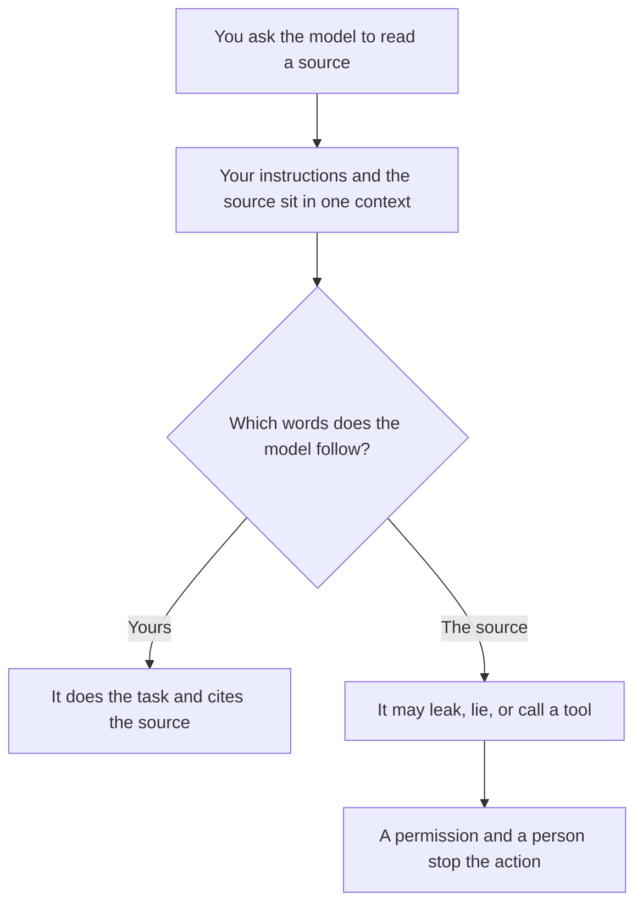

**Prompt injection is untrusted text, sitting inside something the model is asked to read, that tries to make the model follow those words instead of your instructions.** The text can be a web page, a PDF, a ticket, an email, or a help-center article. The user may be honest. The document is the problem.

Your hidden instructions are [what a system prompt is](/blog/what-is-a-system-prompt-2026/). The checks that should stop a bad action are [what AI guardrails are](/blog/what-is-ai-guardrails-2026/). A page that searches and then answers is [what retrieval-augmented chat is](/blog/what-is-retrieval-augmented-chat-2026/). Injection is one way that search result becomes an instruction.

Published October 24, 2026. This article names the risk and the impact. It does not provide payloads or bypass steps.

## What changes when the model can read untrusted text

| Situation | What the attacker uses | What can go wrong |
|---|---|---|
| A person pastes a hostile prompt into the chat | Their own message | They try to override your policy. The product should refuse. The blast radius is that one session unless tools are attached |
| The model reads a page, a file, or a ticket while doing a job you asked for | Text the user did not write | The model treats the document as the boss: it can leak other context, call a tool, or draft a confident lie |
| The model can send email, browse, or update a record | The same hidden instruction, plus a tool | A draft becomes an action. Money, mail, and permissions are the line that needs a person |
| Retrieved help articles are the corpus | A poisoned article | Every later customer can be answered from the poisoned rule. The fix is the article, then the eval |

The model does not have a separate, sealed channel for "real instructions" once the document is in the same context. That is why a longer system prompt is a weak fix. The training-time version of "follow the right instruction" is part of [what AI safety and alignment are](/blog/what-is-ai-safety-alignment-2026/). Product teams still add checks they can test.

## What a buyer should require

**Tools that can act need a permission list.** Reading a help center is a different right from issuing a refund or sending mail. [What function calling is](/blog/what-is-function-calling-in-ai-2026/) is the mechanism. The guardrail is which functions exist.

**A person approves anything that leaves the building.** [Lindy](/tools/lindy/) says outside actions wait for approval, on the pricing page read October 24, 2026. Hold other agent products to a sentence you can find on their page, and then test it. The setup habit is [how to create an AI agent without coding](/blog/how-to-create-an-ai-agent-without-coding/).

**The corpus has an owner.** [Chatbase](/tools/chatbase/) answers from content you upload. Hobby is $32 a month billed yearly on the October 16, 2026 directory card. If anyone can edit the source articles, they can change the bot. Lock the articles. Re-run the questions you care about after an edit. That re-run is [what AI eval testing is](/blog/what-is-ai-eval-testing-2026/).

**Search tools show the page.** [Perplexity](/tools/perplexity/) answers with links. Pro is $17 a month billed annually on the October 16 card. Open the link before you act. A citation you did not open is how injected text becomes a decision. Research habits that start from links are [ChatGPT vs Perplexity for research](/blog/chatgpt-vs-perplexity-for-research-2026/).

**Secrets stay out of the prompt.** A model that can see an API key can be asked, by a document, to repeat it. Put secrets in the tool's credential store, which is the practical half of [what an API for AI tools is](/blog/what-is-an-api-for-ai-tools-2026/).

[Claude](/tools/claude/) and [ChatGPT](/tools/chatgpt/) are the assistants people paste files into. Claude Pro is $20 a month, or $17 billed annually. ChatGPT Plus is $20. Both figures are from directory pages checked October 16, 2026. Pasting a contract is normal. Pasting a contract and connecting a tool that can email the other party is the moment the injection risk becomes an action.

## FAQ

### Is prompt injection a jailbreak?

A jailbreak is usually the user trying to override the product from the chat box. Prompt injection is instructions hidden in content the model was asked to process. The impact overlaps. The fix for the second one is about documents and tools, not only about blocking rude prompts.

### Does retrieval make this worse?

Retrieval adds untrusted text on purpose. That is the feature. Pair it with passages a person can open, and with tools that cannot act on their own. [What RAG is](/blog/what-is-rag-explained-2026/) is the method. Injection is one of its risks.

### Will a stronger model ignore malicious documents?

A stronger model can be better at noticing the trick and still fail on a new one. Test the product you will deploy. Do not treat a model announcement as a control.

### What should I tell a vendor?

Ask which text the model treats as instructions, which tools it can call, whether a human approves outbound actions, and whether you can re-run a set of bad documents after they change the model. A vendor that cannot answer those four questions is selling a chat box with side effects.

## Last verified

Published October 24, 2026. Plan prices are from directory pages checked October 16, 2026, except Lindy's approval sentence, which is from lindy.ai/pricing read October 24, 2026.

**Sources:** [OWASP LLM applications guidance](https://genai.owasp.org/), [Claude](https://claude.ai), [Chatbase](https://www.chatbase.co).

*Published by Andrew for [AI Tools Optimizer](https://aitoolsoptimizer.com).*

[Perplexity](/tools/perplexity/) is in the [research directory](/tools/category/research-search/). Directory pages may use affiliate links. A purchase through them may earn us a commission at no extra cost to you.
