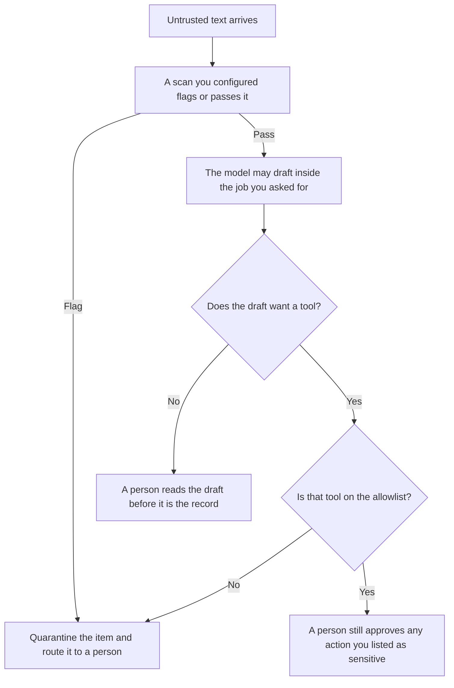

**Prompt injection scanning is a defensive check that flags untrusted text, or a proposed tool call, before the model is allowed to act on it.** The scan is a gate in your system. It is not a catalog of attacks. This page names the kinds of checks a team can run. It does not include payloads, sample hostile text, or any step for getting past a filter.

The risk those checks exist for is [what prompt injection is](/blog/what-is-prompt-injection-2026/). The controls that block a bad reply are [what AI guardrails are](/blog/what-is-ai-guardrails-2026/). The signed list of those controls is [what an AI guardrail policy is](/blog/what-is-ai-guardrail-policy-2026/). Flagging an account against a harm you already defined is [what AI abuse detection is](/blog/what-is-ai-abuse-detection-2026/).

Prices are US list prices excluding tax from directory pages checked October 16, 2026. Published October 24, 2026. We did not test or score any scanner. Nothing here is instructions for breaking one.

## The gates, without the attack text

| Gate | What it looks at | What it must not become |
|---|---|---|
| Inbound scan | Text a person pasted, or a file and page the model was asked to read | A public list of strings. Patterns stay with the owner of the control |
| Data label | Untrusted text marked as data, separate from your instructions | A longer system prompt and a claim that the problem is solved |
| Tool gate | A proposed action against an allowlist you wrote | An automatic send because the draft sounded polite |
| Output scan | A draft checked for secrets or for a ban you already wrote | A substitute for the person who approves a customer email |
| Private review set | Cases your security owner keeps and reruns | A blog post, a ticket the model can read, or a prompt you paste into a customer bot |

A scan that fails closed is doing its job when it holds an item. A scan that fails open, and lets the action through because the checker errored, is a gap you should see in the log. The person who decides a close call is [what human-in-the-loop AI is](/blog/what-is-human-in-the-loop-ai-2026/).

## What this page will not contain

It will not quote an attack, describe a bypass, or explain how to hide instructions in a document. Publishing those details helps the next person aim at the gate. If your team needs to test the gate, the cases stay in a private store the model you are testing cannot retrieve. Do not paste them into the same bot.

A scanner vendor's marketing score is not evidence. Ask which gate is actually on, who reviews flags, and what happens when the scanner itself is down.

## Products where you still write the gate

[Chatbase](/tools/chatbase/) lets you set guardrails and test before going live, on the directory card checked October 16, 2026. Hobby is $32 a month billed yearly, with 700 message credits. The empty field is not a scan. You name the topics the agent may answer and the topics it must hand off. The handoff table is [how to create a support escalation matrix with AI](/blog/how-to-create-a-support-escalation-matrix-with-ai-2026/).

[n8n](/tools/n8n/) can place a step before a send. Starter cloud is €20 a month billed annually for 2,500 executions, on the October 16 card. This page does not convert euros. A human node is a gate your policy can require. The drawing is the evidence, not a claim that a scan ran.

[Claude](/tools/claude/) and [ChatGPT](/tools/chatgpt/) will refuse some requests from their own training. That refusal is not your scanner. Your scanner is the check you added in front of your tools. Pro and Plus are each $20 a month. Claude Pro is also $17 billed annually. A personal chat has no tenant-wide scan unless you built one around it.

## FAQ

### Is scanning the same as the model refusing?

No. A model refusal is the vendor's behavior on a prompt it sees. A scan is your gate, on text or on a tool call, with a log you can review. You want the refusal where it exists. You still want the gate when the model would have complied.

### Should we publish our detection rules so customers trust us?

Publish the fact that you scan, what you do with a flag, and who to contact. Do not publish the patterns. Customers can trust a control they are not invited to rehearse against.

### Can a small team buy a scanner and stop?

You can buy a check. You still name the allowlist and the person who sees the queue. A product you did not configure is a menu item. Write the settings you turned on, the same way a guardrail policy does.

### What if the scan blocks a real document?

That is a false positive, and a person should be able to release it with their name and the date on the log. Silent overrides, and automatic release when the queue is long, are how the gate stops existing. Staff the queue or narrow the job. Do not turn the gate off to clear the backlog.

## Last verified

October 16, 2026 for Chatbase, n8n, Claude, and ChatGPT. Published October 24, 2026. No scanner was tested.

**Sources:** [Chatbase pricing](https://www.chatbase.co/pricing), [Claude pricing](https://claude.com/pricing), [ChatGPT pricing](https://chatgpt.com/pricing/).

*Published by Andrew for [AI Tools Optimizer](https://aitoolsoptimizer.com).*

[Chatbase](/tools/chatbase/) is in the [customer support directory](/tools/category/customer-support/). Directory pages may use affiliate links. A purchase through them may earn us a commission at no extra cost to you.
