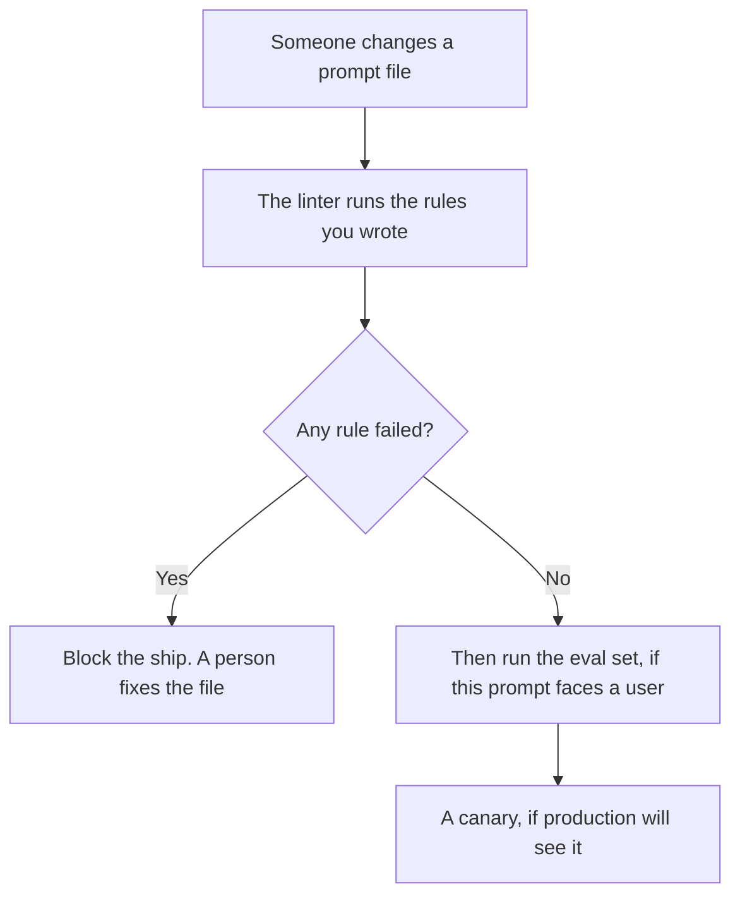

**A prompt linter is a check that reads the prompt, the template, or the system instructions before a model call, and fails the change when a rule you wrote is broken.** Empty variables, a pasted secret, a banned phrase, a missing section, or a length over the budget you set are lint findings. The linter does not ask the model a question and grade the reply. That later check is an eval. Lint is the prompt as a file.

The instructions you are linting, when they are the hidden ones, are [what a system prompt is](/blog/what-is-a-system-prompt-2026/). The set of inputs and expected answers you run after lint passes is [what AI eval testing is](/blog/what-is-ai-eval-testing-2026/). Comparing this version to the last one that passed is [what prompt regression testing is](/blog/what-is-prompt-regression-testing-2026/). The fence on what the model may do at runtime is [what AI guardrails are](/blog/what-is-ai-guardrails-2026/).

Prices are US list prices excluding tax from directory pages checked October 16, 2026. Published October 24, 2026. The directory does not list a prompt-linter fee, so this page does not invent one. We did not score any linter product.

## Rules that belong in lint

| Rule | Fails when | Why this is not an eval |
|---|---|---|
| Variables | `{{name}}` is still in the text you are about to send | You have not called the model |
| Secrets | A key, a password, or a token pattern you listed is in the file | The finding is the string, not the answer |
| Required sections | The template is missing the refusal line or the source line you require | The structure is wrong even if a model would cope |
| Length | The template exceeds a token or character budget you set | You are measuring the file, not the reply |
| Banned phrases | A promise you forbade, such as a guarantee you do not offer, is hardcoded | The phrase is in the prompt, whether or not the model repeats it |

Lint that always passes is a sticker. Start with the failures you have already shipped: an unfilled variable in a customer email, a key in a shared prompt, a prompt so long it crowds out the document. Add a rule per failure. Do not add a rule because it sounds mature.

A model can help list findings if you paste the template and the rule list. The model is not the linter of record. A person owns the rules, and a script or a checklist should fail closed. A fluent "looks good" is not a pass. The person who may override a finding is [what human-in-the-loop AI is](/blog/what-is-human-in-the-loop-ai-2026/).

## Where the template is edited

Lint wraps the file. These seats are where teams edit the file. They do not replace the rule.

| Where you edit | Price the directory recorded | How lint fits |
|---|---|---|
| [Claude](/tools/claude/) Projects | Pro is $20 a month, or $17 billed annually. Free includes Projects, with usage limits | Keep the template in the Project. Run the checklist before you save a new version |
| [ChatGPT](/tools/chatgpt/) projects | Plus is $20 a month and lists projects | Same. Business at $20 a user a month billed annually, minimum two, when the template has customer procedures |
| [Cursor](/tools/cursor/) | Plus is $8 a month, or $80 a year | The prompt lives in the repo. Lint can be a check on the file, the way other repo checks run |
| [GitHub Copilot](/tools/github-copilot/) | Pro is $10 a user a month | Completions can draft a rule. The rule still has an owner |

Cursor's card is [Cursor pricing explained](/blog/cursor-pricing-explained-2026/). Copilot's card is [GitHub Copilot pricing explained](/blog/github-copilot-pricing-explained-2026/). The editor-versus-agent choice is [Cursor vs GitHub Copilot](/blog/cursor-vs-github-copilot-2026/).

If the prompt change will hit a slice of users, lint is the step before the slice. The slice is [what an AI canary release is](/blog/what-is-ai-canary-releases-2026/).

## What a linter will miss

It will miss a prompt that is well-formed and wrong. "Be helpful and offer a full refund" can pass a structure check and still violate policy. That is an eval, or a banned-phrase rule you have not written yet. It will miss a document that tells the model to ignore the prompt. That document arrives at runtime. The pattern is [what prompt injection is](/blog/what-is-prompt-injection-2026/). Lint the template you control. Guard the untrusted text separately.

It will also miss taste. A linter should not fail a prompt for being plain. Plain is often the point.

## FAQ

### Can ChatGPT be the linter?

It can comment on a template you paste, against rules you paste. Save the rules in the repo or the checklist. The next edit should fail without relying on someone remembering to ask. A chat reply is a review. A linter is a gate.

### Is lint the same as guardrails?

Guardrails act when the model is about to answer or use a tool. Lint acts when the prompt file changes. You want lint so you do not ship a broken template. You want guardrails so a good template still cannot do a forbidden thing.

### Should lint block on length?

Yes, if you have a budget. Pick the budget from the window you actually have, and leave room for the user message and the document. The ceiling is [what a context window is](/blog/what-is-a-context-window-2026/). A number copied from another team is a guess.

### Do small teams need this?

They need the two rules that match their last mistake. A startup that has never leaked a key into a prompt can still check for unfilled variables if they send mail from a template. A fifty-rule config on day one will be ignored.

## Last verified

October 16, 2026 for the prices named above. Published October 24, 2026. The definition does not depend on a price change.

**Sources:** [Claude pricing](https://claude.com/pricing), [ChatGPT pricing](https://chatgpt.com/pricing/), [Cursor pricing](https://cursor.com/help/account-and-billing/pricing), [GitHub Copilot](https://github.com/features/copilot).

*Published by Andrew for [AI Tools Optimizer](https://aitoolsoptimizer.com).*

[Cursor](/tools/cursor/) is in the [coding directory](/tools/category/coding/). Directory pages may use affiliate links. A purchase through them may earn us a commission at no extra cost to you.
